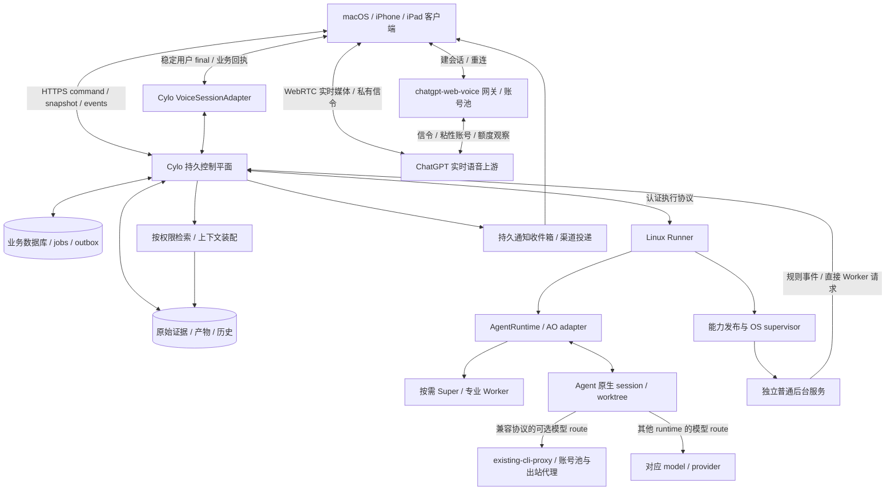

# Cylo 实现调研与架构方案

调研日期：2026-10-21。产品现名 **Cylo**。本文以 [Cylo 完整产品需求说明书](Cylo-完整产品需求说明书.md) 为唯一产品基线，整合专项研究与CLI接续改造方案。**目前完成的是需求、选型、设计与隔离实验，产品实现尚未开始。** 本轮按用户明确决定移除官方Codex桌面App支持，另按最新优先级将人工同 thread 无缝接管和复杂交接协议降为可选增强，基础 CLI 执行、停止查看和持久恢复仍必须；阶段、技术栈和指标为实施建议。

**当前实施主线：采用 OrchestratorInc/agent-orchestrator（AO，Go）管理多种 Agent runtime 的编排、代码执行与原生会话，复用现有 CLIProxyAPI 管理 Codex 账号池与出站代理；建设 Cylo 自己的持久控制平面，优先使用 Go，管理业务账本、记忆、授权、长期普通服务和语音池调度。** 按需调用 Super，简单请求及普通服务可直接调用 Worker。语音继续采用 Space3044/chatgpt-web-voice 的 ChatGPT 网页实时上游、Go 网关与多账号池，补充额度调度和业务桥接。基础 CLI 执行、停止查看、持久恢复、真实工具/必要审批及语音闭环仍须验收；人工同原生会话双向交接可选。官方 Codex 桌面 App、发现/深链及官方 host handoff 不在范围；首期仅保证 Linux 服务端与执行宿主部署及其 CLI 执行恢复，保留 macOS 客户端/浏览器访问、用户自行使用 CLI 及跨环境备份、导出和迁移。macOS 后台运行后续按需评估，不纳入首期验收。

**决策状态：用户已明确采用 AO；Space 网关、网页实时上游与语音账号池继续保留，Cylo 新服务端优先 Go。** 这是当前实施决定，不表示 AO 的权限、恢复、清理或业务集成已经验收。不再并行开发 CAO adapter；[02](docs/research/02-orchestration-and-codex.md)、[07](docs/research/07-cao-cli-handoff-plan.md) 的 CAO 源码与改造研究保留历史语境。Codex 路由复用已有远程 CLIProxyAPI（文档别名 `existing-cli-proxy`），无需另部署或由 AO 重建账号池；每条 route 的选号与轮换由代理负责。用户报告当前登录和使用均可走代理，本文未实测该环境，也未确认每账号登录已自动隔离。Space 的语音池保持独立。

| 用户指定候选 | 决定 | 依据与可复用范围 |
|---|---|---|
| [OrchestratorInc/agent-orchestrator](https://github.com/OrchestratorInc/agent-orchestrator)（AO） | **已采用的 多 Agent / 代码执行与原生会话底座** | 复用 orchestrator/worker、隔离工作区、native ID/resume、host/reconcile；通过 API/事件接入 Cylo。约束默认危险权限、fresh fallback 与强制清理；固定版本逐项验收。源码见 [09](docs/research/09-agent-orchestration-alternatives.md)，实施顺序见 [10](docs/research/10-cao-ao-comparative-poc.md)。 |
| CLIProxyAPI（已有远程实例 `existing-cli-proxy`） | **复用 Codex 账号池与出站代理** | AO 执行宿主配置可达 API endpoint 和服务端密钥引用；代理负责该 route 内选号，AO 保留执行编排与原生会话管理。 |
| [Space3044/chatgpt-web-voice](https://github.com/Space3044/chatgpt-web-voice) | **采纳实时语音上游、网关与多 ChatGPT 账号池，维护固定版本的 Cylo 适配分支** | 保留 ChatGPT Web 实时媒体与私有信令，复用账号管理、LRU 选择与会话粘性；增加原子并发租约、额度状态观察、错误分类/冷却、耗尽后新会话切换、稳定用户 final 提交及业务回执桥接。上游未提供现成 Super/function 桥；不能套用官方 Realtime 协议。实质复制遵守 MIT。详见 [03](docs/research/03-voice.md)。 |

实施分三层，AO 的内部会话状态与 Cylo 的业务状态保持明确归属：

| 层次 | 工作范围 |
|---|---|
| 已有复用 | AO 的 orchestrator/worker、独立 worktree、Codex TUI/Chat 执行路径、原生身份和恢复、host/reconcile；按固定版本实际语义接入 |
| AO适配与必要改造 | 业务 task/run 与 AO session/host/worktree/native thread 映射；受限权限、真实停止、恢复模式可见、清理前保存与核验；人工输入互斥与交回可后置 |
| Cylo外部新增 | 统一任务/证据/授权权威、跨设备客户端、长期服务生命周期、可靠记忆、实时语音网关/账号调度和迁移恢复；这些平台职责不能只靠 AO 会话状态替代 |

AO 的真实工具审批、输入竞态、fresh fallback、force 清理和生产可靠性仍需验证或改造；历史 07 的 CAO patch 不能直接用作 AO 实施清单。

## 阅读导航与需求优先级

| 文档 | 评审用途 |
|---|---|
| [01 需求追踪与验收](docs/research/01-requirements.md) | 全22章及场景 A—E 的稳定 `CY-*` 编号、原始出处、责任、风险与验收；完整范围的审查清单 |
| [02 编排与 Codex](docs/research/02-orchestration-and-codex.md) | 固定源码、CAO/官方接口比较、隔离持久化与 CLI 实验、原生交接协议 |
| [03 语音](docs/research/03-voice.md) | 实时上游/网关/账号池源码、Cylo桥接边界、移动限制与真机 POC |
| [04 总体架构](docs/research/04-architecture.md) | 实体模型、状态机、API/事件、能力生命周期、记忆与迁移的详细契约 |
| [05 可靠性与安全复核](docs/research/05-reliability-security-operations.md) | 恢复边界、授权/隔离、故障注入矩阵与生产准入条件 |
| [06 实时语音接入复核](docs/research/06-realtime-integration-review.md) | 实时语音业务桥接与跨文档约束 |
| [07 CAO CLI接续改造](docs/research/07-cao-cli-handoff-plan.md) | 历史 CAO 改造方案；不再作为当前实施清单 |

旧 [Codex Super 需求与架构讨论稿](codex-super-agent-requirements-and-architecture.md) 仅保留历史，不再与新版并列生效。新版不是“把旧 Super 系统换个名字”：所有请求经过 Super、Codex 承担所有执行、一次会话代表一个长期任务，都不满足新需求。阶段子集通过也不等于完整产品通过。

## 推荐系统结构

首版 Cylo 控制服务优先采用 Go，与 AO daemon 和 Space 网关统一服务端维护语言；原 TypeScript 控制服务方案保留为历史建议。客户端建议 React 响应式 PWA、版本化 JSON Schema、SQLite 本地磁盘和独立 runner。首期服务端和 runner 在 Linux 上以 systemd 管理常驻进程。明确边界后可同包安装，不必先做微服务。Python Agent/普通程序通过协议接入，技术栈不决定产品范围。服务端必须是常开机器；主机睡眠/关机期间展示离线与最后观测时间，不能声称仍在执行。

未来按实测需要增加 PostgreSQL、对象存储、多个 runner 与组织身份。单人版起就保留 workspace、principal、project 权限字段；未建立租户执行隔离前不能开放不可信团队共用主机。远端CLI可通过SSH进入同一backend执行环境，使用相同用户、CODEX_HOME、项目路径及认证继续；这是CLI同环境接续。跨host迁移另按备份、路径和权限映射及原生恢复材料验收，不依赖官方App SSH/host handoff。

AO 执行宿主以抽象配置 `codex_route.api_endpoint`、`codex_route.api_key_secret_ref` 接入 `existing-cli-proxy`；实际值由部署配置提供，endpoint 必须从该宿主可达，密钥仅在服务端解引用，不送客户端或模型上下文。代理承接模型请求、账号选择与出站网络；`CODEX_HOME`、原生 thread 历史、进程及工作区留在 AO 执行宿主，迁移仍须搬迁对应恢复材料。

### 1. 控制平面负责真实状态

必须区分 `Project`、用户 `Conversation`、可验收 `Task`、一次执行 `TaskRun`、原生 `AgentSession`、长期 `ServiceDeployment` 和媒体 `VoiceSession`。关闭聊天、语音断线、Super 回合结束，都不结束任务或服务。`task/run ↔ host/store/thread/turn/worktree` 显式关联；目录路径按 host 映射，不能用绝对路径当项目主键。

用户消息或语音 final 先携带幂等键进入 command；校验身份、权限、目标版本后，在同一事务写业务意图、job、event/outbox，再回“已接收”。API 超时按原键查询/补发；同键不同内容拒绝。`received`、`applied`、实际 `outcome` 分开，provider 接收输入不代表已完成或已遵循要求。客户端使用同快照水位的快照与增量游标，断线补齐、重复去重、过期游标重新同步，陈旧状态可见。

保留产品八态：待执行、执行中、等待、等待用户、暂停、完成、失败、取消；run 和外部 operation 另外保存 unknown。暂停/取消是期望指令，需执行端确认后才显示已停；中断不回滚已写文件或已发邮件。任务完成需要目标验收和结果证据，`turn/completed` 或终端显示完成仅是执行观测。通知有持久收件箱、来源链接、去重与级别，推送投递不是唯一事实来源。

### 2. 智能执行与官方接续

Super 只负责复杂目标理解、计划、依赖和异常协调，输出计划提案，由控制平面校验执行。Worker 按能力契约获得最小上下文与工具权限。确定性路由、时钟、调度、预算、健康检查和普通状态查询直接用程序。并行任务使用独立 worktree/资源锁；集成结果需单独验收，worktree 本身没有安全沙箱功能。

**首期先验证 AO 自动 Super/Worker 与所选 Agent 的基础执行恢复。** Cylo 保存业务 task/run → AO session → agent native session，以及 host/worktree、runtime/model/provider/route 的映射。优先复用 AO 已有恢复 adapter，不另设 Codex resume 开发前置项；按 agent 分别标明原生 resume、fork 或 fresh launch，并验收停止、查看与产物保全。真实 PTY 人工接管和交回属于后续可选增强。详见 [多 Agent 与模型路由边界](docs/research/16-ao-agent-provider-boundaries.md)。

以下 Codex 是具体 runtime 接入实例，不是所有 Agent 的执行约束。AO 已有 Codex app-server Chat 路径；按结构化事件与逐工具审批需求接入，不能只替换 provider 名称而不解耦终端生命周期。其command和WebSocket仍被官方标记experimental、unsupported for production workloads；若采用该路线，须固定二进制/schema并验收thread/turn/审批/重启及生产支持与适用鉴权边界。Agents SDK只可选用于Super/非Codex Worker，不承担任务权威。

若后续实现可选人工原生交接，其顺序是停止新派发 → 确认当前执行/工具已停及副作用可核对 → 保存 thread、工具配置、工作区与 dirty 文件证据 → 释放写权 → 官方工具接续 → Cylo 重新读取原生历史/Git/文件并核对。数据库租约不能约束不合作的官方进程；无法证明旧写者停止或资源拒绝旧代次时禁止自动接管。

02 已有隔离 Linux 合成文本实测：同 CODEX_HOME、同原生 thread，app-server 首轮 → 官方交互 CLI resume 第二轮 → app-server 读回两轮并完成第三轮。它证明这两个官方入口的文字历史闭环，**不是 CAO 已支持原生接续**；provider是本地fixture，真实模型、工具/审批、CLI独立建会话反向关联仍待验；macOS 本机执行接入留待后续按需评估。

可选增强体验可做“进入同一CLI / 交回Cylo”，展示session/thread、工作目录、未提交修改和真实状态，只保留一个输入/执行控制方；退出后通过原生resume恢复同一会话。远端可SSH进入同一backend。摘要导入、新建thread或仅复用tmux窗格均不能单独通过同会话原生恢复验收；CLI人工接续接口无法满足时记录该可选能力缺口，不阻断必需范围交付；基础执行、恢复与安全停止仍须通过。跨环境数据迁移仍独立验收，官方App发现、深链和host handoff不作依赖。

### 3. 普通程序形成长期能力

“一次查邮件”创建可终结任务；“以后监控”创建能力与 deployment，每次触发另记 invocation/task。不可变 release 应含内容 digest、入口、依赖、平台、配置 schema、secret 引用、权限、触发方式、健康探针、资源预算、checkpoint 和升级/回滚条件。代码生成与安装部署分别授权。

流程为实现/配置 → 隔离构建测试 → 展示行为、成本与权限 diff → 对具体 release/config 授权 → 安装与健康验证 → 注册触发 → 独立运行。规则直接处理，语义事件可直接调用 Worker，复杂事件才升级 Super；Super 退出不应终止监控。更新、暂停、停止、恢复、卸载都须观测实际进程与凭证状态。邮件等单消费者服务保持单活，二进制回退不保证数据库迁移或已产生副作用可回滚。

### 4. 记忆与上下文保留依据

原始历史/证据、已确认决定、执行事实、AI 推断分层保存。全局、项目、任务记忆隔离；决定有生效时间、来源、版本和 supersedes，允许回答“过去选什么、何时改、依据是什么”。来源缺失必须表达无法确认。Memory Agent 可事件驱动地建议合并、关联、过期与矛盾处理，无权直接改任务、权限、配置或正式决定。

先做关系索引/全文检索，再按评测收益引入向量检索。每次上下文装配记录来源 ID/hash、权限版本、裁剪和 token；检索先过滤访问权，再做相关性排序。删除/撤权同时作用于派生摘要、索引与缓存；原始已删除资料不能被旧摘要重新注入。

### 5. 语音与多端连续性

主线是实时双向语音：客户端通过 chatgpt-web-voice 网关建立 ChatGPT Web 语音会话，WebRTC 媒体由客户端与上游连接，私有数据通道传送字幕/控制；Cylo 保留业务控制通道。网关负责账号池，`VoiceSessionAdapter` 关联媒体、用户稳定 final、command 与任务回执。上游 assistant 负责自然听说与追问；Cylo 控制平面负责持久任务、权限、记忆和审批，复杂目标按需交 Super，专业执行交 Worker。语音 assistant 的口头承诺不视为执行成功。

上游已有按 role/方向区分的增量字幕，但没有可直接作为事务提交依据的可靠 final 事件；assistant 接收麦克风后可先自主回应，抑制/纠正先答必须 POC。上游已有 LRU 与按账号 ID 的粘性选择，但没有完整的额度/租约调度；`client_tools=[]`，也没有已验证的 instructions、function 或 Super 桥。最小改造先验证“稳定用户 final → 幂等 Cylo command → 真实 Super/Worker 结果 → 私有 `relay_message` 回注业务回执”。回注在现有协议里是用户文本，须标识来源并阻止被误当新用户指令，实测 assistant 能准确汇报；不可宣称获得官方 Realtime 的 system/tool/sideband 能力。私有工具扩展另做 POC。若 final 边界或回执注入未证实，先加可见提交/确认与业务文字结果，并继续实现实时桥接。

每个媒体会话绑定账号与 owner；同账号默认单会话租约，实际并发上限需验证。额度记录来源、观测时间、错误与冷却；`settings/user` 成功仅证 token 有效，JWT 到期不是额度重置时间，429 也不能一律当额度耗尽。耗尽时停旧媒体并核对未提交 turn/已接收 command，用另一个可用账号**新建**媒体会话，按权限注入 Cylo 当前任务/必要摘要。界面明确短暂重连；不承诺保留同一上游 conversation 或无缝同媒体流换账号。旧流未证终止时保留占用/unknown，不因租约超时盲目复用。

用户字幕 partial 仅显示；只有稳定用户 final 经 turn/item/修订归一、顺序校验和意图/目标校验后提交，复杂歧义或高风险动作走 Cylo 审批。重复 final、回执回注和上游 assistant 字幕均不能重复派任务。final 后纠正生成新修订/变更 command，不撤销已经发生的动作。插话立即本地静音/清队列并发上游 `stop_speaking`，隔离旧 generation 迟到输出；“停播报”不取消后台任务，明确停止任务才走独立 command。具体远端音轨清理/恢复与延迟由真机 POC 验证。

跨设备恢复同一 Cylo 对话、任务和权限，再新建实时媒体。PWA 先验证前台显式开麦，不预先承诺锁屏持续通话；有必要再增加原生客户端。受信 HTTPS、Cylo 登录/项目授权与网关 owner 绑定必须贯穿建会话和控制请求。账号凭据留受保护的网关后端，前端仅获会话所需临时材料；撤销凭据不等于现有直连 WebRTC 已结束。独立 STT/TTS 仅作故障降级选项，不替代实时语音验收。

## 安全与可靠性必须从第一条可执行任务开始

- **持久接收：** SQLite 使用本地磁盘、WAL、`foreign_keys=ON`、`synchronous=FULL` 并核验生效；事务提交后才回持久 ACK。NORMAL 不能支撑断电后所有已确认提交仍保留的承诺。FULL仍依赖OS/硬件兑现sync；目录/产物持久化和真实掉电恢复须在 Linux 目标环境验证。
- **恢复先核对：** durable job、租约与 outbox 同库；控制服务重启先查进程身份、原生 turn、工作区和外部回执，再决定重试。租约过期不证明旧进程已死。epoch 必须由实际资源端拒绝旧代次；任意 shell 能直接写文件/网络时，需确认旧进程树终止或隔离，无法证明则等待核对。
- **副作用账本：** 持久 intent/幂等键 → 外部调用 → receipt/结果确认。发送成功后、回执入库前崩溃必须允许 unknown。只有提供者支持幂等或查账时才能安全重放；其余等待核对或补偿，不一般性承诺 exactly-once。
- **执行时授权：** grant 限主体、资源、动作、时间、预算和转授范围；审批绑定计划/动作/release/config digest 与有效期。Super、工具和后台服务均走执行层校验。提示词不是权限边界；本机高信任模式与不可信/多租户容器或 VM 隔离分开验收。
- **撤权有边界：** 联网执行立即禁止新动作；离线服务必须有短期凭据/有界租约，到期后停止副作用。长期 secret 复制给任意程序后无法只靠控制库强制收回；此模式不得宣称即时撤权。语音媒体也需主动断连接/停轨道或受控 relay，token 失效不等于已建媒体已结束。
- **备份与迁移：** 一致性数据库快照 + 产物/hash + 原生恢复材料 + 服务 release/config/checkpoint + 路径映射 + 单独加密的 secret。运行中不只复制 SQLite 主文件而漏 WAL；快照引用对象应pin住防GC，恢复默认禁外发并核对恢复点之后的外部副作用。首期在 Linux 主机间重建进程与平台依赖、停旧 host 后开触发；跨操作系统执行恢复留待目标平台纳入支持后验收；备份文件存在不等于可恢复，须隔离演练。
- **成本与观测：** ChatGPT 语音订阅/账号额度、Codex 调用用量及其他模型/API费用分账，未知剩余额度不能计作无限可用；多账号增加可调度资源但不保证总可用分钟数。派发前预留预算、限制并发/调用/超时，标明估算和实际用量。提供者计费延迟使精确硬美元上限不可保证；停止追加派发也不能撤销在途费用。保留真实观测时间、unknown、错误、恢复动作和证据，禁止让 Super 无限解释失败而继续烧 token。

详见 [04](docs/research/04-architecture.md) 的实现契约及 [05](docs/research/05-reliability-security-operations.md) 的故障矩阵；这些是待实现和验收的保证条件。

## 实施集成与功能验收

| 优先级 / 门槛 | 最小实验与需要保留的证据 | 不通过时的处置 |
|---|---|---|
| B0 基础 CLI 执行与恢复 | Linux 目标环境验证任务派发、真实状态/产物查看、停止确认和保存会话恢复；保留 task/run/session/thread/worktree 与工具/必要审批证据 | 未通过不开放对应自动执行路径；人工同 thread 接管、双向交接不作为 B0 门槛 |
| B0 接口生产与鉴权 | 按实际采用的CLI或app-server路径固定版本；app-server路线另固定schema、验证审批/steer/interrupt/分页/重启；评审官方 experimental 支持风险；按本地与托管模式分别确认许可适用的登录/API/SIWC 接入及账户可用性 | 可继续隔离 POC；未满足支持/鉴权要求不能发布对应生产或托管模式 |
| B0 真实执行与恢复 | 首输入持久化；进程崩溃、旧 shell 存活、旧审批、外部成功但回执丢失；核对真实文件与副作用次数 | 完成与安全恢复闭环前不开放自主长期执行；unknown 显式阻塞 |
| B0 实时语音及业务桥接 | 固定上游 SHA；授权账号真实建立 WebRTC/私有信令会话；用户 final 只提交一次 Cylo command；Super/Worker 真执行后回注回执并核对播报；两账号租约争用、429/耗尽/401/断线分类、切新会话后恢复业务上下文且无重复执行 | 逐项修补网关/桥接并复测；记录不支持项，保留实时语音主线；未通过不宣称完整语音能力 |
| B1 移动语音 | 真 iPhone/iPad/Mac，中文/中英/否定词/数字、回声与双讲、VAD、插话、网络切换、锁屏恢复、通知、跨设备继续；量测 p50/p95 并留样本 | 文字路径可用；修补实时媒体 adapter，或原生客户端立项；不能宣称自然语音已验收 |
| B1 自主能力与撤权 | 邮件 fixture 三路规则/Worker/Super；Super 停止后服务继续；断联超过 TTL 无新副作用；升级失败与卸载撤权 | 权限/运行模型不成立则不部署自主生成服务 |
| B1 证据、记忆与数据 | 决策变更/缺依据/跨项目拒绝/删除后旧索引、隔离备份恢复、Linux 主机间重建 | 未通过不得承诺可靠长期记忆或可迁移 |

语音网关的 ChatGPT 账号池仅用于语音上游，Codex adapter 使用独立认证域与用量账本；两者凭据不得混用。候选 MIT 覆盖代码复用，实际账号的使用权限、额度与部署范围在 P0 核对。

本地个人应用可按官方受支持本地方式验证；[官方 app-server 鉴权说明](https://developers.openai.com/codex/app-server) 对 **app-server authentication** 的商业/托管限制不能泛化成所有 Codex 商业使用被禁止。反之，开源许可证也不赋予共享个人订阅令牌的权利。SIWC 是官方指向的迁移候选，不代表此研究已获得接入资格或证明可用。

## 可验收的实施路线与依赖

沿 AO 单一主线实施并逐项留证，范围与验收顺序见 [10](docs/research/10-cao-ao-comparative-poc.md)，不先做 CAO/AO 对跑。为避免与专项阶段混淆，下表统一沿用 [01](docs/research/01-requirements.md) 的 P0—P3。04 中更细的阶段0—6是组件顺序：0→P0，1—3→P1，4—5→P2，6→P3；基础安全、备份和 operation 账本贯穿 P1 起。

| 阶段 | 具体交付与依赖 | 准出证据 |
|---|---|---|
| **P0 阻断性验证** | 固定版本/schema；B0 各项 POC；先确定基础 CLI 执行恢复及鉴权可行边界，同时验证上游真实语音、两账号粘性/额度故障切换、稳定用户 final 与 Super 回执桥接，再做移动音频最小真机实验 | 明确支持/失败/未测矩阵；原生 ID/历史与文件证据；官方支持风险可接受的决定；没有凭据/设备的条目标未测 |
| **P1 可信任务与跨端开发** | 持久 command/jobs/outbox、任务/run/证据、权限审批、单 runner、Codex adapter、基础 PWA、实时语音网关/账号租约/额度观察及设备同步；依赖 P0 对应契约 | 重复命令只一次业务动作；客户端退出继续；Mac/iPhone/iPad同一任务；取消显示真实确认；场景 A、D 的开发链路通过及故障 E 的关键窗口测试 |
| **P2 长期服务与可靠记忆** | release/deployment/supervisor/secret/checkpoint、普通服务→Worker、通知、Memory 提案/检索/上下文；依赖 P1 事件、授权与证据稳定 | 场景 B 服务在无 Super 会话时持续；C 可解释决策变更和缺依据；D/E 覆盖服务与记忆；更新/撤权/卸载/断网恢复可核对 |
| **P3 全范围与演进验收** | Linux 后台与迁移恢复、异构模型/Agent/语音替换、外部服务故障隔离、未来组织边界；按真机结果补原生客户端 | 01 全需求矩阵逐项留证、场景 A—E 完整重跑；Linux 主机间迁移与隔离备份恢复；替换不损权威数据；未实现范围明确阻止完整产品宣告 |

P0 的低成本失败应先发生，避免用完整 UI 掩盖基础执行与恢复缺口。P2 服务与记忆可在契约稳定后并行开发；必需需求不因工程排序被移出范围；人工无缝接管已明确改为可选增强；macOS 后台运行不纳入当前首期范围，后续按需评估。每阶段执行有价值的集成与故障测试，不用模型自述成功作为通过证据。

### 全需求如何落到方案

此表是覆盖索引，细粒度验收以 01 的每个 `CY-*` 条目为准，不以此表替代原文。

| 新版章节 | 方案责任与交付 |
|---|---|
| §1、2、21、22 | 模块边界、长期权威控制、智能/普通程序分工、全范围准出；P0—P3 |
| §3、12 | 多端统一命令/快照/事件、前台语音、通知与任务连续性；P1—P3 |
| §4、15 | OS常驻、runner观测、持久恢复、休眠/离线识别与迁移；P1—P3 |
| §5 | CLI adapter、执行/停止查看/持久恢复与成果保留；P0验证，P1交付。人工同 thread 接管、双向发现/交接和自动外部变更回读为可选后续 |
| §6、8 | 按需Super、Worker直接调用、并行/依赖、任务/run、真实验收与安全恢复；P1—P2 |
| §7、9 | capability/release/deployment、独立服务、事件、生命周期与去重通知；P2 |
| §10、11 | 四层记忆、来源/版本/决定、Memory提案、按权限上下文；P1基础，P2闭环 |
| §13、18 | Agent/模型/语音/外部服务契约、故障隔离、组织权限与替换演练；P1设计，P3验证 |
| §14、16、17 | 最小权限/审批/撤销/隔离、审计与数据控制、备份恢复/迁移、预算/成本观测；P1起持续交付 |
| §19、20 | A—E跨组件场景及全部质量维度；分阶段留证，P3完整准出 |

## 独立核验记录与研究边界

整合者于2026-10-21独立完成下列核验，没有仅依据专项报告转述决定性新事实：

| 核验 | 实际证据与结果 | 尚不能推出 |
|---|---|---|
| 固定源码 | 本地 `git rev-parse HEAD`：CAO `4e990a9d78b154ad76c6cf94c7b51e36fce69f21`；voice `6338ac478070aaa34bfe7a3c0469caf9e9174c02`。直接读取 CAO `_build_codex_command`、`remove_worktree` 与 voice `service.go`/`interruptAssistant` | main未来行为不自动相同；没有运行完整CAO fleet或语音网关 |
| Codex离线恢复 | 独立重跑 [orchestration-poc.py](docs/research/evidence/orchestration-poc.py)，临时目录 `/tmp/cylo-research-repro-g6xu28u4`：空thread重启后报no rollout；首输入后同thread恢复成功，历史保留userMessage且turn为interrupted；使用不可达loopback假provider | 没有成功模型/工具调用；不是断电实验；CLI屏幕接续是02作者实际实验，本整合者未重跑PTY |
| CAO force 清理 | 独立临时空 Git repo `/tmp/cylo-synthesis-cao-5oip6nrt`，直接 import 固定源码建立worktree与未跟踪文件，再调用 remove；结果 `before True`、`after False worktree_exists False` | 仅证明未提交/未跟踪文件丢失；不能说未合并已提交分支被强删，源码分支删除实际为安全 `-d` |
| 可靠性简化实验 | 独立重跑 [reliability-probe.py](docs/research/evidence/reliability-probe.py)，SQLite 3.40.1：事务前/后进程退出、活动WAL在线备份、旧epoch数据库拒绝但直接文件可写、副作用回执缺口稳定key去重，四项PASS | 属于简化模型与模拟provider，不证明完整Cylo、断电、macOS隔离或真实邮件恢复 |
| 语音静态检查 | 独立重跑 [voice-static-check.cjs](docs/research/evidence/voice-static-check.cjs)：2段 inline JS语法通过；上游stop、重复抑制、静音保护和文字中断分支通过 | 不证明DOM/WebRTC、实际音频中断、中文识别或移动体验 |
| 官方语音API备选比较（非网页私有协议） | 重新实际HTTP 200读取[弃用页](https://developers.openai.com/api/docs/deprecations)与[Realtime转录指南](https://developers.openai.com/api/docs/guides/realtime-transcription)：旧TTS关闭2027-01-06，旧转录关闭2027-02-26；`gpt-live-transcribe`不支持server/semantic VAD，需客户端commit | 不能把推荐Realtime型号直接填入旧 `/v1/audio/speech`；不能扩成所有转录模型都无VAD；没有做真实API/价格实验 |
| 本轮语音池复核 | 实际重跑 [voice-pool-poc.py](docs/research/evidence/voice-pool-poc.py)：固定源码断言、粘性、slot耗尽、换号清上游ID、旧epoch拒绝、command去重及未确认媒体隔离均PASS | 只含单进程串行内存mock，不证明真实数据库并发、额度reset、可靠final、回注接受、上游通话或工具接口；详情见 [实时语音取证](docs/research/evidence/voice-realtime-audit.md) |
| 官方鉴权范围 | 重新实际HTTP 200读取[app-server.md](https://developers.openai.com/codex/app-server.md)，逐字确认本地/开源可继续及商业/托管限制针对app-server authentication，并指向SIWC | 不证明SIWC对本账户/地区/部署可用，不证明任意商业或API接入被禁止 |

本环境未暴露官方文档搜索或通用网页搜索工具；先尝试官方站内 search 路径（404），随后直接获取上述官方正文；语音专项另保存了 [官方原文与hash](docs/research/evidence/voice-official-excerpts.md)。动态文档在实施冻结时必须重新核对。独立核验不把源码存在当运行成功，也不把离线首输入恢复当成功模型/工具链路。

未开展产品 runtime 编码、部署、Mac/iOS 真机、真实收费模型/语音请求、生产断电/磁盘恢复、完整多租户隔离或端到端性能/成本验收。现有证据支持上述设计方向和下一轮实验次序；**完整产品是否可交付，仍取决于阻断项与全需求验收。**
