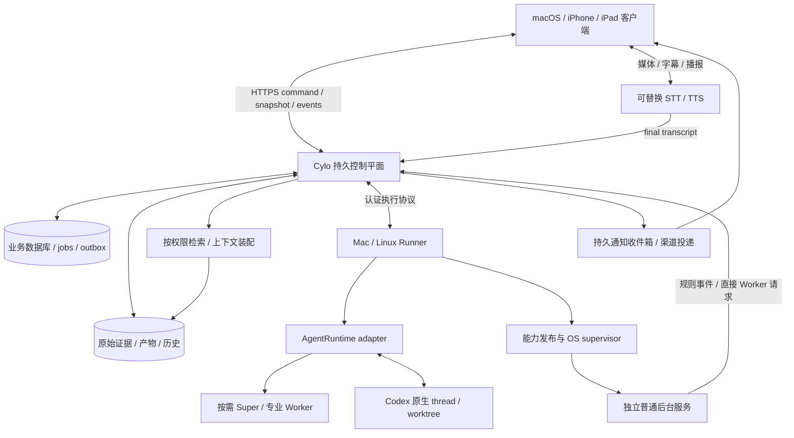

# Cylo 实现调研与架构方案

调研日期：2026-10-21。产品现名 **Cylo**。本文以 [Cylo 完整产品需求说明书](Cylo-完整产品需求说明书.md) 为唯一产品基线，整合并独立复核五份专项研究。**目前完成的是需求、选型、设计与隔离实验，产品实现尚未开始。** 所有阶段、技术栈和指标均为实施建议，不修改完整需求。

**总体推荐：建设 Cylo 自己的持久控制平面，按需调用 Super、允许服务直接调用 Worker，并独立管理普通后台程序、记忆与权限。Codex 优先验证官方 app-server 适配路径；语音采用可替换 STT → 业务控制平面 → TTS。可以开始协议 POC 与隔离开发，尚不能承诺完整产品可交付。** 最大阻断是官方 Mac App 原生双向接续、完整工具/审批恢复，以及 app-server 的生产支持与适用鉴权路径；没有端到端证据时不能把摘要导入包装成原生接续。

| 用户指定候选 | 决定 | 依据与可复用范围 |
|---|---|---|
| [awslabs/cli-agent-orchestrator](https://github.com/awslabs/cli-agent-orchestrator)（CAO） | **不采纳为总控制面或 Codex 主运行时；保留可选局部适配** | 当前具有数据库、工作流恢复和多 CLI 能力，不能误称无持久化；但 Codex 依赖 TUI 抓屏、默认 `--yolo`，逐工具审批受限，删除终端会强制删除 worktree 未提交内容。参考协作工具/多 CLI adapter，未来有明确需求才改造成隔离 fleet 后端，不能与另一 adapter 同时持有同一运行。详见 [02](docs/research/02-orchestration-and-codex.md)。 |
| [Space3044/chatgpt-web-voice](https://github.com/Space3044/chatgpt-web-voice) | **不采纳其上游网关与账号池；选择性参考客户端模块** | 实际绑定 ChatGPT Web 会话与未公开信令，并非独立 STT/TTS 或官方 Realtime API。可参考麦克风选择、字幕、移动播放解锁和连接清理；须替换上游协议与身份、补本地停播和可靠 final 提交。实质复制遵守 MIT。详见 [03](docs/research/03-voice.md)。 |

## 阅读导航与需求优先级

| 文档 | 评审用途 |
|---|---|
| [01 需求追踪与验收](docs/research/01-requirements.md) | 全22章及场景 A—E 的稳定 `CY-*` 编号、原始出处、责任、风险与验收；完整范围的审查清单 |
| [02 编排与 Codex](docs/research/02-orchestration-and-codex.md) | 固定源码、CAO/官方接口比较、隔离持久化与 CLI 实验、原生交接协议 |
| [03 语音](docs/research/03-voice.md) | 候选源码、官方语音 API 当前事实、移动限制、可替换方案与真机 POC |
| [04 总体架构](docs/research/04-architecture.md) | 实体模型、状态机、API/事件、能力生命周期、记忆与迁移的详细契约 |
| [05 可靠性与安全复核](docs/research/05-reliability-security-operations.md) | 恢复边界、授权/隔离、故障注入矩阵与生产准入条件 |

旧 [Codex Super 需求与架构讨论稿](codex-super-agent-requirements-and-architecture.md) 仅保留历史，不再与新版并列生效。新版不是“把旧 Super 系统换个名字”：所有请求经过 Super、Codex 承担所有执行、一次会话代表一个长期任务，都不满足新需求。阶段子集通过也不等于完整产品通过。

## 推荐系统结构

首版建议 TypeScript 模块化控制服务、React 响应式 PWA、版本化 JSON Schema、SQLite 本地磁盘和独立 runner。macOS 用 launchd、Linux 用 systemd 管理常驻进程。明确边界后可同包安装，不必先做微服务。Python Agent/普通程序通过协议接入，技术栈不决定产品范围。服务端必须是常开机器；主机睡眠/关机期间展示离线与最后观测时间，不能声称仍在执行。

未来按实测需要增加 PostgreSQL、对象存储、多个 runner 与组织身份。单人版起就保留 workspace、principal、project 权限字段；未建立租户执行隔离前不能开放不可信团队共用主机。对 Mac 官方 App 的接续需求，应优先在该 Mac 上验证执行环境；迁到 Linux 或云端不会自动让 Mac App 接管远端会话。

### 1. 控制平面负责真实状态

必须区分 `Project`、用户 `Conversation`、可验收 `Task`、一次执行 `TaskRun`、原生 `AgentSession`、长期 `ServiceDeployment` 和媒体 `VoiceSession`。关闭聊天、语音断线、Super 回合结束，都不结束任务或服务。`task/run ↔ host/store/thread/turn/worktree` 显式关联；目录路径按 host 映射，不能用绝对路径当项目主键。

用户消息或语音 final 先携带幂等键进入 command；校验身份、权限、目标版本后，在同一事务写业务意图、job、event/outbox，再回“已接收”。API 超时按原键查询/补发；同键不同内容拒绝。`received`、`applied`、实际 `outcome` 分开，provider 接收输入不代表已完成或已遵循要求。客户端使用同快照水位的快照与增量游标，断线补齐、重复去重、过期游标重新同步，陈旧状态可见。

保留产品八态：待执行、执行中、等待、等待用户、暂停、完成、失败、取消；run 和外部 operation 另外保存 unknown。暂停/取消是期望指令，需执行端确认后才显示已停；中断不回滚已写文件或已发邮件。任务完成需要目标验收和结果证据，`turn/completed` 或终端显示完成仅是执行观测。通知有持久收件箱、来源链接、去重与级别，推送投递不是唯一事实来源。

### 2. 智能执行与官方接续

Super 只负责复杂目标理解、计划、依赖和异常协调，输出计划提案，由控制平面校验执行。Worker 按能力契约获得最小上下文与工具权限。确定性路由、时钟、调度、预算、健康检查和普通状态查询直接用程序。并行任务使用独立 worktree/资源锁；集成结果需单独验收，worktree 本身没有安全沙箱功能。

**优先适配 app-server，不等于它已获生产准入。** 当前官方文档明确 app-server command 和 WebSocket transport 是 experimental、unsupported for production workloads；stdio 是降低接入复杂度的 POC 起点，不能据此宣称整个接口获得稳定生产支持。固定发布二进制与生成 schema，验证 thread/start/list/read/resume、turn/start/steer/interrupt、历史分页和双向审批。也可评估官方 Python Codex SDK 是否覆盖同一契约；这不会消除底层成熟度、恢复和互斥责任。Agents SDK 只可选用于 Super/非 Codex Worker，不承担 Cylo 任务权威。

原生交接顺序是停止新派发 → 确认当前执行/工具已停及副作用可核对 → 保存 thread、工具配置、工作区与 dirty 文件证据 → 释放写权 → 官方工具接续 → Cylo 重新读取原生历史/Git/文件并核对。数据库租约不能约束不合作的官方进程；无法证明旧写者停止或资源拒绝旧代次时禁止自动接管。

当前只证实同 Linux 主机、同隔离 CODEX_HOME 的 app-server 首输入历史可恢复且能由官方 CLI 显示。CLI 新 turn 返回 Cylo、成功模型与工具/审批流程、Mac 官方 App 双向发现与续作均待验。文本导入、复制摘要和新建 thread 可作为明确标注的临时重建工具，不能通过 `CY-05` 原生接续验收。接口或 App 无法满足时，继续隔离开发其他模块可以，但完整产品仍 No-Go，需评估官方接口演进或明确提请需求取舍，不能自行降级。

### 3. 普通程序形成长期能力

“一次查邮件”创建可终结任务；“以后监控”创建能力与 deployment，每次触发另记 invocation/task。不可变 release 应含内容 digest、入口、依赖、平台、配置 schema、secret 引用、权限、触发方式、健康探针、资源预算、checkpoint 和升级/回滚条件。代码生成与安装部署分别授权。

流程为实现/配置 → 隔离构建测试 → 展示行为、成本与权限 diff → 对具体 release/config 授权 → 安装与健康验证 → 注册触发 → 独立运行。规则直接处理，语义事件可直接调用 Worker，复杂事件才升级 Super；Super 退出不应终止监控。更新、暂停、停止、恢复、卸载都须观测实际进程与凭证状态。邮件等单消费者服务保持单活，二进制回退不保证数据库迁移或已产生副作用可回滚。

### 4. 记忆与上下文保留依据

原始历史/证据、已确认决定、执行事实、AI 推断分层保存。全局、项目、任务记忆隔离；决定有生效时间、来源、版本和 supersedes，允许回答“过去选什么、何时改、依据是什么”。来源缺失必须表达无法确认。Memory Agent 可事件驱动地建议合并、关联、过期与矛盾处理，无权直接改任务、权限、配置或正式决定。

先做关系索引/全文检索，再按评测收益引入向量检索。每次上下文装配记录来源 ID/hash、权限版本、裁剪和 token；检索先过滤访问权，再做相关性排序。删除/撤权同时作用于派生摘要、索引与缓存；原始已删除资料不能被旧摘要重新注入。

### 5. 语音与多端连续性

PWA 先验证前台显式开启麦克风的语音文字交互。STT partial 仅显示，final 按 turn/item 与修订幂等入库，乱序不能变为乱序指令；不把低质量否定词或歧义资源直接执行为高风险动作。任务上下文属于服务端，另一设备重新建立媒体连接后读取同一任务和历史。

播报绑定已定稿 message/revision/segment。插话应本地立即停播放器、清队列、取消生成并丢弃旧 generation 迟到音频；只发上游 stop_speaking 不能保证本地停止延迟。“停播报”与“停止任务”是不同命令。当前官方 `gpt-live-transcribe` 转录模式可作为 STT POC，但需要客户端 VAD/commit；TTS 先比较本地 sherpa-onnx 与当前官方音频工作流，验证中文、延迟、许可和忠实朗读。原生 Realtime 对话模式可选，语音模型不能自行获得任务管理权。

浏览器安全上下文、麦克风授权、移动端自动播放与后台生命周期都是真实约束；PWA 不预先承诺锁屏持续通话。若目标机型验收证明必须原生，增加 SwiftUI iOS/iPadOS 客户端，复用控制与媒体契约。推送只能提示打开任务，不是后台录音能力证明。远程使用受信 HTTPS、Cylo 登录与项目授权，永久供应商 key 留后端，VPN 也不代替应用权限。

## 安全与可靠性必须从第一条可执行任务开始

- **持久接收：** SQLite 使用本地磁盘、WAL、`foreign_keys=ON`、`synchronous=FULL` 并核验生效；事务提交后才回持久 ACK。NORMAL 不能支撑断电后所有已确认提交仍保留的承诺。FULL仍依赖OS/硬件兑现sync；macOS是否需F_FULLFSYNC、目录/产物持久化和真实掉电恢复须平台验证。
- **恢复先核对：** durable job、租约与 outbox 同库；控制服务重启先查进程身份、原生 turn、工作区和外部回执，再决定重试。租约过期不证明旧进程已死。epoch 必须由实际资源端拒绝旧代次；任意 shell 能直接写文件/网络时，需确认旧进程树终止或隔离，无法证明则等待核对。
- **副作用账本：** 持久 intent/幂等键 → 外部调用 → receipt/结果确认。发送成功后、回执入库前崩溃必须允许 unknown。只有提供者支持幂等或查账时才能安全重放；其余等待核对或补偿，不一般性承诺 exactly-once。
- **执行时授权：** grant 限主体、资源、动作、时间、预算和转授范围；审批绑定计划/动作/release/config digest 与有效期。Super、工具和后台服务均走执行层校验。提示词不是权限边界；本机高信任模式与不可信/多租户容器或 VM 隔离分开验收。
- **撤权有边界：** 联网执行立即禁止新动作；离线服务必须有短期凭据/有界租约，到期后停止副作用。长期 secret 复制给任意程序后无法只靠控制库强制收回；此模式不得宣称即时撤权。语音媒体也需主动断连接/停轨道或受控 relay，token 失效不等于已建媒体已结束。
- **备份与迁移：** 一致性数据库快照 + 产物/hash + 原生恢复材料 + 服务 release/config/checkpoint + 路径映射 + 单独加密的 secret。运行中不只复制 SQLite 主文件而漏 WAL；快照引用对象应pin住防GC，恢复默认禁外发并核对恢复点之后的外部副作用。Mac→Linux 重建进程与平台依赖、停旧 host 后开触发；备份文件存在不等于可恢复，须隔离演练。
- **成本与观测：** 派发前预留预算、限制并发/调用/超时，标明估算和实际用量。提供者计费延迟使精确硬美元上限不可保证；停止追加派发也不能撤销在途费用。保留真实观测时间、unknown、错误、恢复动作和证据，禁止让 Super 无限解释失败而继续烧 token。

详见 [04](docs/research/04-architecture.md) 的实现契约及 [05](docs/research/05-reliability-security-operations.md) 的故障矩阵；这些是待实现和验收的保证条件。

## 核心阻断与必须先做的 POC

| 优先级 / 门槛 | 最小实验与需要保留的证据 | 不通过时的处置 |
|---|---|---|
| B0 官方原生互通 | 真 Mac 与当前官方 App，Cylo/官方双方各创建含真实工具记录的 thread，互相发现、接续至少两轮；Linux CLI 同样双向测试；保留版本、同 thread/store/worktree、修改与历史证据 | 完整 `CY-05` 和场景 A 暂 No-Go；明确支持矩阵，不能用摘要恢复替代 |
| B0 接口生产与鉴权 | 固定 app-server/SDK 版本与 schema；验证审批/steer/interrupt/分页/重启；评审官方 experimental 支持风险；按本地与托管模式分别确认许可适用的登录/API/SIWC 接入及账户可用性 | 可继续隔离 POC；未满足支持/鉴权要求不能发布对应生产或托管模式 |
| B0 真实执行与恢复 | 首输入持久化；进程崩溃、旧 shell 存活、旧审批、外部成功但回执丢失；核对真实文件与副作用次数 | 完成与安全恢复闭环前不开放自主长期执行；unknown 显式阻塞 |
| B1 移动语音 | 真 iPhone/iPad/Mac，中文/中英/否定词/数字、回声与双讲、VAD、插话、网络切换、锁屏恢复、通知、跨设备继续；量测 p50/p95 并留样本 | 文字路径可用；切语音 adapter，或原生客户端立项；不能宣称自然语音已验收 |
| B1 自主能力与撤权 | 邮件 fixture 三路规则/Worker/Super；Super 停止后服务继续；断联超过 TTL 无新副作用；升级失败与卸载撤权 | 权限/运行模型不成立则不部署自主生成服务 |
| B1 证据、记忆与数据 | 决策变更/缺依据/跨项目拒绝/删除后旧索引、隔离备份恢复、Mac→Linux 重建 | 未通过不得承诺可靠长期记忆或可迁移 |

本地个人应用可按官方受支持本地方式验证；[官方 app-server 鉴权说明](https://developers.openai.com/codex/app-server) 对 **app-server authentication** 的商业/托管限制不能泛化成所有 Codex 商业使用被禁止。反之，开源许可证也不赋予共享个人订阅令牌的权利。SIWC 是官方指向的迁移候选，不代表此研究已获得接入资格或证明可用。

## 可验收的实施路线与依赖

为避免与专项阶段混淆，下表统一沿用 [01](docs/research/01-requirements.md) 的 P0—P3。04 中更细的阶段0—6是组件顺序：0→P0，1—3→P1，4—5→P2，6→P3；基础安全、备份和 operation 账本贯穿 P1 起。

| 阶段 | 具体交付与依赖 | 准出证据 |
|---|---|---|
| **P0 阻断性验证** | 固定版本/schema；B0 三项 POC；先确定原生互通及鉴权可行边界，同时做移动音频最小真机实验 | 明确支持/失败/未测矩阵；原生 ID/历史与文件证据；官方支持风险可接受的决定；没有凭据/设备的条目标未测 |
| **P1 可信任务与跨端开发** | 持久 command/jobs/outbox、任务/run/证据、权限审批、单 runner、Codex adapter、基础 PWA、前台语音及设备同步；依赖 P0 对应契约 | 重复命令只一次业务动作；客户端退出继续；Mac/iPhone/iPad同一任务；取消显示真实确认；场景 A、D 的开发链路通过及故障 E 的关键窗口测试 |
| **P2 长期服务与可靠记忆** | release/deployment/supervisor/secret/checkpoint、普通服务→Worker、通知、Memory 提案/检索/上下文；依赖 P1 事件、授权与证据稳定 | 场景 B 服务在无 Super 会话时持续；C 可解释决策变更和缺依据；D/E 覆盖服务与记忆；更新/撤权/卸载/断网恢复可核对 |
| **P3 全范围与演进验收** | macOS/Linux后台双平台、迁移恢复、异构模型/Agent/语音替换、外部服务故障隔离、未来组织边界；按真机结果补原生客户端 | 01 全需求矩阵逐项留证、场景 A—E 完整重跑；Mac→Linux与隔离备份恢复；替换不损权威数据；未实现范围明确阻止完整产品宣告 |

P0 的低成本失败应先发生，避免用完整 UI 掩盖互通阻断。P2 服务与记忆可在契约稳定后并行开发；完整需求不因工程排序被移出范围。每阶段执行有价值的集成与故障测试，不用模型自述成功作为通过证据。

### 全需求如何落到方案

此表是覆盖索引，细粒度验收以 01 的每个 `CY-*` 条目为准，不以此表替代原文。

| 新版章节 | 方案责任与交付 |
|---|---|
| §1、2、21、22 | 模块边界、长期权威控制、智能/普通程序分工、全范围准出；P0—P3 |
| §3、12 | 多端统一命令/快照/事件、前台语音、通知与任务连续性；P1—P3 |
| §4、15 | OS常驻、runner观测、持久恢复、休眠/离线识别与迁移；P1—P3 |
| §5 | 原生 Codex adapter、双向发现与交接、官方独立运行和变更回读；P0阻断，P1实交付 |
| §6、8 | 按需Super、Worker直接调用、并行/依赖、任务/run、真实验收与安全恢复；P1—P2 |
| §7、9 | capability/release/deployment、独立服务、事件、生命周期与去重通知；P2 |
| §10、11 | 四层记忆、来源/版本/决定、Memory提案、按权限上下文；P1基础，P2闭环 |
| §13、18 | Agent/模型/语音/外部服务契约、故障隔离、组织权限与替换演练；P1设计，P3验证 |
| §14、16、17 | 最小权限/审批/撤销/隔离、审计与数据控制、备份恢复/迁移、预算/成本观测；P1起持续交付 |
| §19、20 | A—E跨组件场景及全部质量维度；分阶段留证，P3完整准出 |

## 独立核验记录与研究边界

整合者于2026-10-21独立完成下列核验，没有仅依据专项报告转述决定性新事实：

| 核验 | 实际证据与结果 | 尚不能推出 |
|---|---|---|
| 固定源码 | 本地 `git rev-parse HEAD`：CAO `4e990a9d78b154ad76c6cf94c7b51e36fce69f21`；voice `6338ac478070aaa34bfe7a3c0469caf9e9174c02`。直接读取 CAO `_build_codex_command`、`remove_worktree` 与 voice `service.go`/`interruptAssistant` | main未来行为不自动相同；没有运行完整CAO fleet或语音网关 |
| Codex离线恢复 | 独立重跑 [orchestration-poc.py](docs/research/evidence/orchestration-poc.py)，临时目录 `/tmp/cylo-research-repro-g6xu28u4`：空thread重启后报no rollout；首输入后同thread恢复成功，历史保留userMessage且turn为interrupted；使用不可达loopback假provider | 没有成功模型/工具调用；不是断电实验；CLI屏幕接续是02作者实际实验，本整合者未重跑PTY |
| CAO force 清理 | 独立临时空 Git repo `/tmp/cylo-synthesis-cao-5oip6nrt`，直接 import 固定源码建立worktree与未跟踪文件，再调用 remove；结果 `before True`、`after False worktree_exists False` | 仅证明未提交/未跟踪文件丢失；不能说未合并已提交分支被强删，源码分支删除实际为安全 `-d` |
| 可靠性简化实验 | 独立重跑 [reliability-probe.py](docs/research/evidence/reliability-probe.py)，SQLite 3.40.1：事务前/后进程退出、活动WAL在线备份、旧epoch数据库拒绝但直接文件可写、副作用回执缺口稳定key去重，四项PASS | 属于简化模型与模拟provider，不证明完整Cylo、断电、macOS隔离或真实邮件恢复 |
| 语音静态检查 | 独立重跑 [voice-static-check.cjs](docs/research/evidence/voice-static-check.cjs)：2段 inline JS语法通过；上游stop、重复抑制、静音保护和文字中断分支通过 | 不证明DOM/WebRTC、实际音频中断、中文识别或移动体验 |
| 官方语音事实 | 重新实际HTTP 200读取[弃用页](https://developers.openai.com/api/docs/deprecations)与[Realtime转录指南](https://developers.openai.com/api/docs/guides/realtime-transcription)：旧TTS关闭2027-01-06，旧转录关闭2027-02-26；`gpt-live-transcribe`不支持server/semantic VAD，需客户端commit | 不能把推荐Realtime型号直接填入旧 `/v1/audio/speech`；不能扩成所有转录模型都无VAD；没有做真实API/价格实验 |
| 官方鉴权范围 | 重新实际HTTP 200读取[app-server.md](https://developers.openai.com/codex/app-server.md)，逐字确认本地/开源可继续及商业/托管限制针对app-server authentication，并指向SIWC | 不证明SIWC对本账户/地区/部署可用，不证明任意商业或API接入被禁止 |

本环境未暴露官方文档搜索或通用网页搜索工具；先尝试官方站内 search 路径（404），随后直接获取上述官方正文；语音专项另保存了 [官方原文与hash](docs/research/evidence/voice-official-excerpts.md)。动态文档在实施冻结时必须重新核对。独立核验不把源码存在当运行成功，也不把离线首输入恢复当成功模型/工具链路。

未开展产品 runtime 编码、部署、Mac/iOS 真机、真实收费模型/语音请求、生产断电/磁盘恢复、完整多租户隔离或端到端性能/成本验收。现有证据支持上述设计方向和下一轮实验次序；**完整产品是否可交付，仍取决于阻断项与全需求验收。**
