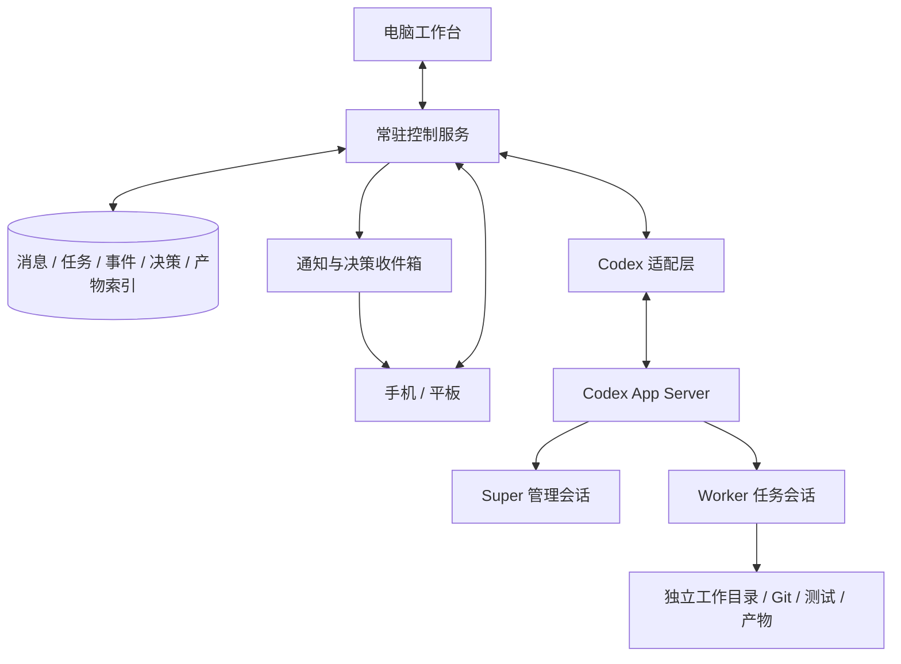

# Codex Super Agent：需求与架构方案

更新日期：2026-10-01  
文档状态：讨论稿，记录已确认的产品方向与建议方案；尚未实施或完成项目选型。

## 1. 产品目标

构建一个由 Codex Super Agent 管理多个 Codex Worker 的自动化工作系统。用户在电脑上进行主要生产工作，离开电脑后通过手机或平板交办事项、了解进展、调整方向和处理关键决策，后台任务持续推进。

系统需要同时满足：

- 电脑上的完整生产力体验。
- 手机和平板上的低输入负担、快速理解和简短决策体验。
- 无人值守执行，以及遇到阻塞时的主动汇报。
- 多 Agent 的可靠调度、任务隔离和可恢复执行。
- 可观测、可限制的 token 消耗，避免管理空转和重复工作。

## 2. 已确认的产品原则

### 2.1 设备分工

电脑是主要生产工作台，承担代码编辑、复杂需求讨论、详细 diff 审查、终端操作与深入排查。

手机和平板是联系 Super 的入口。用户可以用语音、短消息和少量点选完成交办、查看、决策与调整；移动端默认展示任务结论和成果，执行细节按需展开。

| 设备 | 主要场景 | 交互重点 |
| --- | --- | --- |
| 电脑 | 开发、调试、审查、复杂讨论 | 完整上下文、代码、终端、详细变更 |
| 手机 | 随手交办、接收汇报、快速决策 | 短消息、语音输入、通知、简短选项 |
| 平板 | 阅读汇报、查看成果、轻量审阅 | 较大的预览、任务详情、上下文并排查看 |

跨设备共享同一套项目、消息、决定和待办。回到电脑后可以继续处理，无需重新向 Agent 解释背景。

### 2.2 Super 随时可联系，按需推理

用户最初提出“Super 高频自动运行”，其体验目标是及时响应、持续推进和主动汇报。

实现上由普通程序常驻，维护连接、状态、定时检查和任务推进；Super 在新需求、计划变化、阻塞或需要判断时进行推理。空闲期间无需固定频率调用模型。

### 2.3 Super 负责管理与解释

Super 需要理解用户目标、拆分工作、调整优先级，并把 Worker 的执行细节整理成用户能快速判断的信息。

用户默认与 Super 交流。Worker 的会话、日志和工具输出属于任务详情，不应全部流入主对话或手机通知。

## 3. 核心用户需求

| 场景 | 预期行为 |
| --- | --- |
| 随手交办 | 一条短消息或语音即可记录需求；Super 结合已有背景整理任务，必要时询问关键缺失信息 |
| 查看进展 | 简洁回答完成了什么、正在做什么、卡在哪里，并显示状态更新时间 |
| 调整方向 | 接收新的优先级和范围要求，明确告知何时已应用到计划或执行 |
| 处理决策 | 展示问题、推荐方案、主要影响与简短选项，允许补充说明 |
| 查看成果 | 提供页面预览、截图、演示、关键测试结果及变更摘要 |
| 暂缓复杂问题 | 将问题留待电脑处理，继续推进不依赖该决定的任务 |
| 离开或锁屏 | 服务端任务继续运行，关键事件可发送通知 |
| 网络中断 | 保留草稿和待发送消息；重连后恢复状态与遗漏事件 |
| 回到电脑 | 接续同一任务及其决定，展开代码、diff、终端和详细证据 |

移动端汇报示例：

> 登录修复已完成，相关测试通过。  
> 发现旧账号缺少手机号，会影响新验证流程。  
> 建议保留邮箱登录入口，需要增加一项开发任务。  
> 操作：采用建议 / 暂缓 / 补充要求 / 留到电脑处理。

示例仅说明汇报格式，不代表真实执行结果。

## 4. 总体架构

图中的 App Server 表示接入层，实际采用一个还是多个进程，需要根据并发能力和故障隔离验证后决定。多个会话本身不构成文件系统隔离。

### 4.1 客户端

- 展示主对话、任务摘要、成果和待决策事项。
- 接收实时事件，断线后按事件编号补齐遗漏。
- 发送消息与明确操作，并展示操作的实际状态。
- 通知点击后定位到具体任务或决定。
- 电脑端与移动端共享后端数据，按设备提供不同信息密度。

### 4.2 常驻控制服务

- 持久保存消息、任务、依赖、决定和执行记录。
- 执行任务队列、并发限制、超时处理、事件合并和通知规则。
- 启动、恢复、追加输入和中断 Codex 会话。
- 分配独立工作目录，管理产物与验收结果。
- 区分确定的失败、可重试故障和执行结果未知的情况。
- 记录 token 用量与任务预算，在预算边界停止继续派发。
- 重启后核实已有执行状态，避免重复启动任务。

### 4.3 Super Agent

- 维护目标、范围、优先级、约束与任务计划。
- 为 Worker 指定任务范围、验收标准和依赖条件。
- 处理需求冲突、方案取舍和无法由规则解决的阻塞。
- 将需要用户判断的事项转化为简短问题与建议。
- 在关键阶段汇报结果，并按需读取证据。

同一个 Super 会话同时只进行一个管理回合。新事件排队或合并；紧急的明确控制操作由控制服务直接处理。

Super 提交的调度意图由控制服务校验并应用。持久化任务状态以控制服务为准。

### 4.4 Codex Workers

- 每个 Worker 处理一个范围明确、有验收标准的任务。
- 同一任务的后续修复优先继续原有会话。
- 并行写入任务采用独立 Git worktree 或等价工作目录。
- 返回简洁结果、阻塞原因和证据位置。
- 单独通过测试后，合并仍需检查冲突并执行必要的集成验证。

## 5. Codex App Server 的位置

计划使用 Codex App Server 作为 Codex 接入层，满足持续对话、执行中补充要求、中断和会话恢复需求。

| 接口或能力 | 用途 |
| --- | --- |
| `thread/start` | 创建 Super 或 Worker 会话 |
| `thread/resume` | 恢复已有会话 |
| `turn/start` | 发起一轮执行 |
| `turn/steer` | 向当前执行追加要求 |
| `turn/interrupt` | 请求中断当前执行 |
| 事件通知 | 接收消息、工具活动、变更和用量等更新 |

初期建议后端通过本机 stdio 接入，客户端经控制服务访问。Codex 适配层提供统一的启动、恢复、追加输入、中断和事件订阅操作。

App Server 不替代业务任务库、依赖调度、验收、预算和通知系统。会话可恢复也不等于任意外部操作可以安全重放。

根据本次讨论查阅的官方文档，App Server 命令及 WebSocket 传输仍有实验性标记。实施时固定版本并验证接口兼容、并发、断线和中断行为；stdio 接入也需要版本管理。

## 6. 可靠交互与状态管理

### 6.1 消息确认

| 状态 | 含义 |
| --- | --- |
| 已接收 | 控制服务已持久保存消息 |
| 已应用 | 调整已生效，或输入已送达目标执行；需标明具体含义 |
| 已完成 | 对应工作结束并满足验收条件 |

“已接收”不能显示为“已执行”。暂停或中断操作先显示“正在处理”，待执行端确认后再更新状态。中断不会自动撤销已经产生的文件修改或外部副作用。

### 6.2 恢复与防重复

- 客户端提交使用唯一标识，重复发送可被识别。
- 事件使用可恢复的编号，重连按位置补齐。
- 保存任务、会话和执行实例之间的映射。
- 服务恢复时先核实运行中的进程与执行状态。
- 已确认执行过或结果未知的操作不能直接重放。
- 暂停任务需要确认相关执行是否仍在进行，不能仅修改数据库标签。

### 6.3 决策收件箱

每个待决定事项绑定任务、相关计划版本、问题、推荐方案、影响与证据。用户可以回复、暂缓或留到电脑处理。

任务变化后检查决定是否仍有效；过时问题应撤回或重新生成，避免用户操作旧通知后错误改变当前计划。

## 7. 高频体验与 token 控制

| 事件 | 默认处理方式 |
| --- | --- |
| 查看状态、日志、产物 | 控制服务直接读取 |
| 明确停止执行或取消排队任务 | 控制服务直接操作 |
| 新需求、范围变化、优先级调整 | 唤醒 Super |
| Worker 完成预定步骤 | 验收后按已有计划推进 |
| 普通执行进度 | 存储并按需推送，不调用模型润色 |
| 需求冲突、方案受阻 | 携带摘要和证据唤醒 Super |
| 网络或基础设施暂时失败 | 满足可安全重试条件时由程序重试 |
| 到期、超时 | 程序检查，仅在需要判断时唤醒 Super |
| 没有新事件 | 保持监控，不进行模型推理 |

具体策略：

1. 默认一个 Worker，只有独立任务才增加并发；初期最多三个是待验证的起始配置。
2. Super 接收用户新消息、精简计划、关键增量和待决策事项。
3. 完整日志保留在任务中，通过证据索引按需读取。
4. 同一任务复用会话，跨任务隔离上下文；历史过长时整理必要状态。
5. 非紧急事件合并处理，避免每个 Worker 事件都触发管理推理。
6. 状态展示、通知合并和固定格式报告由程序生成；取舍和解释才调用模型。
7. 记录每项任务的输入、缓存输入、输出、重试次数和耗时，与单 Agent 基线比较。
8. 设置任务级与总体预算；实际硬限制能力和用量上报延迟需验证。

多 Agent 通常会增加总 token，其直接收益是并行速度与任务隔离，不能预先承诺更低成本。

`--ephemeral` 仅取消会话文件持久化，不直接节省 token；需要恢复的长期任务不默认使用它。对于 CLI 批处理，`--json` 提供事件流，最终结构化结果应使用 `--output-schema` 并由程序校验。

## 8. 结果与验收

Worker 结果至少包含：

- 任务标识、执行标识与状态。
- 简短成果摘要。
- 变更文件、提交或补丁位置。
- 测试命令、执行结果及报告位置。
- 阻塞原因与下一步建议。
- 预览、截图或其他可供用户查看的产物位置。

控制服务根据可观察证据与验收规则判断完成状态。Worker 的自然语言“完成”或“测试通过”不能单独作为完成依据。需要产品判断的成果可进入待用户验收状态。

## 9. 现有项目与复用路线

以下能力依据本次讨论中的仓库和文档核查，尚未安装实测，具体版本需在选型时重新确认。

| 项目 | 可复用部分 | 尚需评估 |
| --- | --- | --- |
| [CC Pocket](https://github.com/K9i-0/ccpocket) | 手机和平板客户端、Codex App Server 接入、断线恢复、成果与 diff 查看 | 能否围绕简短交办、主动汇报和决策收件箱调整体验 |
| [HAPI](https://github.com/tiann/hapi) | Hub、SQLite、Runner、REST/SSE、远程会话与共享 Codex 会话 | 扩展 Super 调度、预算与验收机制的成本；原生端安装和能力差异 |
| [Happy](https://github.com/slopus/happy) | 移动客户端、通知、会话同步；Happy Agent 的程序化会话控制 | 接入调度层及任务状态模型的方式 |
| [CLI Agent Orchestrator](https://github.com/awslabs/cli-agent-orchestrator) | Supervisor/Worker 调度、流程与定时执行 | 基于终端进程的机制与 App Server 方案如何衔接 |
| [Golutra](https://github.com/golutra/golutra) | 多 Agent 工作台、自定义工作流 | 文档中的 CEO Agent 和移动操控属于后续计划；复用还需核查许可证 |

优先评估复用客户端和会话基础设施，再补充 Super 调度、汇报和决策层。选型重点是异步交办、主动汇报、简短决策、成果预览与电脑接续。

组合项目时必须明确哪一层创建、持有和恢复 Codex 会话，避免多个调度器重复接管。

## 10. 建议的第一阶段范围

建议单机部署：一个控制服务、SQLite、一个 Super 会话、按需启动的 Workers，以及 Codex App Server 适配层。客户端优先复用现有项目；自建时可先采用响应式 Web/PWA。原生客户端是否必要取决于通知、语音和系统集成体验的实测。

首条完整链路：

1. 用户在电脑上建立项目背景、目标和约束。
2. 手机发送一项短需求，获得可靠的接收确认。
3. Super 整理任务，控制服务启动 Worker。
4. 用户锁屏或离线，服务端继续执行。
5. 用户追加要求，系统明确反馈应用状态。
6. 阻塞时收到简短问题和推荐选项，可留到电脑处理。
7. 完成后收到成果摘要和可查看产物。
8. 回到电脑接续审查，看到同一任务、决定和证据。

第一阶段验收重点：消息不重复执行、状态可信、断线可恢复、关键通知可到达、任务成果可核查，并且能统计每项任务的 token 与管理开销。

## 11. 待确定与待验证

- 首先支持 iOS/iPadOS 还是 Android，以及具体设备组合。
- 执行主机是个人电脑、常开工作站还是服务器；休眠与离线时如何呈现。
- 选用哪个现有项目作为基础，或是否需要自建客户端。
- 各设备上的通知、语音输入和成果预览体验。
- Codex 接口版本、会话并发能力、进程布局与故障隔离。
- 自动执行的操作范围，以及哪些事项需要用户作出决定。
- 任务验收规则、Git 集成流程和产物保留策略。
- token 预算、汇报频率和并发上限的起始配置。
- 超过预算、执行结果未知、会话丢失等情形的恢复策略。

## 12. 参考资料

- [Codex App Server](https://developers.openai.com/codex/app-server)
- [Codex 非交互模式](https://developers.openai.com/codex/non-interactive-mode)
- [Codex SDK](https://developers.openai.com/codex/sdk)
- [Codex 子 Agent](https://developers.openai.com/codex/multi-agent)
- [CC Pocket Bridge](https://github.com/K9i-0/ccpocket/blob/main/packages/bridge/README.md)
- [HAPI 架构](https://github.com/tiann/hapi/blob/main/docs/guide/how-it-works.md)
- [HAPI Codex 共享会话](https://github.com/tiann/hapi/blob/main/docs/guide/codex-shared-sessions.md)
- [Happy Agent](https://github.com/slopus/happy/tree/main/packages/happy-agent)
