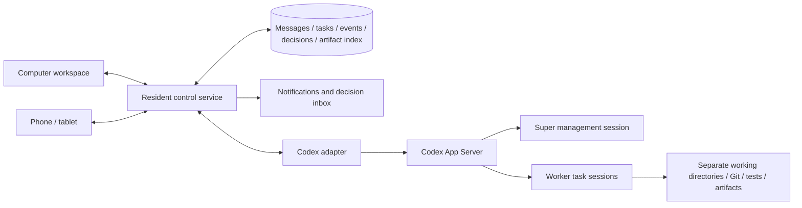

> Historical discussion draft, dated 2026-10-01. It records the product direction and proposal at that time; it was not implemented and did not complete project selection. The current plan is [the master plan](../../master-plan.md).

# Codex Super Agent: Requirements and Architecture Proposal

Updated: 2026-10-01  
Document status: Discussion draft recording confirmed product direction and a proposed solution; not yet implemented and project selection not complete.

## 1. Product Goal

Build an automated work system in which a Codex Super Agent manages multiple Codex Workers. The user does most production work at a computer, then uses a phone or tablet while away to assign work, check progress, adjust direction, and handle important decisions, while background tasks continue to advance.

The system needs to provide all of the following:

- A complete productivity experience on a computer.
- Low-input, quick-to-understand interactions and short decisions on phones and tablets.
- Unattended execution and proactive reports when work is blocked.
- Reliable multi-Agent scheduling, task isolation, and recoverable execution.
- Observable and controllable token use, avoiding idle management and repeated work.

## 2. Confirmed Product Principles

### 2.1 Device Roles

The computer is the primary production workspace for code editing, complex requirements discussions, detailed diff reviews, terminal operations, and in-depth troubleshooting.

Phones and tablets are entry points for contacting Super. Users can assign work, check status, make decisions, and adjust direction using voice, short messages, and a few selections. By default, the mobile client shows task conclusions and results, with execution details available on demand.

| Device | Primary scenarios | Interaction focus |
|---|---|---|
| Computer | Development, debugging, review, complex discussions | Full context, code, terminal, detailed changes |
| Phone | Quick assignments, receiving reports, rapid decisions | Short messages, voice input, notifications, brief options |
| Tablet | Reading reports, reviewing results, lightweight review | Larger previews, task details, side-by-side context |

Projects, messages, decisions, and to-dos are shared across devices. When the user returns to the computer, they can continue work without explaining the background to the Agent again.

### 2.2 Super Is Always Reachable and Reasons on Demand

The user's initial request for “Super to run automatically at high frequency” described the desired experience: timely responses, continuous progress, and proactive reporting.

In implementation, ordinary programs remain resident and maintain connections, state, periodic checks, and task progress. Super reasons about new requests, plan changes, blockers, or other situations requiring judgment. The system does not need to call a model at a fixed frequency while idle.

### 2.3 Super Manages and Explains

Super needs to understand user goals, break down work, adjust priorities, and organize Worker execution details into information the user can judge quickly.

Users normally communicate with Super. Worker conversations, logs, and tool output belong in task details and should not all flow into the main conversation or phone notifications.

## 3. Core User Needs

| Scenario | Expected behavior |
|---|---|
| Quick assignment | A short message or voice note records a request; Super uses existing context to organize it and asks about important missing information when necessary |
| Check progress | Briefly state what is done, what is in progress, and what is blocked, with the status update time |
| Change direction | Accept new priority and scope requirements and clearly report when they have been applied to the plan or execution |
| Handle a decision | Present the issue, recommended approach, main effects, and concise options, while allowing more explanation |
| Review results | Provide page previews, screenshots, demos, key test results, and a summary of changes |
| Defer a complex issue | Leave the issue for the computer while continuing tasks that do not depend on the decision |
| Leave or lock the screen | Keep server tasks running and send notifications for important events |
| Lose network access | Preserve drafts and unsent messages; restore state and missed events after reconnecting |
| Return to the computer | Continue the same task and decisions, with access to code, diffs, terminal, and detailed evidence |

Example mobile report:

> The login fix is complete, and the relevant tests pass.  
> Existing accounts without phone numbers may be affected by the new verification flow.  
> I recommend keeping email login and adding a development task.  
> Actions: Accept recommendation / Defer / Add a requirement / Handle on the computer.

The example illustrates a report format; it does not describe a real execution result.

## 4. Overall Architecture

The App Server in the diagram represents an integration layer. Whether to use one process or several must be decided after validating concurrency and fault isolation. Multiple sessions alone do not provide filesystem isolation.

### 4.1 Clients

- Show the main conversation, task summaries, results, and pending decisions.
- Receive live events and fill in missed events by event number after disconnects.
- Send messages and explicit actions, and show their actual status.
- Open a specific task or decision when a notification is tapped.
- Share backend data between computer and mobile clients while presenting different levels of detail on each device.

### 4.2 Resident Control Service

- Persist messages, tasks, dependencies, decisions, and execution records.
- Run the task queue, concurrency limits, timeout handling, event coalescing, and notification rules.
- Start, resume, provide additional input to, and interrupt Codex sessions.
- Assign separate working directories and manage artifacts and acceptance results.
- Distinguish definite failures, retryable failures, and unknown execution outcomes.
- Record token usage and task budgets, and stop dispatching more work at budget limits.
- Verify existing execution state after restart to avoid starting tasks twice.

### 4.3 Super Agent

- Maintain goals, scope, priorities, constraints, and task plans.
- Give Workers task boundaries, acceptance criteria, and dependency conditions.
- Handle conflicting requirements, tradeoffs, and blockers that rules cannot resolve.
- Turn issues requiring user judgment into concise questions and recommendations.
- Report results at key stages and inspect evidence when needed.

Only one management turn runs in a given Super session at a time. New events are queued or coalesced; the control service handles urgent, explicit control actions directly.

The control service validates and applies scheduling intent submitted by Super. The control service is authoritative for persisted task state.

### 4.4 Codex Workers

- Each Worker handles one task with a defined scope and acceptance criteria.
- A follow-up fix for the same task should preferably continue the existing session.
- Parallel write tasks use separate Git worktrees or equivalent working directories.
- Return concise results, reasons for blockers, and locations of evidence.
- Passing tests independently does not remove the need to check merge conflicts and run necessary integration validation.

## 5. Role of Codex App Server

The proposal uses Codex App Server as the Codex integration layer to support ongoing conversations, additional requirements during execution, interruption, and session recovery.

| Interface or capability | Purpose |
|---|---|
| `thread/start` | Create a Super or Worker session |
| `thread/resume` | Resume an existing session |
| `turn/start` | Start an execution turn |
| `turn/steer` | Add a requirement to current execution |
| `turn/interrupt` | Request interruption of current execution |
| Event notifications | Receive updates about messages, tool activity, changes, and usage |

Initially, the backend is proposed to connect over local stdio, with clients accessing it through the control service. The Codex adapter provides unified operations for starting, resuming, adding input, interrupting, and subscribing to events.

App Server does not replace the business task database, dependency scheduling, acceptance checks, budget controls, or notification system. A recoverable session does not mean that arbitrary external operations can be replayed safely.

According to the official documentation reviewed for this discussion, the App Server command and WebSocket transport were still marked experimental. Implementation should pin a version and validate interface compatibility, concurrency, disconnects, and interruption behavior; stdio integration also needs version management.

## 6. Reliable Interaction and State Management

### 6.1 Message Acknowledgments

| State | Meaning |
|---|---|
| Received | The control service has durably saved the message |
| Applied | An adjustment has taken effect, or input has been delivered to the target execution; the specific meaning must be stated |
| Completed | The corresponding work has ended and met its acceptance criteria |

“Received” must not be displayed as “executed.” A pause or interruption first shows “in progress”; the status updates only after the execution side confirms it. Interruption does not automatically undo file changes or external side effects that have already occurred.

### 6.2 Recovery and Duplicate Prevention

- Client submissions use unique identifiers so repeated sends can be recognized.
- Events use recoverable identifiers, and reconnects fill in events from the last position.
- Save the mappings between tasks, sessions, and execution instances.
- When the service recovers, first verify running processes and execution state.
- Do not directly replay operations whose execution is confirmed or whose result is unknown.
- For a paused task, confirm whether related execution is still underway; do not only change a database label.

### 6.3 Decision Inbox

Each pending decision is bound to a task, relevant plan version, question, recommendation, effects, and evidence. The user can respond, defer, or leave it for the computer.

When a task changes, check whether the decision is still valid. Withdraw or regenerate stale questions so that a user cannot act on an old notification and mistakenly change the current plan.

## 7. High-Frequency Experience and Token Control

| Event | Default handling |
|---|---|
| View status, logs, or artifacts | Read directly from the control service |
| Explicitly stop execution or cancel a queued task | Operate directly through the control service |
| New request, scope change, or priority adjustment | Wake Super |
| Worker completes a planned step | Continue the existing plan after acceptance checks |
| Ordinary progress update | Store and push on demand without asking a model to rewrite it |
| Conflicting requirements or blocked approach | Wake Super with a summary and evidence |
| Temporary network or infrastructure failure | Retry in program code when safe-retry conditions are met |
| Deadline or timeout | Check in program code; wake Super only when judgment is needed |
| No new event | Continue monitoring without model reasoning |

Specific policies:

1. Default to one Worker; add concurrency only for independent tasks. An initial maximum of three is a starting configuration to validate.
2. Give Super user messages, concise plans, important deltas, and pending decisions.
3. Keep full logs in the task and read them on demand through an evidence index.
4. Reuse sessions for the same task and isolate context across tasks; summarize necessary state when history grows too long.
5. Coalesce non-urgent events to avoid triggering a management reasoning turn for every Worker event.
6. Generate status displays, coalesced notifications, and fixed-format reports in program code; use a model for tradeoffs and explanations.
7. Record input, cached input, output, retry count, and elapsed time for each task, and compare them with a single-Agent baseline.
8. Set task-level and overall budgets; validate whether hard limits can be enforced and how delayed usage reports are handled.

Multiple Agents usually increase total token use. Their direct benefits are parallel speed and task isolation, so lower cost should not be promised in advance.

`--ephemeral` only disables session-file persistence; it does not directly save tokens, so it is not the default for long-running tasks that need recovery. For CLI batch processing, `--json` provides an event stream; use `--output-schema` for the final structured result and validate it in program code.

## 8. Results and Acceptance

A Worker result must include at least:

- Task identifier, execution identifier, and status.
- Concise result summary.
- Changed files, commit, or patch location.
- Test command, execution result, and report location.
- Reason for any blocker and a next-step recommendation.
- Location of a preview, screenshot, or other user-viewable artifact.

The control service determines completion from observable evidence and acceptance rules. A Worker's natural-language statement that work is “complete” or “tests pass” is not sufficient on its own. Results requiring product judgment can be marked as awaiting user acceptance.

## 9. Existing Projects and Reuse Path

The following capabilities were identified from repository and documentation checks during this discussion. They were not installed and tested, and specific versions need to be checked again during selection.

| Project | Potential reuse | Still needs evaluation |
|---|---|---|
| [CC Pocket](https://github.com/K9i-0/ccpocket) | Phone and tablet client, Codex App Server integration, disconnect recovery, results and diff viewing | Whether the experience can be adapted around short assignments, proactive reports, and a decision inbox |
| [HAPI](https://github.com/tiann/hapi) | Hub, SQLite, Runner, REST/SSE, remote sessions, and shared Codex sessions | Cost of extending Super scheduling, budgets, and acceptance; native installation and device differences |
| [Happy](https://github.com/slopus/happy) | Mobile client, notifications, session synchronization; programmatic session control through Happy Agent | How to integrate a scheduling layer and task-state model |
| [CLI Agent Orchestrator](https://github.com/awslabs/cli-agent-orchestrator) | Supervisor/Worker scheduling, workflows, and scheduled execution | How its terminal-process mechanism would connect with the App Server approach |
| [Golutra](https://github.com/golutra/golutra) | Multi-Agent workspace and custom workflows | The CEO Agent and mobile control were future plans in its documentation; reuse also needs a license review |

First evaluate reuse of the client and session infrastructure, then add Super scheduling, reporting, and decisions. Selection should focus on asynchronous assignments, proactive reporting, concise decisions, result previews, and continuation on a computer.

When combining projects, clearly define which layer creates, owns, and recovers Codex sessions to prevent multiple schedulers from taking control of the same session.

## 10. Proposed First-Phase Scope

The proposed initial setup is a single machine with one control service, SQLite, one Super session, Workers started as needed, and a Codex App Server adapter. Prefer reusing an existing client; if building one, start with a responsive web app/PWA. Whether a native client is necessary depends on tests of notifications, voice, and system integration.

The first complete flow:

1. The user establishes project background, goals, and constraints on a computer.
2. A phone sends a short request and receives reliable acknowledgment.
3. Super organizes the task and the control service starts a Worker.
4. The user locks the screen or goes offline while the server continues execution.
5. The user adds a requirement and the system clearly reports whether it was applied.
6. If blocked, the user receives a concise question and recommended options, which can be deferred until they return to the computer.
7. On completion, the user receives a result summary and viewable artifacts.
8. On returning to the computer, the user continues the review and sees the same task, decisions, and evidence.

First-phase acceptance focuses on avoiding duplicate message execution, trustworthy status, disconnect recovery, delivery of important notifications, verifiable task results, and the ability to count token use and management overhead for each task.

## 11. Open Questions and Items to Validate

- Whether to support iOS/iPadOS or Android first, and which devices to target.
- Whether the execution host is a personal computer, always-on workstation, or server, and how sleep and offline states should appear.
- Which existing project to use as a foundation, or whether a client needs to be built.
- Notification, voice input, and result-preview experiences on each device.
- Codex interface versions, session concurrency, process layout, and fault isolation.
- Scope of automatic operations and which issues require a user decision.
- Task acceptance rules, Git workflow, and artifact retention policy.
- Initial token budget, reporting frequency, and concurrency limit.
- Recovery strategies when over budget, execution outcome is unknown, or a session is lost.

## 12. References

- [Codex non-interactive mode](https://developers.openai.com/codex/non-interactive-mode)
- [Codex subagents](https://developers.openai.com/codex/multi-agent)
- [HAPI architecture](https://github.com/tiann/hapi/blob/main/docs/guide/how-it-works.md)
- [HAPI shared Codex sessions](https://github.com/tiann/hapi/blob/main/docs/guide/codex-shared-sessions.md)
