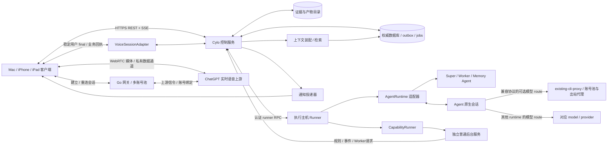
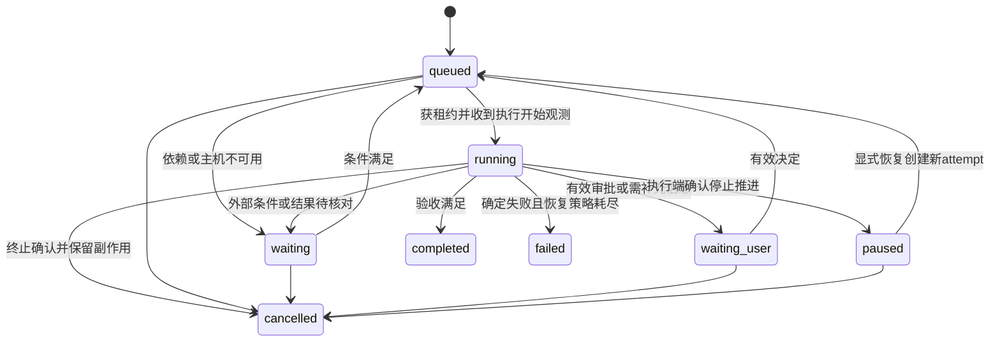
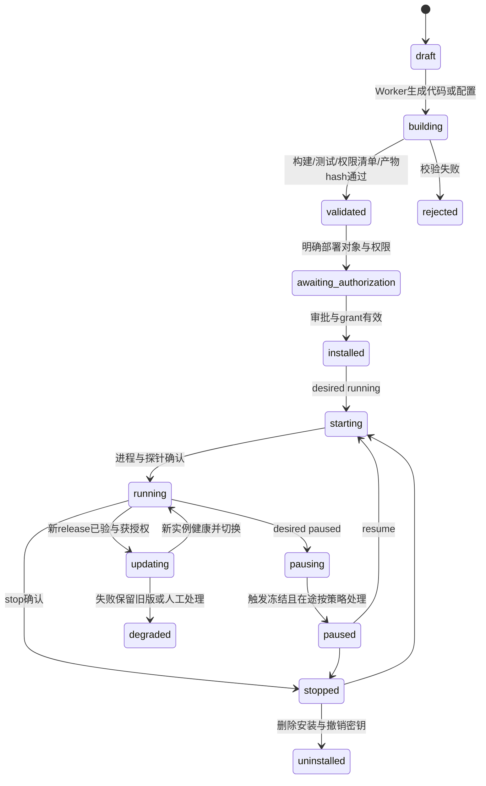

# Cylo overall implementation architecture and implementation contract
Study date: 2026-10-21. This article is an implementation decision draft and does not represent existing running code. Taking the fully read ["Cylo-Complete Product Requirements Manual.md"](../product-requirements.md) as the highest product basis, the product will be renamed Cylo; the latest range will cancel the official Codex Desktop App support, the first phase of server and execution host uses Linux, retaining macOS client/browser, user's own use of CLI and cross-environment backup and export migration; subsequent on-demand evaluation of macOS background operation will not be included in the first phase of acceptance; the old "codex-super-agent-requirements-and-architecture.md" only retains the compatibility principle, and the "all requests go through Super" and "Codex is all Agents" in the old solution are not true. This article also supplements the key design of the original independent reliability study; the specific source code evidence of arrangement and speech can be found in the special report in the same directory.
## 1. Decision Summary
| Problem | Main Decision | Alternative Routes and Triggering Conditions |
|---|---|---|
| Application structure | Cylo control service and runner-first Go; modular monolithic control service, React responsive PWA, versioned JSON Schema contract | No microservices will be dismantled without throughput evidence; AO and Space are accessed through API/events, independent storage and permission boundaries |
| Authoritative data | Single-machine SQLite WAL, local disk, control service only business write port; transaction outbox and durable jobs are in the same database | Multi-node control plane/team write concurrency needs are migrated to PostgreSQL; SQLite is not placed in NFS [S3] |
| Background operation | The first phase of Linux systemd management daemon service, the execution host runner holds the process and working directory | Docker is not required to use the local development environment; multi-tenant execution uses Linux container/VM isolation |
| Agent integration | `AgentRuntime` adapts to the selected AO; reuse orchestrator/worker, native ID/resume and host/reconcile, fixed version acceptance basic CLI execution/stop viewing/recovery; manual takeover is optional | AO already has TUI/Chat path, access according to actual needs; app-server path must verify the experimental/production support boundary [S1] |
| AO / Cylo authority | AO manages multiple Agent runtimes, code execution and native sessions; Cylo manages business ledgers, memory, authorization, long-term common services and voice pool scheduling | There is only one owner for the same execution; default dangerous permissions, fresh fallback, and ForceDestroy still need to be restricted and accepted. AWS CAO/07 reserved for historical research |
| Codex account and network | Reuse the account pool and outbound proxy of the existing remote CLIProxyAPI (document alias `existing-cli-proxy`), and each Codex route is selected by the proxy | AO does not need to repeatedly rotate the pool; Space uses an independent voice pool; the native history and workspace still belong to the execution host |
| Client | PWA first completes the Mac/iPhone/iPad same business connection, front-end voice | If the lock screen continues to voice, system notification behavior, audio routing test does not meet product goals, add SwiftUI native iOS/iPadOS client, reuse service contract |
| Voice | Adopt chatgpt-web-voice's real-time voice upstream, Go gateway and multi-account pool; VoiceSessionAdapter bridges Cylo command/receipt | Complements stable submission, business result injection, account stickiness/concurrent lease/quota status; private protocol capabilities are subject to source code and real POC; standalone STT/TTS is only a fallback for degraded operation |
| Memory | Separation of original evidence, confirmed decisions, execution facts, and inference; Memory Agent only produces proposals/indexes | FTS starts with embedded retrieval and then added; vector library is not an authoritative fact library |
| Long-term capabilities | Immutable release + deployment + independent service instance; deterministic program runs on its own | Agent creation code and service deployment are authorized separately, and containers are not the only cross-system release format |
The complete required scope retains long-term capabilities, memory, basic CLI execution and saved session recovery; manual same-thread seamless takeover and two-way handover are listed as optional enhancements according to the latest decision, and do not block the initial phase or required scope acceptance. Prioritize automatic Super splitting, independent workers, multiple worktrees, long tasks/background services, persistent recovery, products and costs. Users have clearly adopted AO; Space will continue to be retained, and Cylo’s new server will give priority to Go. The existing CLIProxyAPI has been used as a reuse object for the Codex account pool and outbound proxy, and there is no need to create a new service for the same purpose. Users report that their current Codex login and use can use a proxy; this article has not tested this environment, nor has it been confirmed that account-by-account logins have been automatically isolated.
## 2. Deployment topology and boundaries

**Minimum deployment**: One always-on Linux host; one control service process (API, scheduling loop, outbox, memory job module), one runner process, local SQLite, local product directory, selected Agent external process, fixed version of Go voice gateway and its account storage. The gateway is responsible for upstream signaling and account control, and existing audio media is directly connected to the upstream; the HTTP gateway cannot be regarded as a relay that can intercept existing media. It can be co-installed, but the runner does not have the same life cycle as the HTTP request. PWA static resources are served by the control service. The network defaults to LAN or authenticated private network; remotely uses TLS. Independent services are managed by OS supervisor, which controls process crashes without killing deployed services; the runner/service will report after reconnection. The user workstation sleeping does not mean that the server is available. The UI displays the execution host offline and the last observation time, which is not called "continuous execution".
**Existing Codex agent boundary**: Reuse `existing-cli-proxy` without having to install an agent in the minimal deployment. AO executes the host configuration `codex_route.api_endpoint` and `codex_route.api_key_secret_ref`; the endpoint must be reachable from the host, the real address and key are provided by the deployment configuration, and the key is only dereferenced on the server side. This alias does not represent a confirmed API address or port. CLIProxyAPI is responsible for account selection and outbound network for model requests; AO does not perform another layer of account rotation within the same route. `CODEX_HOME`, native thread history, process and project/worktree remain in the execution host, and the agent does not undertake these recovery materials. Space’s account, lease and voice quota are managed independently.
**Extended deployment**: Linux always-on control plane + PostgreSQL + object storage + multiple Linux runners (macOS runner will be evaluated on demand later); the scheduler selects the host according to the resource lease; the notification/index can split the process; the team identity can connect to OIDC. Each executing host can only see authorized project and secret references. The remote CLI can log in to the same backend execution environment via SSH, using the same user, CODEX_HOME, project path and authentication; this is not an official App SSH or cross-host session relocation. Data migration of different execution hosts is still accepted according to §13. No Kubernetes, Redis, messaging middleware or specialized vector services will be introduced until there is no need.
Module responsibilities:
- `interaction`: Session, message, voice turn association and reliable ACK, no real process scheduled.
- `voice adapter/gateway`: Real-time session and account owner/lease, quota observation, private protocol event normalization and Cylo receipt annotation; no task/approval/memory authoritative write rights.
- `control`: project/task/dependency/plan, command verification, approval, strategy, state transition, budget, lease, event transaction; the only business authority.
- `dispatcher`: Read durable jobs, call runtime/runner, persistent observation, ordinary rules precede the model; Super only submits plan proposals.
- `runner`: Process and host resource observation, working directory mapping, execution isolation, cancellation, heartbeat, evidence upload; you cannot change the task to complete by yourself.
- `agent adapters`: Translate provider agreement, save session/thread/turn identification, capability negotiation and original events; do not create additional business task authority.
- `capability manager`: Build, release, configuration, authorization, desired state and health coordination.
- `memory/context`: Organizes proposal, retrieval and context lists, does not override control status.
- `notification/audit`: event-driven delivery, deduplication, auditing and data retention.
The TypeScript interface below only expresses language-independent contracts and does not require the control service to use Node. The implementation directory can use `cmd/control`, `cmd/runner`, `internal/domain`, `internal/adapters`, `web` and versioned contract directories; the specific Go tool chain and HTTP/database dependencies are being frozen. The client remains React/Vite, and the database uses SQL migration + parameterized queries. The original Node/Fastify control service recommendation has been replaced by the priority Go route; heterogeneous Agent/common services are still accessed through the JSON protocol.
## 3. Projects, tasks, conversations, native conversations
`Workspace` is the data and permission boundary, and one is pre-built for single-person installation. `Project` is the long-term goal, asset and knowledge boundary. A project has multiple tasks, conversations, and host checkouts. `Task` is the acceptance target; `TaskRun` is an actual attempt; `AgentSession` is the conversation execution history saved by the provider. A task can span multiple runs; an agent session can be repaired and reused later in the same task, or can be used in subsequent tasks through explicit association. Ending the run will not destroy the native session.
`Conversation` is a user communication portal that can span multiple projects; messages are associated with tasks/projects using independent link tables instead of putting tasks into the chat window. Voice `VoiceSession/VoiceTurn` belongs to the interaction layer and cannot be a container for task existence. The new device restores the conversation, target task, and business status; a new media connection is created, and the active microphone/WebRTC is not transferred.
The project primary key cannot use an absolute path: `project_checkout(project_id, host_id, logical_root, native_path, repo_url, branch, revision)` saves the mapping. Different paths after migration do not change the project identity. Git worktree isolates parallel write tasks, but is not a safe sandbox. For "the project just now", resolve candidates in this order: explicitly selected object → current session link → recent related tasks. If multiple valid candidates remain, ask the user to disambiguate; the model must not choose one and write to it.
## 4. Data model and invariants
The following fields are the minimum logical model and are not implemented DDL. Unless otherwise specified, the entity contains `id, workspace_id, created_at, updated_at, version`, the time is UTC, and the ID is a unique ID that does not rely on clock ordering; the external ID must be associated with the provider/host/account domain. All cross-entity references are verified to be the same as the workspace; project permissions are filtered before querying.
| Entity | Core Fields/Constraints |
|---|---|
| identity / membership / device | principal, workspace role, device public key/session revocation time; device is not an authorized principal substitute |
| project / project_checkout | name, status, scope; host mapping, repo, revision, path; multiple worktrees of the same repo are not automatically treated as new projects |
| conversation / message / message_link | actor, client_message_id, body_ref, reply_to, project/task links, transcript_ref; `UNIQUE(workspace, device, client_message_id)` |
| command | actor, device, kind, target, payload_hash, idempotency_key, expected_version, status, accepted_at, applied_at, outcome_ref; same idempotent key but different payload returns conflict |
| task / task_dependency | goal, acceptance_spec, parent_task, project, plan_version, status, wait_reason, desired_control, active_run; reject loop when DAG dependency is created |
| task_run | task, attempt, executor, host, session, provider_turn_id, status, lease_epoch, checkpoint_ref, error_class, started/ended; at most one activity with the same task is written to run |
| agent_profile / agent_session | role, provider, capability statement, model/config version; session provider_id, host/account, native_cwd, owned_by, last_observed_status, resume_locator |
| plan_revision / decision | Immutable plan, based on message/evidence, supersedes, validity time; decision is bound to the target version |
| approval / grant | action_digest, resource_scope, release_digest, plan_version, expires_at, policy_version; authorization and approval are clearly assigned to the execution subject |
| job / lease / resource_lock | due_at, trigger_key, attempt, retry_policy, owner, epoch, expires_at, resource_key; job trigger key is unique |
| operation | run/service, external_effect_key, request_digest, provider_receipt, intent/dispatch/confirmed/unknown, reconcile policy |
| event / outbox | stream_id, stream_seq, event_id, aggregate/version, schema_version, type, payload_ref, cause, correlation; written within transaction |
| consumer_cursor / device_cursor | consumer, stream, acked_seq, stream_epoch; advance after the event is applied |
| capability / capability_release | purpose, owner, source; immutable digest, manifest, artifact, test evidence, permission statement, dependency, migration/rollback statement |
| deployment/service_instance | capability/release, host, config_version, secret_refs, grant, desired_state; observed_state, health, heartbeat, supervisor_id, generation |
| service_invocation / schedule / trigger | deployment, trigger_key, job/task link, run_result, checkpoint; cron/timezone, misfire_policy, dedupe_key |
| evidence / artifact | Type, content_hash, storage_uri, producer_run, source_event, collection time, sensitivity level, retention rules; large logs will not be filled with event payload |
| memory_claim / memory_revision / evidence_link | scope, subject/predicate/value, authority_kind, status, valid_from/to, recorded_at, supersedes, evidence, confidence, extractor_version |
| context_manifest | run, project/authorized version, selected claim/decision/evidence ID and hash, search conditions, token budget, clipping and conflict description |
| voice_session / voice_turn | conversation, owner/device, provider/native IDs, account_ref, lease/generation, media status, last_observed_at; turn saves role, original item ID, revision, completion evidence, command link and submission status |
| voice_account / voice_account_lease / quota_observation | SecretRef, available/cooling/exhausted/authentication exception/unknown, concurrency upper limit; atomic slot lease and media termination evidence; quota source/original error/observed_at/reset_at or unknown, cannot be derived from JWT expiration |
| usage / notification / audit | Provider usage, reservation and estimate identification; notification logical key/channel receipt/read; actor/action/resource/result/evidence association |
Mandatory invariant: The final task is not directly restarted as the original run, but a new attempt/explicit follow-up task; the task "completion" must have an acceptance record. `agent turn completed` only ends the model turn. Granted permissions cannot be extended by the model. Manual decisions can only be modified by command with authority. Summary without fact checking cannot produce fact level promotion. All business state changes, events and subsequent jobs are written in one database transaction.
SQLite `foreign_keys=ON`, WAL, `synchronous=FULL`, local disk, busy timeout, short transaction; start to verify the actual configuration, and persistent ACK will only be returned after the transaction is submitted. NORMAL may lose confirmed transactions due to power outage in WAL mode, which does not meet the durable reception commitment of this solution; FULL still relies on the OS/hardware to fulfill sync. If macOS is supported in the future, whether F_FULLFSYNC is required must be separately verified by the platform. The process exit experiment does not prove the durability of power outage. A control write queue, the runner does not directly open the database. WAL only supports shared memory coordination with the host and only one writer [S3]. The product first writes a temporary file and fsyncs/atomically renames it, and then releases the reference after registering the hash; the existence of a database reference does not mean that the file is available and needs to be verified. Organization expansion uses `(workspace_id,id)` combined foreign key/unique constraints. PostgreSQL will subsequently add row-level strategies and cannot rely solely on front-end filtering.
## 5. Unify task status, execution facts and ACK
The task status maintains eight product states: `queued/running/waiting/waiting_user/paused/completed/failed/cancelled`; `wait_reason` explains dependency, host_offline, effect_unknown, budget, and verification. "Unknown" in recovery coordination remains in run/operation instead of forging failed or running.

run can be `prepared/starting/active/interrupting/stopped/succeeded/failed/lost/unknown` . The user clicks pause to update the `desired_control=pause_requested` concurrent command first; mark paused after observing the stop and checkpoint available. When the bottom layer only supports interrupt, the UI explains that this is "stopping the current execution and resuming later" and does not pretend that the process is frozen. Cancel and interrupt do not roll back files, sent messages, or third-party side effects.
There are four levels of message and command confirmation:
1. `received`: The transaction submitted the original message, command and queued job, and returned `202 + command_id + receipt_event`. It is possible to ACK even if the model has not been called yet.
2. `applied`: The target version has been updated, or the runtime confirms that additional input is accepted; return `applied_to` to indicate plan/task/runtime_turn. Not "the model already complies with the requirements".
3. `rejected/expired/conflict`: permissions, expired approval, old version or inoperability; reasons for retention, the client does not resend indefinitely.
4. `outcome`: The actual execution and acceptance results of the business are read through the associated task/operation. Do not treat provider RPC success as business completion.
Retrying with the same message will return the same receipt; after the API submission times out, query using the same idempotency key, and do not blindly resend with a new key. Two modifications to the same task are compared using `expected_version`. The second one returns 409 and the current version, and the user can review it again. Ordinary status queries, explicit stops, and health checks are performed by the program; Super is awakened only by new targets/ambiguities/cross-domain blocking.
## 6. API and event contracts
Transport version `/api/v1`, command/event JSON Schema independent version, server verification schema and permissions. Example interface:
```text
POST /api/v1/commands
  {idempotency_key, kind, target:{type,id}, expected_version?,
   conversation_id?, client_message_id?, payload}
  -> 202 {command_id,status:'received',receipt_event_id,stream_cursor}
GET  /api/v1/commands/{id}
GET  /api/v1/projects/{id}/tasks?updated_after=...
GET  /api/v1/tasks/{id}                 # authoritative version, observed_at
GET  /api/v1/tasks/{id}/runs/{run}/evidence
GET  /api/v1/sync/snapshot              # cursor水位与同一DB快照中的投影
GET  /api/v1/events?cursor=opaque       # SSE; cursor绑定workspace/stream epoch
POST /api/v1/device-cursors            # 应用成功后ACK
POST /api/v1/approvals/{id}/resolve    # command语义, action_digest + version
GET  /api/v1/agent-sessions?project_id=...&discover=true
POST /api/v1/agent-sessions/{id}/handoff  # prepare/release/claim；仍受能力协商
POST /api/v1/capabilities/{id}/releases
POST /api/v1/deployments               # digest/config/grant/host，返回command
GET  /api/v1/services/{id}             # desired/observed/health同时返回
POST /api/v1/memory/proposals/{id}/resolve
POST /api/v1/voice-sessions            # owner/grant检查+账号slot预留，再调用网关建媒体
POST /api/v1/voice-sessions/{id}/turns  # 角色/稳定完成证据/顺序/修订+command幂等
POST /api/v1/voice-sessions/{id}/close  # 关媒体与确认；与停止task分开
GET  /api/v1/export-manifests/{id}
```
All POSTs that generate actions (including approval and deployment) enter the command processor uniformly; the above dedicated paths are only typed appearances and do not bypass idempotence and auditing. Uploading/downloading requires scope verification, and files cannot be read directly based on the local path given by the model.
```json
{
  "schema_version": 1,
  "event_id": "evt_unique",
  "stream_id": "workspace:ws_1:access_epoch_7",
  "stream_seq": 184,
  "type": "task.state_changed",
  "aggregate": {"type": "task", "id": "task_1", "version": 12},
  "occurred_at": "2026-10-21T10:00:00Z",
  "recorded_at": "2026-10-21T10:00:01Z",
  "actor": {"kind": "runner", "id": "host_1"},
  "correlation_id": "task_1",
  "causation_id": "cmd_1",
  "payload": {"from": "running", "to": "waiting", "reason": "host_offline"}
}
```

Core events also include `command.received/applied/rejected`, `message.persisted`, `run.observed`, `approval.requested/invalidated/resolved`, `operation.unknown/confirmed`, `evidence.registered`, `service.observed/health_changed`, `capability.release_verified`, `memory.proposed/revised`, `notification.created`. Voice delta and original large logs use temporary media/log channels. Only final transcript, turn results and evidence index enter the persistent business flow to avoid high-frequency audio from crowding out status updates.
### 6.1 Disconnection recovery must be closed loop
Each grant flow has an intra-transaction assigned monotonic `stream_seq` , unique key `(stream_id,stream_seq)` ; it cannot be sorted by timestamp or directly assumed that PostgreSQL auto-incremented IDs equal commit order. The stream counter is updated within the SQLite transaction; the stream counter row is locked during PostgreSQL migration and a sequence number is assigned before submission. The server reads/traces from the event table, and the outbox is only responsible for external delivery, and does not determine whether the event exists if the memory broadcast is successful.
The client first obtains the snapshot (the water level N and the projection are in the same read transaction), then requests the `>N` event, and then applies the idempotent application one by one to atomically store the projection and cursor in IndexedDB. SSE `id` and `Last-Event-ID` have a standard reconnection mechanism [S2], but the fact that the browser has received the event does not mean that the application has been placed on the disk; the client uses its own cursor for each new connection and does explicit ACK, and cannot only rely on the EventSource memory cursor. Duplicate events are acceptable, but missing events are unacceptable. The projection only accepts consecutive serial numbers and higher aggregate versions. If gaps are found, request filling.
When the event retention period expires or the ACL changes, `cursor_reset_required` is returned, and the authorization snapshot is taken again; permission revocation switches access_epoch and the device cache is cleared. Different visible sets of team members use different authorization flows or delivery visible progress markers, and filtered events cannot be mistaken for network packet loss. The client always displays `last_synced_at/offline`; offline drafts are clearly "to be sent", and unconfirmed actions that have taken effect are not displayed when disconnected. Push notifications only wake up and locate, and query the latest objects after opening; expired approval cannot be executed directly from old push.
## 7. Replaceable execution interface
Business task/run → AO session → agent native session is explicitly mapped, and runtime, model/provider/route, host/worktree and recovery mode are recorded; business tasks are not equal to execution sessions. AO already has multiple runtime recovery adapters, which are prioritized for reuse and do not develop separate Codex resume patches first. CLIProxyAPI only accepts the selected compatible protocol route and does not require all Agents to go through Codex. For specific source code and differences, see [Multi-Agent and Model Routing Boundary](16-ao-agent-provider-boundaries.md).
The interface is a business adaptation abstraction and does not claim that all vendors have all capabilities. Unify `capabilities()` to clarify the supported/unsupported/experimental and version; disable the operation if it is not supported, and cannot rely on simulated text to claim support.
```ts
interface AgentRuntime {
  capabilities(): RuntimeCapabilities; // discover/read/resume/steer/interrupt/usage等
  discover(filter: SessionFilter): Promise<SessionPage>;
  inspect(session: SessionLocator): Promise<ObservedSession>;
  create(spec: AgentSpec, ctx: ContextManifest, grant: GrantRef): Promise<SessionRef>;
  resume(session: SessionLocator, claim: LeaseToken): Promise<SessionRef>;
  startTurn(session: SessionRef, input: Input, claim: LeaseToken): Promise<TurnRef>;
  steer(turn: TurnRef, input: Input, claim: LeaseToken): Promise<AcceptedInput>;
  interrupt(turn: TurnRef, claim: LeaseToken): Promise<ControlReceipt>;
  events(after?: ProviderCursor): AsyncIterable<RuntimeEvent>;
  reconcile(ref: SessionLocator): Promise<ObservedSession>; // 不隐式重跑
}
interface VoiceSessionAdapter {
  capabilities(): VoiceCapabilities; // realtime、stableUserFinal、receiptInjection逐项标证据
  open(spec: VoiceSpec, grant: GrantRef): Promise<VoiceSessionRef>; // 内部原子账号slot租约
  observe(ref: VoiceSessionRef): AsyncIterable<VoiceObservation>; // 原始role/item/revision/完成证据
  submitTurn(ref: VoiceSessionRef, turn: StableUserTurn): Promise<CommandReceipt>;
  relayReceipt(ref: VoiceSessionRef, receipt: BusinessReceipt): Promise<InjectionObservation>;
  interruptOutput(ref: VoiceSessionRef, generation: number): Promise<OutputStopObservation>;
  close(ref: VoiceSessionRef): Promise<MediaCloseObservation>;
  reconcile(ref: VoiceSessionRef): Promise<VoiceObservation>; // unknown不自动释放slot
}
interface CapabilityRunner {
  validate(release: Digest, host: HostRef): Promise<ValidationReport>;
  install(spec: DeploymentSpec, grant: GrantRef): Promise<InstallReceipt>;
  setDesired(instance: InstanceRef, state: DesiredState, generation: number): Promise<Receipt>;
  inspect(instance: InstanceRef): Promise<ServiceObservation>;
  logs(instance: InstanceRef, after?: Cursor): AsyncIterable<LogChunk>;
  uninstall(instance: InstanceRef, retention: RetentionPolicy): Promise<Receipt>;
}
```
Credentials only enter the adapter as SecretRef/short-lived credentials, not the context. The voice account credentials are dereferenced by the gateway backend, and the permanent token cannot be sent to the browser through the above interface; the session temporary materials required by the upstream are separated from the Cylo login. `relayReceipt` is a Cylo adaptation abstraction. Currently, the upstream only has private text back-annotation candidates for `author:user`, which does not mean that the tool_result/system channel already exists. The original provider event is retained, and the mapped RuntimeEvent must contain native IDs, original source, observed_at, and provider version. When the provider does not have a replayable event cursor, it cannot be fabricated; after the control service is disconnected, inspect + pulls the history to make up for the account. If the continuity cannot be proved, it will be marked as gap/unknown, and items that require manual verification will be retained.
### 7.1 Codex Example: Basic CLI recovery with optional native handover
The official current document provides `thread/list/read/resume`, history paging, `turn/start/steer/interrupt`; `thread/list` and the default `sourceKinds` only have cli/vscode. It is found that Cylo-initiated sessions must explicitly include appServer/exec, etc. [S1]. `thread/resume` is for saving session recovery and does not prove that active sessions can be preempted; the official desktop App found that it is not within the current acceptance range. The current documentation still writes that the app-server command and WebSocket transmission are experimental and do not support production; prioritizing stdio does not mean that experimental risks have been eliminated.
Basic execution and recovery must fix the Codex CLI version, account/authentication domain, configuration directory, host, cwd, and native thread ID, and verify true execution, stop viewing, persistent recovery, and single-write protection. The following artificial two-way connectivity matrix is ​​only accepted if this optional enhancement is selected and claims "native connectivity":
| Scenario | Acceptance Evidence |
|---|---|
| Cylo → Linux CLI | The text sequel has been synthesized through the same machine isolation CODEX_HOME and fixture provider; the real model/tool/approval and code target still need to be accepted |
| Linux CLI → Cylo | The app-server reads back and completes the third turn after the second turn of the official interactive CLI of the same thread; the discovery/project association created independently by the CLI still needs to be accepted with the real tool |
| macOS native CLI ↔ Cylo (on demand later) | Currently not verified on the actual machine; if it is included in the macOS execution host in the future, the same native session/workspace, real tools and approval recovery will be accepted; Mac access to the Linux execution environment through SSH will not be affected |
| Concurrency and interruption | External active sessions can only be read-only; single write after clear handover, no repeated execution; external lock bypass can detect and stop dispatching |
| Upgrade/Migration | The native history can be restored after the fixed version is upgraded; changes in different host paths will not be incorrectly associated |
For remote connections, priority is given to entering the same backend execution environment via SSH to run the official CLI, and check the user, CODEX_HOME, workspace and native session. Cross-environment data migration still requires independent backup/path/permission/native recovery acceptance (§13); the official App deep link, App SSH and host handoff are only retained in 02 historical data and are not relied upon by this solution.
The Linux three-turn experiment is completed directly by app-server and the official CLI. It does not prove that AO or CAO have the same end-to-end capabilities; AO native resume and interface conversion require independent acceptance. For the source code, see [09](09-agent-orchestration-alternatives.md). [07](07-cao-cli-handoff-plan.md) is only a historical CAO retrofit design.
If you choose manual handover: `prepare` Stop new turn→Interrupt/wait for the current turn to end→Check the workspace and external side effects→Save checkpoint and handoff package→Release lease→Continue with the native tool; in reverse, first observe that the native tool has stopped, then claim and reconcile. Cylo lease only binds Cylo's runner and cannot force the independent official CLI to respect local locks; when it cannot detect external writers, explicit user handover is required and automatic takeover is prohibited. Active session "seamless migration" is not part of the verified promise. If the threshold fails, the project path, git status, native resume command (only those that are valid in actual testing) and handoff summary with evidence can still be provided, which is marked as a downgrade continuation and is not equivalent to the native history.
Official [S1] states that app-server authentication has never been permitted for commercial or hosted services. This restriction applies to that authentication method, not to commercial Codex use in general; standalone local/open-source and team SaaS deployments must not share unverified authentication assumptions. Independently verify Sign in with ChatGPT/API key availability, terms and account isolation before hosting expansion. The ChatGPT account pool of the voice gateway cannot be used as the Codex authentication pool; the voice upstream and Codex use independent credentials, authorization and usage accounts.
## 8. Long-Term Memory: Evidence, Facts, and Versions Failed
Corresponds to CY-10-01 ~06, CY-11-01. The four layers are not four model contexts, but different permissions and search scopes:
1. Original history: messages, provider output, tool records, execution logs, file/document versions; save sources and hashes, and manage them according to retention policies.
2. Task working memory: goals, completed checkpoints, unresolved issues, dependencies and recovery summary; task status can still be checked in real time on task/run.
3. Project memory: requirements, ADR, background, historical decisions and applicable versions; not propagated across projects by default.
4. Global/organizational memory: Confirmed preferences, ongoing rules, long-term goals; retrieved by subject and organization scope, personal preferences cannot override organizational mandatory policies.
`authority_kind` takes `user_confirmed / execution_observed / imported_authoritative / model_inferred` and is independent of `confidence`. A high-confidence inference is still an inference. The execution fact must include operation/provider receipt/tool ​​exit and evidence. The scope of its statement is limited by the evidence: "The test command exited with 0" does not launch "The product has absolutely no errors". The imported document indicates the author/version/validation conditions, and the embedding similarity is not used to determine conflicts.
Memory Agent consumes `task.verified`, `decision.confirmed`, session end, a large number of new history or manual sorting requests; it only writes `proposed` after deduplication, extraction, and conflict detection. Deterministic deduplication/indexing does not call the model. Automatic sorting can generate summaries and candidate inferences with model identification, and cannot change task status, authorization, configuration, or user-confirmed decisions. Fact upgrade must be triggered by explicit authoritative input/execution of evidence verification or user command. Agent proposals include claim, evidence location, scope of application, validity period, relationship with existing claims, and uncertainty.
Example: `decision:d1=SQLite` takes effect at t1, `d2=PostgreSQL` is officially confirmed at t2, the same transaction sets `d1.valid_to=t2`, `d2.valid_from=t2`, `d2.supersedes=d1`, publishes decision events and rebuilds related indexes. Old facts are not deleted; querying "current database" only takes the current valid data, querying "last week basis" returns d1 according to valid time. `recorded_at` is separated from the effective time and supports subsequent supplementary recording of history. The summary/embedding record depends on the claim version and source hash. The source is withdrawn, revised, deleted, or the permissions are changed with the suffix `stale` and is rebuilt in the background. The authoritative version must be verified online before retrieval, and expired vectors cannot be continued to be injected. When the priority cannot be determined, retain `conflicted` and request disambiguation to prevent the latest AI summary from automatically overwriting the official decision.
Context assembly is a control service module that prevents each Agent from pulling the entire library without boundaries:
- First determine the principal, workspace, project/task and grant, and then check the authoritative task snapshot, effective decisions, and related operation status.
- Add current user instructions and clear constraints; filter by project/task, FTS + reference map is retrieved first, and semantic recall is added if necessary.
- Verify the ACL, validity time, source hash, and whether to withdraw the recalled entries; put the inference into an independent area with labels, and list the evidence of both parties for conflicts.
- Budget priorities: Security and Authorization→Current Goals/Acceptance→Current Status/Recovery→Effective Decisions→Relevant Evidence→Historical Context. If the budget exceeds the original long log, the original long log will be trimmed and the retrievable references will be retained. Key constraints cannot be silently truncated.
- Record `context_manifest`, including the actual injected version/hash, token estimate, gap and reason for cutting; sensitive materials are only given to authorized workers. If rights are revoked during operation, the next tool action will re-verify and stop further reading.
When the native Codex session already has history, only increments and references are injected to avoid repeatedly injecting the entire history. Project switching does not reuse irrelevant sessions. Super can obtain cross-task summaries, but cross-project data are also subject to permission restrictions. Model context compression does not alter the authoritative database and does not replace the original evidence with compressed summaries.
Deletion adopts tombstone + index removal + object/cache cleaning operation; audit retains the necessary minimum metadata and explains the legal retention rules. Replay the deletion list during backup and restoration to avoid "resurrection" of deleted data. Explicitly demonstrating that evidence is unavailable when the original retrievable history is missing cannot rely on vectors that have not been purged to reveal content.
## 9. Long-term capability lifecycle and independent services
Corresponds to CY-07, CY-09. `Capability` is the installable capability definition; `Release` is the immutable code/configuration template; `Deployment` is the installation of the specified host and configuration; `ServiceInstance` is the actual running unit; `Invocation` is a certain trigger. The update capability does not rewrite historical releases and does not display resident services as tasks that will never be completed.

The above describes the life cycle view; the database saves the release build status, deployment desired and instance observed respectively to avoid using a single enum to hide "expect to stop but the process is still active". `health=healthy/degraded/unhealthy/unknown` is independent of the running state. Service suspension is triggered by default, which does not mean that the process has been stopped; stopping requires confirmation from the supervisor, and pending/unknown is displayed without confirmation.
The minimum manifest should be machine-verifiable:
```yaml
schema_version: 1
capability: important-mail-monitor
release: sha256:immutable-artifact
runtime: python
entrypoint: ["python3", "-m", "mail_monitor"]
platforms: ["linux-arm64", "linux-x64"]
config_schema: schemas/config.json
secrets: [mail_read_token]
permissions:
  network: ["mail.example.com:443"]
  actions: ["mail.read", "cylo.worker.invoke:mail-classifier", "cylo.notify"]
triggers: ["webhook", "schedule"]
healthcheck: {kind: heartbeat, deadline_seconds: 90}
resource_limits: {memory_mb: 256, max_agent_calls_per_day: 20}
checkpoint_schema: schemas/checkpoint-v1.json
update: {mode: stop_then_start, rollback_safe: true}
uninstall: {retain_user_data: true}
```

The fields are just interface examples and do not guarantee that Python processes will have full kernel isolation on Mac. Dependencies require lockfile/checksum, platform conditions and reproducible installation instructions. The deployment process must include: requirements → generation/configuration → build and static verification → isolation testing → permission diff/behavior and cost description → authorization of specific release digest and config → installation → health verification → registration trigger → run. Authoring code authorization does not automatically grant deploy, send email, or read full disk permissions. Expansion of release permissions, changes in secret usage, and changes in external targets invalidate old approvals; whether updates within the same authorization scope are automatically executed is determined by the user's explicit update policy.
Example of email monitoring: a deterministic service saves the mailbox cursor, removes duplicates by provider message ID, and filters ordinary notifications by rules; semantic judgment calls the mail Worker, and only rule exceptions or cross-project coordination are escalated to Super. Each Worker call creates a task/run and inherits the service's minimum grant and budget. The service itself does not require Super to be online. When the control service is briefly unreachable, the service can only monitor deterministically and buffer bounded events under existing authorization and an unexpired bounded lease/short-term credential. If the lease expires without renewal, new external side effects stop; actions requiring new approval, a Worker, or budget wait, and the service cannot expand its own rights. Revocation immediately prevents new actions through the control plane. The enforceable time limit for offline instances depends on lease/credential TTL and enforcement at the resource. Once a long-term secret has been copied to a program, changing the control database alone cannot guarantee immediate revocation; the upstream credential must be revoked or the actual process stopped/isolated.
A service pause disables new triggers by default; it does not by itself mean that the service process has stopped. Before updating, save the old release/config/checkpoint and verify checkpoint compatibility. Stop triggering and process in-flight first. Confirm that the old process tree is stopped or resources are isolated, and then install/health check/switch. Parallel canaries are only allowed when there is no risk of mutually exclusive external consumption; email monitoring, etc. rely on resource locks to ensure single liveness. If it fails, you can return to the old binary, but the database is irreversibly migrated and the sent emails cannot be "rolled back"; the manifest must declare that the data is forward/backward compatible. If it cannot be rolled back, it will enter degraded and provide a recovery plan. By default, uninstallation confirms that the entire process tree is stopped, removes triggers, revokes credentials, and cleans installation files without force after saving the dirty product list. User data retention and deletion are independently confirmed; audit, release, and historical results are retained.
## 10. Durable job, failure recovery and side effects
Corresponds to CY-15. Scheduling work does not rely on memory queues: `job(status,due_at,trigger_key,attempt,lease_epoch,lease_expires_at,policy)` persistence; receiving the same transaction as outbox. Even if there is only one dispatcher on a single machine, lease semantics are implemented, which facilitates restart and multi-host expansion. Lease expiration indicates a need for reconciliation and does not prove that the old process is dead. The fencing token increments the epoch for each resource, and the runner rejects the old epoch request; the actual resource execution end must also reject the old epoch to prevent the old execution from continuing to write. Shells that have been started and can directly access files/networks will not stop because the runner rejects new requests; before handover, the old process tree must be confirmed to be terminated/isolated, or fencing must be forced by the resource side, otherwise it will wait for verification instead of redispatch. When a third party does not support fencing, it still requires idempotent keys or auditing, and cannot claim to be end-to-end exactly-once.
Control service restart steps:
1. Open a new recovery generation and suspend the distribution of new runs related to tasks/services that are considered active.
2. Read the job, run, operation, session, service and lease; ask the runner process identity (PID + start time + supervisor ID), provider status, workspace revision and external receipt.
3. If it is still active and the ownership is clear, resubscribe and resume observation; if it has ended, collect the results and accept them. Provider callbacks and query results are deduplicated by native ID.
4. If it is confirmed that it has not started, you can retry; if it is confirmed that it has been successful, only the result will be recorded; if the unknown result is unknown, it will enter waiting and be processed according to the reconcile policy of the operation, and will not be replayed blindly.
5. Repair the outbox and job status, check that old execution cannot continue to be written before releasing the resource lock; publish recovery events and real observation times.
External side effects use the `operation` ledger: persistent intent and unique effect key before execution → dispatch → call with provider idempotency key → save receipt → confirmed. Crash just after external success is a window that cannot be eliminated; if the provider supports query/idempotence, query or resend the same key; otherwise, mark unknown and verify. The email "timed out" is not "not sent", and new emails cannot be automatically sent. Tool calls generated by the model must also go through the ledger/policy layer and cannot bypass the back-end security guarantee.
Safe retry limits specify pure read, idempotent write or query operations, exponential backoff + jitter + maximum times/total time limit, and errors are classified as transient/permanent/auth/conflict/unknown. Infinite failure enters the dead-letter to be processed; retry the same business operation instead of creating a new effect key. If the external API continues to be unavailable, turn on the circuit breaker to isolate the connector without affecting unrelated services. Event delivery is at least once, and the consumer persists inbox deduplication; consumers who perform side effects first create intents and cannot "take action after ACK".
cron uses clear timezone storage, and the trigger key contains the schedule ID and logical time slot; after the host sleeps, it is processed by `skip / latest / bounded_catchup`. By default, the latest is used for monitoring instead of re-issuing each expiration reminder. DST and repeat webhooks tested independently. Service health relies on process heartbeat + meaningful probes. The existence of PID does not prove that the mailbox can be accessed; lost connection means unknown, not healthy. Automatic restart requires a rate limit to prevent crash loops.
## 11. Permissions, approvals, execution isolation and auditing
Corresponds to CY-14. The subjects are user, agent profile, service, and runner; the grant at least limits the workspace/project, resources, actions, environment, time, budget, and scope of sub-granting. Super can only propose a subset of calling permissions and cannot bypass the grant by writing natural language to the Worker. Policies are verified upon submission and before each actual tool action; long-term authorization is not a permanent exemption. After revocation, prohibit new actions, invalidate approval and short-term credentials, and request to stop related execution; clearly distinguish between prohibiting new actions, stopping in-transit requests, and irrevocable occurrences. Canceling the RPC response is not an external revocation certificate. Preserve the true state: authorization may be revoked, but an external action may already have occurred.
Approval and binding `action_digest + plan_version + target_resource + release_digest/config_version + expires_at`, and save the standardized parameters, parsed actual target/account/environment and grant/policy version; re-verify before actual distribution. Approval of two devices at the same time will only take effect once. Old notifications, plan changes, and permission diffs will cause approvals to expire; consent for operation A will not be transferred to operation B. Reading emails/sending emails, writing code/deploying services, and reading files/deleting files are authorized separately. There will be no repeated inquiries for reversible actions within the scope of the plan, and high-risk boundaries will only be requested for approval, taking into account both independent execution and controllability.
The reliability and safety failure matrix and evidence can be found in [05 Independent Review](05-reliability-security-operations.md).
Execution level:
- Trusted single-user local machine: independent working directory/OS user, minimal environment variables, and controlled tool proxy; the first phase is based on the actual Linux runtime acceptance; macOS native sandbox is left to be verified when subsequent platform support is provided. worktree is just parallel isolation.
- Self-generated programs/untrusted content: build containers or VMs without secrets; minimum authorized accounts, network allowlist, writable paths and resource restrictions after installation.
- Multi-tenant: Single-tenant independent Linux VM/container boundaries and credentials, runners cannot share user home directories; do not use the shared Codex configuration directory as a team identity system.
If a runtime can run any shell and inherit host permissions, the service layer policy cannot restrict it out of thin air. The startup environment/tool ​​entrance and system boundaries must be restricted; if it cannot be forced, it must be clear that the runner is in high-trust native mode and untrusted multi-tenancy should not be enabled. The default approval/sandbox bypass path of the selected AO's Codex adapter must not enter the main line; unsafe worktree forced cleaning cannot be reused.
Audit records command actor, grant/policy version, approval, input/target digest, runner lease, provider IDs, external receipts, result evidence, and errors. Keys and audio are not entered into the log by default; the data body and audit metadata are kept separately. Export, delete, restore, and permission changes themselves are also auditable operations. The context of external web pages/emails should be treated as untrusted data, and the instructions therein are not allowed to modify the control policy.
## 12. Client, voice, notification continuity
The PWA cache only stores necessary authorization projections and local drafts, and is cleared upon logout/revocation of authority; the server is still authoritative. macOS/iPhone/iPad share device-independent conversation/task IDs, read progress can be merged by user, and event cursor is by device. When logging in to a new device, take a snapshot first and then increment it, without copying the chat cache of another device.
WebKit officially supports the home screen Web App Web Push starting from iOS/iPadOS 16.4. It needs to be added to the home screen and request notification permission after user interaction [S5]; notification arrival is still affected by user settings and network, and push cannot be used as a reliable command transmission. Use the notification inbox as authoritative, the channel supports Web Push/APNs replaceability, deduplicate by logical events + recipients, merge ordinary progress, only key completion/blocking/abnormal active reminders.
### 12.1 The relationship between real-time voice, business submission and Super
Adopt [03 Voice Research](03-voice.md) fixed version of the ChatGPT Web real-time voice upstream and gateway, retaining its WebRTC media, private `oai-events` data channel, and account management/stickiness mechanism. The upstream assistant is responsible for real-time listening, speaking and dialogue questioning; Cylo persists user intentions, tasks, approvals and memories. Complex goals are handed over to on-demand Super, professional execution is handed over to Worker, and simple queries can directly read the authoritative status. The voice Agent does not own Cylo task status, authorization, or Worker scheduling. It is not a second Super or executor and has no Cylo credentials for business-writing tools; saying "completed" does not generate a completion event. Background tasks are independent of media, account switching, and voice assistant context.
**Off-the-shelf capability separate from retrofit. ** Upstream `client_tools=[]` has no verified instructions/function/Super bridge; empty model fields do not prove that an official Realtime model can be specified. The subtitles have role/direction/increment, and there is no final completion event for reliable transaction submission; after the microphone reaches the upstream directly, the assistant can respond independently first, and the existing `stop_speaking` does not prove that new responses are prohibited. The official API's `session.update`, tool result, sideband, or server VAD capabilities may not be ported to this private protocol fact.
The minimum bridge POC retains the main audio line, and adds `VoiceSessionAdapter`: record the original event and source → verify or replace the stable user turn to complete the boundary → verify the role/target/authorization and sequence → normalize the `(voice_session,turn,revision)` into a stable command idempotent key → submit the business transaction → return the command receipt, actual results and evidence association messages to the client. Partial/assistant subtitles/system comments do not send tasks. When there is no proof of completion, first display the pending submission or let the user explicitly confirm. Silent timeout cannot be used to infer reliable final. The user corrects and generates a new revision after final; if the original command has been received, use the change/cancel command and real status processing, and the executed intention cannot be silently overwritten. High-risk consent in the voice must be parsed to the current approval action digest, and ambiguity/expiration means rejection or requesting confirmation.
The minimum back-injection candidate is the existing private `relay_message` , whose message identity is `user` . The client's controlled bridge encapsulates the business receipt retrieved through the Cylo login channel into source traceable text, registers the injection ID and excludes user command extraction; it cannot be written as an upstream tool/system result. You must use a real account to prove that you can consistently report real results after injection, that numbers/negative words are not distorted, that you will not say "received" as "completed", and verify how to suppress/correct upstream first answers. When it fails, the business text results are still presented in the true state, and the backnote/private tool bridge continues to be modified; the independent TTS is only used as a clearly identified fault degradation and does not replace the real-time speech accuracy.
Only inject necessary task snapshots, user-visible results, and summaries filtered by project permissions into the upstream, and record context manifests; do not send secrets, complete projects, or all long-term memories to the pool account. Changing the account means a new upstream identity and potential data storage domain; upstream conversations are not reused across unauthorized users/projects by default. The account record available range and data retention policy, `history_and_training_disabled`, are false in the current source code, and it cannot be claimed that the gateway does not retain upstream history by default. Deleting a Cylo local record is not the same as deleting the upstream copy.
### 12.2 Account pool, quota status and switching
Upstream currently `Pick` is LRU, `PickByID` is sticky select, and has a 401 disabled path; not a full quota scheduler. The minimum new contract for the Cylo adaptation branch is as follows. All states have observation times and reasons:
| Mechanism | Implementation Rules | Acceptance Boundaries |
|---|---|---|
| Account identity and stickiness | `voice_session → owner/workspace/account_ref/upstream IDs`; Session creation, reconnection, and text/image assistance requests all verify the owner and use the bound account | Account ID is not an access right; account A’s conversation ID must not be submitted to account B to try to renew |
| Concurrent slots | Reserve slots atomically by account, and create sessions again. The default upper limit is 1. Configure according to actual measurement; record lease generation, heartbeat and session creation results | LRU update time does not count as exclusive lease; failure will only be recycled if it proves that the media has not been created. Restart/timeout will not automatically recognize the old stream as stopped |
| Quota observation | Record credential health, voice quota, rate limit, media health separately; quota available/depleted/cooling/unknown attached evidence/source/observed_at | `settings/user` success only proves that the token is alive; JWT exp is not a quota reset; when there is no real measurement API, the remaining minutes are displayed as unknown, and the local duration is an estimate |
| Error classification | Keep the desensitization evidence of upstream status/body/trace; 401 → authentication exception; 429 distinguish current limit/concurrency/quota first; network/5xx short backoff, auth does not retry infinitely | Currently, WM non-401 errors can be wrapped as 502, so the gateway must preserve diagnostic details; a 502 must not always trigger account switching, and a 429 must not automatically be classified as quota exhaustion. |
| Cooling and selection | First meet the owner's available range, quota/credential and slot, and then select the candidate LRU; set reset_at only if there is evidence of reset, otherwise there will be bounded backoff/low-frequency detection | Do not fabricate unified daily quotas and reset windows; display waiting/available text when all are unavailable, and do not consume accounts in a cycle |
| Exhaustion or failover | Mark the old media status → Locally stop input/output and request shutdown → Check unsubmitted turn / received command → Keep the old slot until confirmation → Select another account to create new media → Rebuild the necessary Cylo context | Clear reconnection interval; Do not promise seamless number change with the same media stream or the same upstream conversation; Received commands will not be retransmitted, and unsubmitted drafts are pending confirmation |
Account leases, session status, and quota observations are persistently associated with business commands; the media itself is not a recoverable DB object. If the old media cannot be queried/closed after the gateway is restarted, mark unknown, isolate the slot, require the client to reconnect for verification, or wait for a verified upstream period without any TTL claiming that the remote session is over.
### 12.3 Interruption, cross-device and undo
When interrupting, first stop/mute locally, clear the queued output, increment the generation, and then send the private `action_request:stop_speaking`, only accepting the attributable output of the current generation. The upstream media is not a ready-made TTS clip, and remote audio track cleaning/restoration and late audio isolation need to be tested; local suspension cannot pretend to be a successful remote cancellation. "Stop reporting" and "stop task" are independent operations; once a business command is received, it will not be revoked if interrupted or hung up. To clearly stop the task, authorization and stop confirmation must be obtained from the control plane.
In the same conversation, the device voice owner lease can be set. The new device will restore the authoritative business history and create new media. By default, the old device stream will be closed before being connected. If the old connection cannot be confirmed, the old connection unknown will be displayed. PWA only promises to open the mic explicitly in the foreground; detect track/AudioContext/connection and display the real status after locking the screen/system interruption/network switch, and the background task continues. Native clients are determined by target device testing results.
The gateway is placed after Cylo authentication, and account import/modification/deletion is decentralized from daily opening of the microphone; credential encryption, desensitization, and backup are separated, and unnecessary public network management entrances are closed. When canceling the session, refuse to create/control, notify the client to stop all microphone tracks/audio tracks and close RTCPeerConnection/DataChannel, record the confirmation. Existing media are directly connected to the upstream. Deleting binding/withdrawing tokens from the gateway cannot guarantee that the established media will be cut off. When it is necessary to force the server to revoke authority, first verify the upstream termination capability or add a controlled media relay before declaring its effect.
## 13. Backup, recovery, host migration and resource costs
Corresponds to CY-16, CY-17. The backup unit is not a sqlite file, but a consistent DB snapshot, content addressing product, project/checkout list, native session recoverable data (limited to official permission/support), service release/config, permissions and secret references, schema/provider version, deletion list, and verification manifest. SQLite uses the official Online Backup API or equivalent consistency mechanism [S4], and cannot only copy the main db and miss the WAL during operation. When creating a snapshot, the reference list is frozen and the product is pinned to prevent GC. The backup manifest is released only after the copy verification is completed; DB consistent snapshots do not automatically ensure that the object is consistent with the workspace. The secret is encrypted separately. Re-authorization or key import is required for recovery. The export does not contain plain text tokens.
It is recommended that personal starting goals are daily backups, retaining the last 7 days and 4 copies per week, and additional backups after key confirmation decisions/capabilities are released; this is a configuration goal to be tested, and it is not claimed that RPO/RTO has been achieved. An isolation recovery drill is performed before each release, triggering and outgoing are turned off by default, and hash, foreign keys, project path mapping, historical retrieval, permissions, and a task recovery without external side effects are verified. After restoring the old snapshot, first check the external effects that may have occurred after the recovery point, and do not directly resend the pending execution of the old database. Product and project files are covered according to their own backup policies, and the Git remote is not equivalent to uncommitted modifications/database backup.
The first phase of migration between Linux hosts (Mac→Linux will be accepted when subsequent platform support is provided): Freeze distribution→let the activity run safely stop/clear unknown→backup→copy data and release→remap checkout/secret/OS supervisor in the target→detect platform dependencies→restore the new host_generation→confirm the old host revokes the lease and stops side effects→re-enable triggering. Native processes are not migrated, and capabilities are rebuilt according to the manifest; when later involving macOS-specific application automation, the compatibility gaps need to be clarified, and Linux compatibility cannot be pretended. Restoring the service configuration does not mean that the execution state has been restored.
SQLite→PostgreSQL: Isolate the SQL dialect from the first version through the warehousing interface and explicit migration script; first stop writing and exporting logical tables and object manifests→import and verify row count/foreign key/hash→fix snapshot cursor/stream epoch resynchronization→grayscale read-only verification→cut and write. The default is not to double-write the two databases to avoid the need to bear distributed consistency. The event protocol and entity ID remain stable, the internal index/FTS can be rebuilt, and all leases are reconcile during operation without being redistributed directly.
Voice subscription fees/number of accounts, observable voice duration/limit status, Codex call usage and other API fees are recorded separately; the voice subscription quota cannot be used as Codex/API balance, or local call minutes can be used as the actual upstream deduction. Multiple accounts only add candidate resources, and subscription price increase/unknown quota/cooling can change the availability.
The budget is divided into user/workspace, project, task/run, service, and provider; the estimated maximum cost/concurrency slot is reserved before distribution, and is settled after the event is reported. The standard is estimated/actual/unknown. Exact hard dollar caps are not guaranteed when provider usage is delayed; what is enforced is that call count, concurrency, timeouts, and append dispatch are stopped, and charges for initiated calls may still be incurred. Enter waiting/budget when the budget is exceeded, and do not continue to distribute Super to explain the infinite loop. Ordinary status query, timing, health check, notification template and event merging do not use LLM; Memory jobs are triggered according to the incremental threshold. Indicators include at least LLM input/cache/output, management call proportion, retry, context token, budget error per task, queue lag, provider event gap, recovery time, notification repetition rate and service health. Log/object retention also has capacity and cleanup water level, and cannot be accumulated indefinitely.
## 14. Phased implementation of dependencies and thresholds
| Stages | Delivery and pre-dependencies | Acceptance that must be passed |
|---|---|---|
| 0 evidence and protocol freeze | Complete requirement ID mapping; fixed Codex/candidate version; JSON Schema; basic CLI execution/stop viewing/persistent recovery; upstream real voice/stable submission/receipt/two account quota switching and real machine POC | The basic CLI path gives actual test results; manual same-thread takeover is not a prerequisite; empty threads cannot be regarded as placed; persistent messages can also be confirmed without model calls |
| 1 Control and single-machine reliable closed loop | SQLite schema, command/outbox/jobs, authentication, task/run status, runner, basic PWA | Only one command can be sent repeatedly; disconnection/restart after submission will not be lost; there is no gap between snapshot and cursor; pause/cancel shows real confirmation |
| 2 Professional execution and official interoperability | AO AgentRuntime + Codex fixed version; a Super on-demand and Worker direct call; independent worktree; evidence acceptance | close the client to continue; the run ends without mistakenly marking task completion; Linux basic CLI call/stop viewing/recovery, real tools and necessary approvals; external active writers do not execute concurrently; manual two-way connection is optional |
| 3 Voice and cross-device | Real-time upstream/Go gateway, account slot/limit observation, stable turn and receipt bridging, notification inbox, device cursor; relies on stage 1 business contract | iPhone/iPad/Mac same task; interrupt and non-repetitive actions; run out of new media for account change and tasks are not reassigned; backend still runs after locking the screen; restart recovery events; record background recording restrictions |
| 4 Capability creation and independent operation | manifest/release/deployment, authorization, secret, supervisor, health, checkpoint; dependency stage 1/2 | Email monitoring still runs when Super is deactivated; rules are directly sent to Worker; timeout is sent without resending; upgrade failure can be verified/rolled back; uninstall and revoke authority |
| 5 Memory and context | evidence/decision version, Memory proposal, FTS/retrieval, context manifest; rely on authoritative events for stability | SQLite→PostgreSQL decision is not confused; inference does not upgrade facts; revoke/delete/old index is not leaked; task recovery does not rely on summary guessing status |
| 6 Expansion and Migration | Multi-runner, PostgreSQL/Object Storage, Organizational Identity/Isolation, Native Client Determined by Actual Testing | Linux inter-host reconstruction, offline host recovery, old epoch rejection; cross-tenant rejection; backup isolation recovery; authentication access to meet the deployment mode |
Phases 4 and 5 can be developed in parallel after the event/evidence contract is stabilized; there is no need to wait for the team to expand before the workspace field is implemented. Key authorization, backup, and operation ledgers are implemented starting from phase 1, and security and reliability cannot be postponed until the end. Each stage only performs tests to prove its contract, and does not rely on "Agent says success" for acceptance.
Minimum fault injection set: network disconnection after command commit; control crash after job acquisition; external write succeeds but crashes before receipt is persisted; runner lease expires but old process is active; two devices approve old approval at the same time; stream disconnection repeats/cursor expires; host sleeps and misses schedule; new release of capability fails healthily and old schema cannot be rolled back; memory source is revised/deleted; old host is still online during backup and restoration. Each item retains observable DB status, true side effect counts, and recovery results.
## 15. Not yet verified and blocking conditions
- Codex app-server is still experimental despite its rich interfaces; Linux basic CLI execution/stop viewing/recovery and real tools/approval still need to be accepted; independent CLI session discovery/reverse association, manual handover with threads are optional enhancements, and the necessary paths will not be blocked if not accepted. Official desktop apps, deep links, and official host handoff are not in scope and will not block implementation. The actual measurement of orchestration project 0.163.0 is only `thread/start(ephemeral=false)` and the session without turn will report `resume` after restart, so "return thread ID" is not a recoverable persistence submission point; a real historical session is required to verify the disk placement/restart. Do not create empty turns to bypass acceptance.
- `--remote`, Unix socket and WebSocket paths appear in the official CLI, and cross-host persistence guarantees are not deduced; stdio is still the minimum integration choice, and the stability field and overall maturity are judged separately.
- The current official authentication terms must be checked for the specific authentication surface and deployment type. The app-server authentication restriction does not establish a blanket prohibition on commercial Codex use. The hosting team will not use ChatGPT personal login by default.
- The delay, interruption, front and back switching and notifications of PWA audio on the current target iPhone/iPad model, network and system version have not been tested; if the target must lock the screen to continue the conversation, the native client project needs to verify the system capabilities first.
- If the macOS execution host is supported in the future, the strict network/file isolation and resource restrictions of its independent programs must be independently verified, and Linux container semantics cannot be copied; this does not block the first phase of Linux acceptance.
- External write operations without provider idempotent/queryable credentials cannot be implemented exactly-once in general; unknown must be visible and manually checked or business compensation must be used.
- RPO/RTO, performance/cost commitments are not currently achieved or all team sizes are supported; this report provides testable design and migration exits.
## 16. Primary information and evidence collection instructions
The external page of this report was actually retrieved on **2026-10-21**. Dynamic documents may be updated, and the snapshot hash and version need to be saved to implement freezing. Technology selection recommendations/thresholds belong to the decisions made in this article, and no links are used to masquerade as externally verified performance.
- **[S1] OpenAI Codex App Server**: [Official text](https://developers.openai.com/codex/app-server), [Actual read Markdown](https://developers.openai.com/codex/app-server.md). Supports stdio/Unix socket/experimental WebSocket, thread reading/recovery/source filtering, round control, approval, auth endpoints; the text clearly defines the boundary between command/WS experimental and commercial/hosted app-server authentication. Native UI interoperability is not guaranteed on this page.
- **[S2] WHATWG HTML Server-sent events**: [Specification](https://html.spec.whatwg.org/multipage/server-sent-events.html). `Last-Event-ID` and reconnection behavior do not provide application database submission ACK or business exactly-once.
- **[S3] SQLite Write-Ahead Logging**: [Official documentation](https://www.sqlite.org/wal.html). Native shared memory, network file system restrictions and single writers support single machine selection and limit migration conditions.
- **[S4] SQLite Online Backup API**: [Official Documentation](https://www.sqlite.org/backup.html). Running consistent backup mechanism; objects, secrets, and native sessions still require independent backup strategies.
- **[S5] WebKit Web Push for Web Apps on iOS and iPadOS** (2023-02-16): [Official article](https://webkit.org/blog/13878/web-push-for-web-apps-on-ios-and-ipados/). 16.4 The interaction authorization between the main screen Web App and the user does not prove the continuous sound collection in the background.
- **[S6] Apple Creating Launch Daemons and Agents**: [Official Archive](https://developer.apple.com/library/archive/documentation/MacOSX/Conceptual/BPSystemStartup/Chapters/CreatingLaunchdJobs.html). launchd job/KeepAlive; archived documents only support the design direction, and the specific OS version installation needs to be tested.
- **[S7] systemd.service**: [Official manual](https://www.freedesktop.org/software/systemd/man/latest/systemd.service.html). Basic supervisor semantics such as service type and Restart; durable business tasks are still responsible for Cylo.
- Candidate source code and version evidence: CAO `4e990a9` (v2.5.4) is verified by the editing staff; chatgpt-web-voice `6338ac478070aaa34bfe7a3c0469caf9e9174c02` is verified by the voice staff. For details, see the corresponding special report. CAO/07 retains historical research; currently AO `7c83bd68c1e60c85b6a90e3ffa1340c859e4a3ff` has been used (see 09 for source code evidence), Space continues to be the main line dependency, and the two have not yet completed product integration.
[S1] Current original text (`Auth endpoints`, scope is limited to app-server authentication of this page):
> If you’ve built a local or open-source application using Codex app-server authentication, you can continue using it, though we recommend migrating to Sign in with ChatGPT so users have greater control over and visibility into their usage. [...] App-server authentication has never been permitted for commercial or hosted services. We launched Sign in with ChatGPT to support these use cases [...].

SHA-256 of the content read in this report (S1 is Markdown, others are original HTML; only for evidence comparison, temporary downloads will not be used as product assets):
```text
S1 f879715bb0d440db60b71e7a5bfe1258d045520feabe3fc6b11847100c8d064b
S2 152975a1750efd6db3c0b572c5425a286ded7405e56e18bdf5602561b052e8c7
S3 f3467b530b883d4a00574fe1a898b3d121ed72764ae28cf66941080ac0badb9e
S4 306b6cca5c7c2f93b648040ae139f14d7d3221c0d16d79b5749e69d808382e04
S5 e6e32edfd3077b9a92cb3bf9eacf27c8c1f741987afa549c0420b1358d80f04d
S6 b1d06c31060d20542b8e36844a8008708a580986281d88ce0e946cfd07a8e6ee
S7 8b9e04d13a18329c395d9088ee32898fa3c27cc296d7bd84baa549f7344f5aea
```
