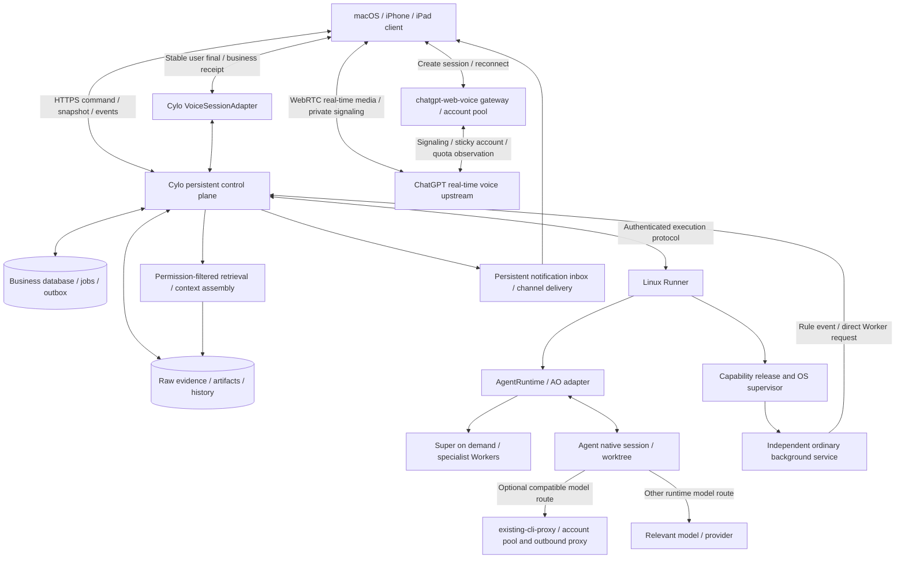

> Historical implementation research and architecture proposal dated 2026-10-21. Its implementation decisions and recommendations are preserved as they stood at that point; consult [the current master plan](../../master-plan.md) for the current plan.

# Cylo Implementation Research and Architecture Proposal

Research date: 2026-10-21. The product's current name is **Cylo**. This document uses the [Cylo Complete Product Requirements Specification](product-requirements.md) as its sole product baseline and integrates specialist research with the CLI continuation modification proposal. **Work completed so far consists of requirements, selection, design, and isolated experiments; product implementation has not started.** In this round, the user explicitly decided to remove support for the official Codex desktop app and, according to the latest priorities, downgrade manual seamless takeover of the same thread and complex handoff protocols to optional enhancements. Basic CLI execution, stop/view, and persistent recovery remain required. Phases, technology stack, and metrics are implementation recommendations.

**Implementation path at the time: adopt OrchestratorInc/agent-orchestrator (AO, Go) for orchestration of multiple Agent runtimes, code execution, and native sessions; reuse the existing CLIProxyAPI for the Codex account pool and outbound proxy; and build Cylo's own persistent control plane, preferring Go, to manage the business ledger, memory, authorization, long-running ordinary services, and voice-pool scheduling.** Invoke Super when needed; simple requests and ordinary services can call Workers directly. Continue using Space3044/chatgpt-web-voice for its ChatGPT web real-time upstream, Go gateway, and multi-account pool, adding quota scheduling and the business bridge. Basic CLI execution, stop/view, persistent recovery, real tools/required approvals, and the voice loop still need acceptance; bidirectional human continuation of the same native session is optional. The official Codex desktop app, discovery/deep links, and official host handoff are out of scope. The first release guarantees only Linux server and execution-host deployment and CLI execution/recovery, while retaining macOS client/browser access, users' independent CLI use, and cross-environment backup, export, and migration. macOS background operation can be evaluated later as needed and is not part of first-release acceptance.

**Decision status at the time: the user had explicitly adopted AO; the Space gateway, web real-time upstream, and voice account pool remained; Go was preferred for Cylo's new server.** This was an implementation decision, not evidence that AO permissions, recovery, cleanup, or business integration had passed acceptance. No parallel CAO adapter development was planned; the CAO source and modification research in [02 Orchestration and Codex](../reports/02-orchestration-and-codex.md) and [07 CAO CLI Handoff Plan](../reports/07-cao-cli-handoff-plan.md) remains historical context. Codex routes reuse the existing remote CLIProxyAPI (document alias `existing-cli-proxy`); AO does not need another deployment or to rebuild the account pool. The proxy selects and rotates accounts for each route. The user reported that current login and use can go through the proxy; this document did not test that environment and did not verify automatic per-account login isolation. Space's voice pool remains separate.

| User-designated candidate | Decision at the time | Basis and reusable scope |
|---|---|---|
| [OrchestratorInc/agent-orchestrator](https://github.com/OrchestratorInc/agent-orchestrator) (AO) | **Adopted base for multi-Agent work, code execution, and native sessions** | Reuse orchestrator/worker, isolated workspaces, native ID/resume, and host/reconcile; connect through the API/events. Constrain dangerous default permissions, fresh fallback, and forced cleanup; accept each behavior at a pinned version. Source details: [09](../reports/09-agent-orchestration-alternatives.md); implementation order: [10](../reports/10-cao-ao-comparative-poc.md). |
| CLIProxyAPI (existing remote instance `existing-cli-proxy`) | **Reuse Codex account pool and outbound proxy** | Configure a reachable API endpoint and server-side secret reference on the AO execution host. The proxy selects accounts within that route; AO retains execution orchestration and native session management. |
| [Space3044/chatgpt-web-voice](https://github.com/Space3044/chatgpt-web-voice) | **Adopt the real-time voice upstream, gateway, and multi-account ChatGPT pool; maintain a pinned Cylo adaptation branch** | Keep ChatGPT Web real-time media and private signaling; reuse account management, LRU selection, and session stickiness. Add atomic concurrency leases, quota-state observation, error classification/cooldowns, switching to a new session after exhaustion, stable user-final submission, and business-receipt bridging. The upstream has no ready-made Super/function bridge; the official Realtime protocol cannot be assumed. Substantial code copying must follow MIT. Details: [03](../reports/03-voice.md). |

Implementation is divided into three layers, with clear ownership between AO's internal session state and Cylo's business state:

| Layer | Scope |
|---|---|
| Reuse as-is | AO orchestrator/worker, separate worktrees, Codex TUI/Chat execution paths, native identity and recovery, host/reconcile; integrate according to behavior at a pinned version |
| AO adaptation and necessary changes | Map business task/run to AO session/host/worktree/native thread; constrain permissions, confirm real stopping, expose recovery mode, save and verify before cleanup; manual input exclusivity and handback can be deferred |
| New Cylo platform responsibilities | Authoritative tasks/evidence/authorization, cross-device clients, long-running service lifecycle, reliable memory, real-time voice gateway/account scheduling, and migration/recovery; AO session state alone cannot replace these responsibilities |

AO's actual tool approvals, input races, fresh fallback, forced cleanup, and production reliability still need verification or modification. Historical CAO patches in 07 must not be used as an AO implementation checklist.

## Reading Guide and Requirement Priorities

| Document | Review purpose |
|---|---|
| [01 Requirements Traceability and Acceptance](../reports/01-requirements.md) | Stable `CY-*` identifiers across all 22 chapters and scenarios A–E, original sources, ownership, risks, and acceptance; the complete-scope review checklist |
| [02 Orchestration and Codex](../reports/02-orchestration-and-codex.md) | Pinned source, CAO/official interface comparison, isolated persistence and CLI experiments, native handoff protocol |
| [03 Voice](../reports/03-voice.md) | Real-time upstream/gateway/account-pool source, Cylo bridge boundary, mobile limitations, and device POC |
| [04 Overall Architecture](../reports/04-architecture.md) | Detailed contracts for entity model, state machine, API/events, capability lifecycle, memory, and migration |
| [05 Reliability and Security Review](../reports/05-reliability-security-operations.md) | Recovery boundaries, authorization/isolation, fault-injection matrix, and production admission conditions |
| [06 Real-Time Voice Integration Review](../reports/06-realtime-integration-review.md) | Real-time voice business bridge and cross-document constraints |
| [07 CAO CLI Handoff Plan](../reports/07-cao-cli-handoff-plan.md) | Historical CAO modification proposal; no longer the current implementation checklist |

The old [Codex Super Agent Requirements and Architecture discussion draft](codex-super-agent-requirements-and-architecture.md) is retained only as history and is no longer effective alongside the newer version. The new plan is not “the old Super system with a new name”: routing every request through Super, making Codex responsible for all execution, and treating one session as one long-running task all fail to meet the new requirements. Passing a phase subset is not the same as passing the complete product.

## Recommended System Structure

For the first release, prefer Go for the Cylo control service to align server-side maintenance language with the AO daemon and Space gateway. The earlier TypeScript control-service proposal remains a historical recommendation. The client proposal is a React responsive PWA, versioned JSON Schema, local SQLite disk storage, and a separate runner. For the first release, manage the Linux server and runner as resident services with systemd. Once boundaries are clear, they can be installed in one package; microservices are not a prerequisite. Python Agents and ordinary programs connect through a protocol; the technology stack does not define product scope. The server must run on an always-on machine. While the host sleeps or is shut down, show it as offline and display the last observed time; do not claim execution is continuing.

Add PostgreSQL, object storage, multiple runners, and organizational identities later if experiments justify them. Keep workspace, principal, and project permission fields even in a single-user version; do not allow untrusted teams to share a host until tenant execution isolation exists. A remote CLI can use SSH to enter the same backend execution environment and continue with the same user, `CODEX_HOME`, project path, and authentication; this is CLI continuation in the same environment. Cross-host migration is separately accepted against backups, path/permission mapping, and native recovery materials; it does not depend on official-app SSH/host handoff.

The AO execution host connects to `existing-cli-proxy` using abstract settings `codex_route.api_endpoint` and `codex_route.api_key_secret_ref`. Deployment configuration supplies actual values. The endpoint must be reachable from that host; the secret is resolved only server-side and is never sent to the client or model context. The proxy handles model requests, account selection, and outbound networking. `CODEX_HOME`, native thread history, processes, and the workspace remain on the AO execution host, so migration must move the corresponding recovery materials too.

### 1. The Control Plane Owns Authoritative State

Distinguish `Project`, user `Conversation`, acceptably verifiable `Task`, one execution `TaskRun`, native `AgentSession`, long-running `ServiceDeployment`, and media `VoiceSession`. Closing a chat, losing voice, or finishing a Super turn does not end a task or service. Explicitly associate `task/run ↔ host/store/thread/turn/worktree`; map directory paths by host and do not use an absolute path as a project primary key.

A user message or voice final first enters a command with an idempotency key. After checking identity, permissions, and target version, write business intent, job, and event/outbox in one transaction, then return “received.” If an API times out, query/resend using the original key; reject different content with the same key. Separate `received`, `applied`, and actual `outcome`: provider acceptance of input does not mean the task completed or followed the requirement. Clients use a snapshot and incremental cursor at the same snapshot watermark; after disconnect, fill gaps, deduplicate repeats, resynchronize when a cursor expires, and expose stale state.

Keep the product's eight states: pending, in progress, waiting, waiting for user, paused, completed, failed, and canceled; also store `unknown` for runs and external operations. Pause/cancel is a desired command; display as stopped only after the execution side confirms. Interruption does not undo files written or email sent. A task is complete only after objective acceptance and result evidence; `turn/completed` or a terminal display is only an execution observation. Notifications need a persistent inbox, source link, deduplication, and severity; push delivery is not the sole source of truth.

### 2. Intelligent Execution and Official Continuation

Super handles complex goal understanding, planning, dependencies, and exception coordination, and returns a proposed plan for the control plane to validate and execute. Workers receive minimal context and tool permissions under a capability contract. Route deterministically, and use programs directly for time, scheduling, budgets, health checks, and ordinary status queries. Parallel tasks use separate worktrees/resource locks; integrated results require separate acceptance, and a worktree alone is not a security sandbox.

**First validate AO's automatic Super/Worker operation and basic execution recovery for the selected Agent.** Cylo stores mappings from business task/run → AO session → Agent native session, together with host/worktree and runtime/model/provider/route. Prefer reusing AO's existing recovery adapter; do not make separate Codex-resume development a prerequisite. Record, per Agent, whether recovery is native resume, fork, or fresh launch, and accept stopping, viewing, and artifact preservation. Real PTY human takeover and handback are optional future enhancements. See [Multi-Agent and Model Routing Boundaries](../reports/16-ao-agent-provider-boundaries.md).

The Codex examples below are a specific runtime integration, not an execution constraint for all Agents. AO has a Codex app-server Chat path; integrate it for structured events and per-tool approvals, rather than merely changing the provider name without decoupling terminal lifecycle. Its command and WebSocket are still marked experimental and unsupported for production workloads by the official project. If using that path, pin the binary/schema and accept thread/turn/approval/restart behavior, production support, and applicable authentication boundaries. The Agents SDK is an optional choice for Super/non-Codex Workers; it does not own task authority.

If optional manual native handoff is implemented later, its order is: stop new dispatch → confirm current execution/tools have stopped and side effects can be reconciled → save thread, tool configuration, workspace, and dirty-file evidence → release write ownership → continue in the official tool → have Cylo reread native history/Git/files and verify. A database lease cannot constrain an uncooperative official process. Do not automatically take over unless the old writer is proven stopped or the resource itself rejects stale generations.

A previous isolated Linux synthetic-text experiment for 02 tested the same `CODEX_HOME` and native thread: first turn through app-server → resume second turn in official interactive CLI → app-server reads both turns and completes a third. It proves text-history continuity between these two official entry points, **not that CAO supports native continuation**. The provider was a local fixture; real models, tools/approvals, and reverse association of sessions independently created by the CLI remain unverified. Local macOS execution integration can be evaluated later as needed.

An optional enhanced experience could provide “enter the same CLI / return to Cylo,” showing the session/thread, working directory, uncommitted changes, and actual state, while keeping a single input/execution controller; after exit, resume the same session through native recovery. Remote users can SSH into the same backend. Importing a summary, creating a new thread, or reusing only a tmux pane cannot individually pass same-session native recovery acceptance. If the CLI's manual continuation interface is unavailable, record that optional capability gap; it does not block required delivery. Basic execution, recovery, and safe stopping still must pass. Cross-environment data migration is accepted separately; official-app discovery, deep links, and host handoff are not dependencies.

### 3. Ordinary Programs Create Long-Term Capabilities

“Check email once” creates a terminable task; “monitor it from now on” creates a capability and deployment, with a separate invocation/task for every trigger. An immutable release should include a content digest, entry point, dependencies, platform, configuration schema, secret references, permissions, trigger type, health probe, resource budget, checkpoint, and upgrade/rollback conditions. Authorize code generation separately from installation and deployment.

The flow is: implement/configure → isolated build and test → show behavior, cost, and permission diff → authorize the specific release/configuration → install and verify health → register triggers → run independently. Handle rules directly, call a Worker directly for semantic events, and escalate complex events to Super. Super exiting should not stop monitoring. Updates, pauses, stops, recovery, and uninstall all require observation of actual process and credential state. Keep single-consumer services such as email monitoring single-active; rolling back a binary does not guarantee a database migration or prior side effect can be rolled back.

### 4. Preserve Evidence for Memory and Context

Store raw history/evidence, confirmed decisions, execution facts, and AI inferences in separate layers. Isolate global, project, and task memories. Give decisions an effective time, source, version, and `supersedes` relationship, so Cylo can answer “What did we choose before, when did it change, and why?” If a source is missing, say that the reason cannot be confirmed. A Memory Agent can make event-driven proposals for merging, linking, expiration, and contradiction handling, but cannot directly modify tasks, permissions, configuration, or formal decisions.

Start with relational indexes/full-text search and add vector search only if evaluation supports it. For each context assembly, record source IDs/hashes, permission version, trimming, and token use; filter access first, then rank relevance. Deletion/revocation applies to derived summaries, indexes, and caches as well; an old summary must not reintroduce deleted raw material.

### 5. Voice and Multi-Device Continuity

The main path is real-time two-way voice: the client establishes a ChatGPT Web voice session through the chatgpt-web-voice gateway; WebRTC media connects the client to the upstream and a private data channel carries subtitles/control; Cylo retains the business control channel. The gateway manages the account pool, and `VoiceSessionAdapter` associates media, the stable user final, commands, and task receipts. The upstream assistant handles natural listening/speaking and follow-up questions. Cylo's control plane owns persistent tasks, permissions, memory, and approvals; complex goals go to Super when needed, and specialist work goes to Workers. A spoken promise from the voice assistant is not evidence that execution succeeded.

The upstream has incremental subtitles distinguished by role/direction, but no reliable final event suitable as the basis for a transaction commit. After receiving microphone input, the assistant may respond autonomously first; preventing/correcting that first response must be proved in a POC. The upstream has LRU and account-ID session stickiness but no complete quota/lease scheduling. `client_tools=[]`, and there is no verified instructions, function, or Super bridge. First validate the minimum change: “stable user final → idempotent Cylo command → real Super/Worker result → return the business receipt through private `relay_message`.” In the existing protocol the returned receipt is user text, so identify its source and prevent it from being treated as a new user instruction; verify that the assistant reports it accurately. Do not claim access to the official Realtime protocol's system/tool/sideband features. Test private tool extensions separately. If final boundaries or receipt injection are not proven, first add visible submission/confirmation and a business-text result, and continue implementing the real-time bridge.

Bind each media session to an account and owner; default to one session per account and verify actual concurrency limits. Record quota source, observation time, errors, and cooldown. Success from `settings/user` only proves the token is valid; JWT expiry is not a quota reset time, and 429 must not always be treated as quota exhaustion. On exhaustion, stop the old media session and reconcile unsubmitted turns/accepted commands, then create a **new** media session with another available account and inject the current Cylo task/necessary summary according to permissions. Make the brief reconnect visible in the interface. Do not promise preservation of the same upstream conversation or an uninterrupted account swap in the same media stream. If termination of the old stream is unproven, preserve its slot as occupied/unknown; do not reuse it blindly because a lease timed out.

Show partial user subtitles only. Submit only a stable user final after normalizing turn/item/revision, checking order, and validating intent/target; send complex ambiguity or high-risk actions through Cylo approval. A duplicate final, returned receipt, or upstream assistant subtitle must not dispatch another task. A correction after final creates a new revision/change command; it does not undo an action that already happened. On interruption, immediately mute locally/clear queued output and send upstream `stop_speaking`; isolate late output from the old generation. “Stop speaking the report” does not cancel a background task; only an explicit task-stop request uses its separate command. Validate remote-track cleanup/recovery and latency in a real-device POC.

Across devices, restore the same Cylo conversation, task, and permissions, then create new real-time media. First validate the PWA with the screen foregrounded and explicit microphone activation; do not promise continued locked-screen calls in advance. Add native clients if needed. Trusted HTTPS, Cylo login/project authorization, and gateway-owner binding must apply to both session creation and control requests. Keep account credentials in the protected gateway backend; the frontend receives only temporary session material it needs. Revoking credentials does not prove an existing direct WebRTC session has ended. Independent STT/TTS is a failure-degradation option only; it does not replace real-time voice acceptance.

## Security and Reliability from the First Executable Task

- **Durable receipt:** Use SQLite on local disk with WAL, `foreign_keys=ON`, and `synchronous=FULL`, and verify that settings took effect; return a durable ACK only after the transaction commits. NORMAL does not support a promise that every acknowledged commit survives power loss. FULL still depends on the OS/hardware honoring sync; validate directory/artifact persistence and actual power-loss recovery in the target Linux environment.
- **Check before recovery:** Store durable jobs, leases, and outbox in the same database. After control-service restart, check process identity, native turn, workspace, and external receipt before deciding to retry. An expired lease does not prove the old process died. The actual resource must reject stale epochs; if any shell can write files/network directly, confirm the old process tree ended or was isolated. If that cannot be proven, wait and reconcile.
- **Side-effect ledger:** Durable intent/idempotency key → external call → receipt/result confirmation. A crash after sending succeeds but before the receipt is stored must allow an `unknown` result. Replay is safe only if the provider supports idempotency or lookup; otherwise wait for reconciliation or compensate. Do not make a general exactly-once promise.
- **Authorization at execution time:** Grants limit principal, resource, action, time, budget, and delegation scope. Bind approvals to plan/action/release/config digest and expiration. Super, tools, and background services all pass through execution-layer checks. Prompts are not a permission boundary. Separately accept high-trust local mode and untrusted/multi-tenant container or VM isolation.
- **Revocation has limits:** Immediately block new actions from network-connected execution. Offline services need short-lived credentials/bounded leases and must stop side effects when they expire. If a long-lived secret is copied into an arbitrary program, a control database alone cannot forcibly revoke it; do not claim immediate revocation in that mode. Voice media also needs an active disconnect/track stop or controlled relay; token invalidation does not end an established media session.
- **Backup and migration:** Keep a consistent database snapshot + artifacts/hashes + native recovery materials + service release/config/checkpoint + path mapping + separately encrypted secrets. While running, do not copy only the SQLite main file and miss the WAL. Pin snapshot-referenced objects against garbage collection. On restore, disable outbound actions by default and reconcile external side effects after the recovery point. For the first release, rebuild processes/platform dependencies between Linux hosts, stop the old host, then enable triggers. Execution recovery across operating systems awaits support for those target platforms; the existence of a backup file does not prove recoverability, so rehearse recovery in isolation.
- **Cost and observation:** Track ChatGPT voice subscription/account quota, Codex usage, and other model/API fees separately; unknown remaining quota is not unlimited capacity. Multiple accounts add schedulable resources but do not guarantee more total available minutes. Reserve budget before dispatch, limit concurrency/calls/timeouts, and label estimates versus actual usage. Provider billing delays prevent a guaranteed exact hard-dollar cap; stopping new dispatch cannot reverse in-flight charges. Preserve actual observation time, `unknown`, errors, recovery actions, and evidence. Do not let Super explain failures indefinitely while consuming more tokens.

See the implementation contracts in [04](../reports/04-architecture.md) and the fault matrix in [05](../reports/05-reliability-security-operations.md); these are conditions still to implement and accept.

## Integration and Functional Acceptance

| Priority / gate | Minimum experiment and evidence to retain | Action if it fails |
|---|---|---|
| B0 Basic CLI execution and recovery | In the target Linux environment, verify dispatch, real status/artifact viewing, stop confirmation, and saved-session recovery; retain task/run/session/thread/worktree and tool/required-approval evidence | Do not enable the corresponding automatic execution path until it passes; manual same-thread takeover and bidirectional handoff are not B0 gates |
| B0 Production interface and authentication | Pin the version for the chosen CLI or app-server path; for app-server also pin schema and verify approvals/steer/interrupt/pagination/restart; review official experimental-support risk; confirm supported login/API/SIWC integrations and account availability separately for local and hosted modes | Isolated POC may continue; do not release the corresponding production or hosted mode until support/authentication requirements are met |
| B0 Real execution and recovery | Persist first input; test process crash, surviving old shell, stale approval, external success with lost receipt; reconcile actual file changes and side-effect count | Do not enable autonomous long-running execution before safe recovery closes the loop; unknown must block explicitly |
| B0 Real-time voice and business bridge | Pin upstream SHA; use authorized accounts to establish real WebRTC/private-signaling sessions; submit each user final as one Cylo command; run Super/Worker and return/play the receipt; test two-account lease contention, 429/exhaustion/401/disconnect classification, new-session recovery with business context and no duplicate execution | Fix gateway/bridge item by item and rerun; document unsupported items while preserving the real-time voice path; do not claim complete voice capability before passing |
| B1 Mobile voice | On real iPhone/iPad/Mac, test Chinese, Chinese/English, negation, numbers, echo and double talk, VAD, interruption, network changes, lock-screen recovery, notifications, and cross-device continuation; measure p50/p95 and retain samples | Text remains usable; fix the real-time media adapter or start a native-client project; do not claim natural voice is accepted |
| B1 Autonomous capabilities and revocation | Three email fixture paths for rules/Worker/Super; service continues after Super stops; no side effects after disconnection exceeds TTL; failed upgrade and revocation on uninstall | Do not deploy autonomously generated services if the permission/runtime model fails |
| B1 Evidence, memory, and data | Decision change/missing rationale/cross-project denial/deleted old index/isolation backup restore/rebuild between Linux hosts | Do not claim reliable long-term memory or migratability before passing |

The voice gateway's ChatGPT account pool is only for the voice upstream; the Codex adapter uses a separate authentication domain and usage ledger. Never mix the two credentials. Candidate MIT licensing covers code reuse; verify actual account usage rights, quota, and deployment scope in P0.

A local personal application can be evaluated using the official supported local method. The [official app-server authentication documentation](https://developers.openai.com/codex/app-server) limits commercial/hosted use of **app-server authentication**; this must not be generalized into a ban on all commercial Codex use. Conversely, an open-source license does not grant the right to share personal subscription tokens. SIWC is an officially referenced migration candidate; this research did not obtain eligibility or prove it works.

## Acceptable Implementation Path and Dependencies

Implement along the single AO path and retain evidence at every step. Scope and acceptance order are in [10](../reports/10-cao-ao-comparative-poc.md); do not first run CAO and AO in parallel. To avoid confusion with specialist phase numbering, the table uses P0–P3 from [01](../reports/01-requirements.md). The more detailed stages 0–6 in 04 describe component order: 0→P0, 1–3→P1, 4–5→P2, and 6→P3. Basic security, backup, and the operation ledger continue from P1 onward.

| Phase | Deliverables and dependencies | Exit evidence |
|---|---|---|
| **P0 Blocking validation** | Pin versions/schema; run B0 POCs. First establish basic CLI execution/recovery and feasible authentication boundaries while validating real upstream voice, two-account stickiness/quota-failure switching, stable user final, and Super receipt bridge; then run a minimal real-device mobile-audio experiment | Explicit supported/failed/untested matrix; native ID/history and file evidence; decision on whether official support risk is acceptable; mark any item without credentials/device as untested |
| **P1 Trustworthy tasks and cross-device development** | Persistent command/jobs/outbox, tasks/runs/evidence, permission approvals, one runner, Codex adapter, basic PWA, real-time voice gateway/account lease/quota observation, and device synchronization; depends on corresponding P0 contracts | Repeated command causes one business action; work continues after client exit; same task on Mac/iPhone/iPad; cancellation shows real confirmation; development flow for scenarios A and D passes, with key failure windows from E tested |
| **P2 Long-running services and reliable memory** | Release/deployment/supervisor/secret/checkpoint, ordinary service → Worker, notifications, Memory proposals/retrieval/context; depends on stable P1 events, authorization, and evidence | Scenario B service continues without a Super session; C explains decision changes and missing rationale; D/E cover service and memory; update/revocation/uninstall/disconnected recovery can be reconciled |
| **P3 Full-scope and evolution acceptance** | Linux backend/migration recovery, replacement of heterogeneous models/Agents/voice, external-service fault isolation, future organizational boundary; add native clients based on real-device results | Retain evidence for every requirement in the full 01 matrix and rerun scenarios A–E; migrate between Linux hosts and restore isolated backups; replacements preserve authoritative data; explicitly block a complete-product claim for unimplemented scope |

Run low-cost P0 failures first to avoid a complete UI masking missing basic execution/recovery. P2 service and memory work can proceed in parallel after contracts stabilize. Engineering sequence does not remove required scope. Manual seamless takeover has explicitly become an optional enhancement; macOS background operation is outside the current first-release scope and can be evaluated later. Run meaningful integration and failure tests at each phase; an Agent's self-report of success is not acceptance evidence.

### How the Full Requirements Map to the Proposal

This table is a coverage index. Fine-grained acceptance is defined by each `CY-*` entry in 01; this table does not replace the source requirements.

| New specification section | Proposal responsibility and delivery |
|---|---|
| §§1, 2, 21, 22 | Module boundaries, long-term authoritative control, separation of intelligent/ordinary programs, full-scope exit; P0–P3 |
| §§3, 12 | Unified multi-device commands/snapshots/events, foreground voice, notifications, task continuity; P1–P3 |
| §§4, 15 | OS-resident operation, runner observability, persistent recovery, sleep/offline detection, migration; P1–P3 |
| §5 | CLI adapter, execution/stop/view/persistent recovery and artifact retention; validate at P0, deliver at P1. Manual same-thread takeover, bidirectional discovery/handoff, and automatic reread of external changes are optional future work |
| §§6, 8 | Super on demand, direct Worker calls, parallelism/dependencies, task/run, real acceptance and safe recovery; P1–P2 |
| §§7, 9 | Capability/release/deployment, independent service, events, lifecycle, deduplicated notifications; P2 |
| §§10, 11 | Four memory layers, source/version/decisions, Memory proposals, permission-filtered context; P1 foundation, P2 closed loop |
| §§13, 18 | Agent/model/voice/external-service contracts, fault isolation, organizational permissions, replacement drills; P1 design, P3 validation |
| §§14, 16, 17 | Least privilege/approval/revocation/isolation, audit and data control, backup/recovery/migration, budget/cost observability; continuous delivery from P1 |
| §§19, 20 | Cross-component scenarios A–E and all quality dimensions; retain phase evidence, complete P3 exit |

## Independent Verification Record and Research Boundaries

On 2026-10-21, the integrator independently completed the checks below and did not rely only on specialist-report summaries for decisive new facts:

| Check | Evidence and result | What cannot be inferred |
|---|---|---|
| Pinned source | Local `git rev-parse HEAD`: CAO `4e990a9d78b154ad76c6cf94c7b51e36fce69f21`; voice `6338ac478070aaa34bfe7a3c0469caf9e9174c02`. Directly read CAO `_build_codex_command`, `remove_worktree`, and voice `service.go`/`interruptAssistant`. | Future `main` behavior is not automatically the same; the full CAO fleet or voice gateway was not run. |
| Offline Codex recovery | Independently reran [orchestration-poc.py](../evidence/orchestration-poc.py), temporary directory `/tmp/cylo-research-repro-g6xu28u4`: after restart, an empty thread reports no rollout; after first input, same-thread recovery succeeds, history retains `userMessage`, and turn is `interrupted`; used an unreachable loopback fake provider. | No successful model/tool call; not a power-loss experiment; CLI screen continuation was the 02 author's experiment and the integrator did not rerun the PTY. |
| CAO forced cleanup | Independent temporary empty Git repo `/tmp/cylo-synthesis-cao-5oip6nrt`; imported pinned source directly to create a worktree and untracked file, then called `remove`; result `before True`, `after False worktree_exists False`. | Only proves loss of uncommitted/untracked files; does not prove unmerged committed branches are force-deleted; source branch deletion actually uses safe `-d`. |
| Simplified reliability experiment | Independently reran [reliability-probe.py](../evidence/reliability-probe.py), SQLite 3.40.1: process exit before/after transaction, online backup with active WAL, rejection of old epoch in database while direct file write remains possible, side-effect receipt gap with stable-key deduplication; all four PASS. | A simplified model with simulated provider does not prove full Cylo, power loss, macOS isolation, or real email recovery. |
| Static voice check | Independently reran [voice-static-check.cjs](../evidence/voice-static-check.cjs): syntax of two inline JS sections passed; upstream stop, repeat suppression, mute protection, and text interruption branches passed. | Does not prove DOM/WebRTC, actual audio interruption, Chinese recognition, or mobile experience. |
| Official voice API alternative comparison (not the web private protocol) | Re-fetched and received HTTP 200 for the [deprecation page](https://developers.openai.com/api/docs/deprecations) and [Realtime transcription guide](https://developers.openai.com/api/docs/guides/realtime-transcription): old TTS closes 2027-01-06, old transcription closes 2027-02-26; `gpt-live-transcribe` lacks server/semantic VAD and requires client commit. | Do not put the recommended Realtime model directly into old `/v1/audio/speech`; do not generalize to say all transcription models lack VAD; no real API/price experiment was done. |
| Voice-pool recheck this round | Actually reran [voice-pool-poc.py](../evidence/voice-pool-poc.py): pinned-source assertions, stickiness, slot exhaustion, clearing upstream IDs on account switch, old-epoch rejection, command deduplication, and isolation of unconfirmed media all PASS. | A single-process, serial in-memory mock does not prove real database concurrency, quota resets, reliable finals, accepted receipt injection, upstream calls, or tool interfaces. Details: [Real-Time Voice Evidence](../evidence/voice-realtime-audit.md). |
| Official authentication scope | Re-fetched the [app-server.md](https://developers.openai.com/codex/app-server.md) with HTTP 200 and confirmed directly that local/open-source use can continue, the commercial/hosted limits apply to app-server authentication, and the document points to SIWC. | Does not prove SIWC availability for this account/region/deployment or that any commercial/API integration is prohibited. |

This environment did not expose an official documentation-search or general web-search tool. An initial attempt to use the official site's internal search path returned 404, after which the official text above was fetched directly. The voice-specific review also saved [official source text and hashes](../evidence/voice-official-excerpts.md). Dynamic documentation must be checked again when implementation versions are frozen. Independent verification does not treat source-code presence as runtime success or offline first-input recovery as a successful model/tool chain.

No product runtime was coded or deployed. No Mac/iOS device test, real paid model/voice request, production power-loss/disk-recovery test, complete multi-tenant isolation, or end-to-end performance/cost acceptance was performed. Existing evidence supports the design direction and order of the next experiments; **whether the complete product is deliverable still depends on blocking items and full-scope acceptance.**
