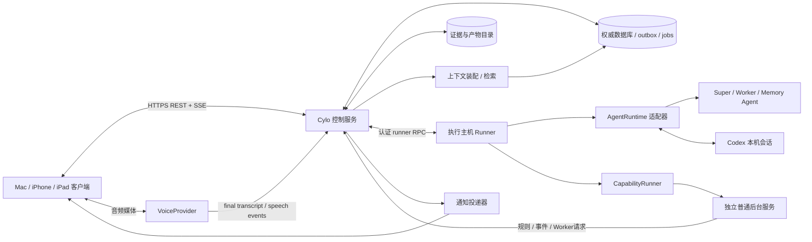
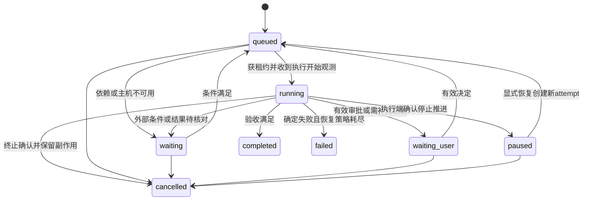
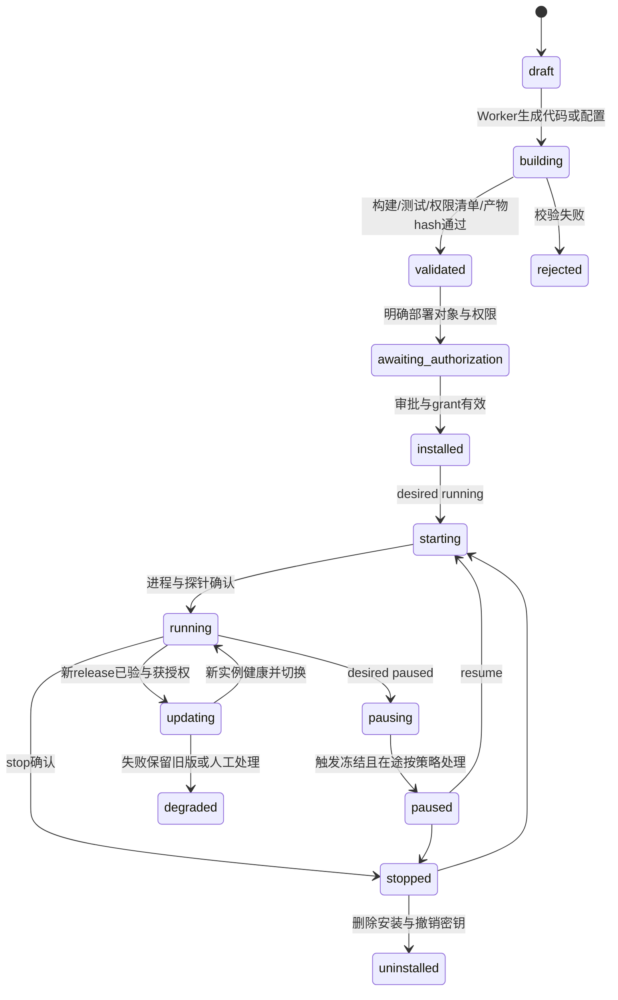

# Cylo 总体实现架构与落地契约

研究日期：2026-10-21。本文是实现决策稿，不代表已有运行代码。以完整阅读的[《Cylo-完整产品需求说明书.md》](../../Cylo-完整产品需求说明书.md)为最高产品依据，产品统一更名 Cylo；旧《codex-super-agent-requirements-and-architecture.md》仅保留兼容原则，旧方案中“所有请求经 Super”“Codex 是所有 Agent”不成立。本文同时补充原拟独立可靠性研究的关键设计；编排与语音具体源码证据见同目录专项报告。

## 1. 决策摘要

| 问题 | 主决策 | 替代路线与触发条件 |
|---|---|---|
| 应用结构 | TypeScript 模块化单体控制服务 + 独立执行 runner；React 响应式 PWA；明确版本化 JSON Schema 契约 | 核心控制服务无吞吐证据前不拆微服务；若 CAO 有复用价值，只加 Python 侧车适配器 |
| 权威数据 | 单机 SQLite WAL、本地磁盘、控制服务唯一业务写入口；事务 outbox 与 durable jobs 同库 | 多节点控制平面/团队写并发需求出现后迁 PostgreSQL；不将 SQLite 放 NFS [S3] |
| 后台运行 | macOS launchd / Linux systemd 管理守护服务，执行主机 runner 持有进程与工作目录 | 不要求 Docker 才能使用本机开发环境；多租户执行用 Linux 容器/VM 隔离 |
| Agent 集成 | `AgentRuntime` 适配器；Codex app-server stdio 为首选深度集成实验路径，固定版本 | app-server 命令仍官方标为实验、不受生产支持 [S1]，未过门槛时 CLI 批处理只交付其实际能力，不冒充原生接续 |
| CAO | 不作为 Cylo 权威控制平面；仅保留可选隔离 CLI fleet adapter | 专项核查发现 TUI 状态解析、默认权限与清理风险，不直接采用其默认配置 |
| 客户端 | PWA 先完成 Mac/iPhone/iPad 同一业务接续，前台语音 | 若锁屏持续语音、系统通知行为、音频路由实测不达产品目标，增加 SwiftUI 原生 iOS/iPadOS 客户端，复用服务契约 |
| 语音 | STT → 已确认 transcript → 业务 command → TTS；VoiceProvider 不拥有任务状态 | 官方实时音频可作可替换提供者；候选 chatgpt-web-voice 不整合其非公开账号池协议 |
| 记忆 | 原始证据、已确认决策、执行事实、推断分离；Memory Agent 仅产提案/索引 | FTS 起步，嵌入检索后加；向量库不是权威事实库 |
| 长期能力 | 不可变 release + deployment + 独立 service instance；确定性程序自行运行 | Agent 创建代码与服务部署分离授权，容器不是跨系统唯一发布格式 |

“完整产品”保留所有需求；MVP 是验证顺序，不删除长期能力、记忆或官方工具互通目标。跨端业务接续、保存会话恢复、活跃会话接管分别验收。

## 2. 部署拓扑和边界



**最小部署**：一台常开 Mac 或 Linux；一个控制服务进程（API、调度循环、outbox、记忆作业模块）、一个 runner 进程、本地 SQLite、本地产物目录、Codex 外部进程、按需语音服务。可共包安装，但 runner 不与 HTTP 请求同生命周期。PWA 静态资源由控制服务供应。网络默认局域网或受认证私网；远程使用 TLS。独立服务由 OS supervisor 管理，控制进程崩溃不杀死已部署服务；runner/服务重连后回报。用户工作站睡眠不等于服务器可用，UI 显示执行主机离线与最后观测时间，不称“持续执行”。

**扩展部署**：Linux 常开控制平面 + PostgreSQL + 对象存储 + 多个 Mac/Linux runner；调度器按资源租约选 host；通知/索引可拆进程；团队身份可接 OIDC。每个执行 host 只能看到获授权的项目和 secret 引用。Mac 本地官方 Codex 接续仍要求项目与原生会话在该 Mac 或官方支持的远端环境；把控制服务搬云上不会自动迁移官方 App 会话。无需求前不引入 Kubernetes、Redis、消息中间件或专门向量服务。

模块职责：

- `interaction`：会话、消息、语音 turn 关联和可靠 ACK，不调度真实进程。
- `control`：项目/任务/依赖/计划、命令校验、审批、策略、状态转换、预算、租约、事件事务；唯一业务权威。
- `dispatcher`：读取 durable jobs、调用 runtime/runner、持久观测，普通规则先于模型；Super 只提交计划提案。
- `runner`：进程与主机资源观测、工作目录映射、执行隔离、取消、心跳、证据上传；不能自己改任务为完成。
- `agent adapters`：翻译提供者协议、保存 session/thread/turn 标识、能力协商和原始事件；不另建业务任务权威。
- `capability manager`：构建、发布、配置、授权、期望状态与健康协调。
- `memory/context`：整理提案、检索和上下文清单，不覆盖控制状态。
- `notification/audit`：事件驱动投递、去重、审计和数据保留。

包建议 `apps/web`、`apps/control`、`apps/runner`、`packages/contracts`、`packages/domain`、`packages/adapters-*`。Node.js LTS 的具体版本在实施冻结，使用 Fastify、React/Vite、SQL migration + 参数化查询；这些是维护成本决策，不是产品约束。Python 服务通过同一 JSON 协议接入，避免为了候选仓库改变全栈。

## 3. 项目、任务、对话、原生会话

`Workspace` 是数据与权限边界，单人安装也预建一个。`Project` 是长期目标、资产与知识边界。一个 project 有多条 task、多段 conversation、多处 host checkout。`Task` 是可验收目标；`TaskRun` 是一次实际尝试；`AgentSession` 是提供者保存的对话执行历史。一个 task 可跨多个 run；一个 agent session 可在同一任务后续修复复用，也可经显式关联用于后续任务。run 结束不会销毁原生会话。

`Conversation` 是用户交流入口，可跨多个项目；消息与 task/project 用独立 link 表关联，而非把任务放进聊天窗口。语音 `VoiceSession/VoiceTurn` 属于交互层，不能成为任务存在的容器。新设备恢复的是 conversation、目标 task 和业务状态；新建媒体连接，不转移活跃麦克风/WebRTC。

项目主键不能用绝对路径：`project_checkout(project_id, host_id, logical_root, native_path, repo_url, branch, revision)` 保存映射。迁移后路径不同不改变项目身份。Git worktree 隔离并行写任务，但不是安全沙箱。对“刚才那个项目”按显式选中对象→当前会话 link→最近相关任务候选检索；多个有效候选时创建消歧问题，不凭模型选一个就写入。

## 4. 数据模型和不变量

以下字段为最小逻辑模型，非已经实现 DDL。除特别标明外，实体含 `id, workspace_id, created_at, updated_at, version`，时间 UTC，ID 为不依赖时钟排序的唯一 ID；外部 ID 必须连带 provider/host/账号域。所有跨实体引用校验同 workspace；项目权限在查询前过滤。

| 实体 | 核心字段 / 约束 |
|---|---|
| identity / membership / device | principal、workspace角色、设备公钥/会话撤销时间；设备不是授权主体替代物 |
| project / project_checkout | name、status、scope；host映射、repo、revision、路径；同一 repo 的多个 worktree 不自动当新项目 |
| conversation / message / message_link | actor、client_message_id、body_ref、reply_to、project/task links、transcript_ref；`UNIQUE(workspace, device, client_message_id)` |
| command | actor、device、kind、target、payload_hash、idempotency_key、expected_version、status、accepted_at、applied_at、outcome_ref；相同幂等键不同 payload 返回冲突 |
| task / task_dependency | goal、acceptance_spec、parent_task、project、plan_version、status、wait_reason、desired_control、active_run；DAG依赖创建时拒环 |
| task_run | task、attempt、executor、host、session、provider_turn_id、status、lease_epoch、checkpoint_ref、error_class、started/ended；同 task 至多一个活动写入 run |
| agent_profile / agent_session | role、provider、capability声明、model/config版本；session provider_id、host/account、native_cwd、owned_by、last_observed_status、resume_locator |
| plan_revision / decision | 不可变方案、依据message/evidence、supersedes、有效时间；decision与目标版本绑定 |
| approval / grant | action_digest、resource_scope、release_digest、plan_version、expires_at、policy_version；授权与审批明确到执行主体 |
| job / lease / resource_lock | due_at、trigger_key、attempt、retry_policy、owner、epoch、expires_at、resource_key；job触发键唯一 |
| operation | run/service、external_effect_key、request_digest、provider_receipt、intent/dispatch/confirmed/unknown、reconcile策略 |
| event / outbox | stream_id、stream_seq、event_id、aggregate/version、schema_version、type、payload_ref、causation、correlation；事务内写入 |
| consumer_cursor / device_cursor | consumer、stream、acked_seq、stream_epoch；事件应用后再推进 |
| capability / capability_release | 用途、owner、source；不可变digest、manifest、artifact、测试证据、权限声明、依赖、迁移/回滚声明 |
| deployment / service_instance | capability/release、host、config_version、secret_refs、grant、desired_state；observed_state、health、heartbeat、supervisor_id、generation |
| service_invocation / schedule / trigger | deployment、trigger_key、job/task link、run_result、checkpoint；cron/timezone、misfire_policy、dedupe_key |
| evidence / artifact | 类型、content_hash、storage_uri、producer_run、source_event、采集时间、敏感级别、保留规则；大日志不塞event payload |
| memory_claim / memory_revision / evidence_link | scope、subject/predicate/value、authority_kind、status、valid_from/to、recorded_at、supersedes、evidence、confidence、extractor_version |
| context_manifest | run、项目/授权版本、选中claim/decision/evidence ID与hash、检索条件、token预算、裁剪与冲突说明 |
| usage / notification / audit | 提供者用量、预留和估算标识；通知逻辑键/渠道receipt/已读；actor/action/resource/result/证据关联 |

强制不变量：终态 task 不直接重启为原 run，而是新 attempt/显式后续 task；任务“完成”必须有验收记录。`agent turn completed` 只结束模型回合。已授权权限不能由模型扩大。人工决定只能由有权身份的 command 改版本。未经事实校验的 summary 不能产生事实级别提升。所有业务状态变更、事件和后续 job 在一个数据库事务写入。

SQLite `foreign_keys=ON`、WAL、`synchronous=FULL`、本地磁盘、busy timeout、短事务；启动核验实际配置，持久ACK仅在事务提交后返回。NORMAL在WAL模式下可能因断电丢失已确认事务，不满足本方案持久接收承诺；FULL仍依赖OS/硬件兑现sync，macOS是否需要F_FULLFSYNC须平台验证，进程退出实验不证明断电耐久。一条控制写队列，runner 不直接开数据库。WAL 只支持同主机共享内存协调，只有一个写者 [S3]。产物先写临时文件并 fsync/原子rename，登记 hash 后才发布引用；数据库引用存在不代表文件可用，需校验。组织扩展采用 `(workspace_id,id)` 组合外键/唯一约束，后续 PostgreSQL 增加行级策略，不能只依赖前端筛选。

## 5. 统一任务状态、执行事实和 ACK

任务状态保持产品八态：`queued/running/waiting/waiting_user/paused/completed/failed/cancelled`；`wait_reason` 解释 dependency、host_offline、effect_unknown、budget、verification。恢复协调中的“未知”保留在 run/operation，而不是伪造 failed 或 running。



run 可为 `prepared/starting/active/interrupting/stopped/succeeded/failed/lost/unknown`。用户点击暂停先更新 `desired_control=pause_requested` 并发命令；观察到停止且checkpoint可用后才标 paused。底层只支持 interrupt 时，UI 说明这是“停止当前执行、之后恢复”，不虚构进程冻结。取消与中断不回滚文件、已发邮件或第三方副作用。

消息与 command 确认四层：

1. `received`：事务提交了原始消息、command和排队 job，返回 `202 + command_id + receipt_event`。模型尚未调用也可 ACK。
2. `applied`：目标版本已更新，或 runtime 确认追加输入被接受；返回 `applied_to` 指明 plan/task/runtime_turn。不是“模型已经遵循要求”。
3. `rejected/expired/conflict`：权限、过期审批、旧版本或无法操作；保留原因，客户端不无限重发。
4. `outcome`：业务实际执行和验收结果，通过关联 task/operation 读取。不得把 provider RPC 成功当业务完成。

同消息重试返回同 receipt；API提交超时后按幂等键查询，禁止重新生成键“再试一次”。同 task 的两个修改用 `expected_version` 比较，第二个返回409和当前版本，用户重新审阅。普通状态查询、明确停止、健康检查由程序执行；新目标/歧义/跨领域阻塞才唤醒 Super。

## 6. API 和事件契约

传输版本 `/api/v1`，命令/事件 JSON Schema 独立版本，服务器验证 schema 与权限。示例接口：

```text
POST /api/v1/commands
  {idempotency_key, kind, target:{type,id}, expected_version?,
   conversation_id?, client_message_id?, payload}
  -> 202 {command_id,status:'received',receipt_event_id,stream_cursor}
GET  /api/v1/commands/{id}
GET  /api/v1/projects/{id}/tasks?updated_after=...
GET  /api/v1/tasks/{id}                 # authoritative version, observed_at
GET  /api/v1/tasks/{id}/runs/{run}/evidence
GET  /api/v1/sync/snapshot              # cursor水位与同一DB快照中的投影
GET  /api/v1/events?cursor=opaque       # SSE; cursor绑定workspace/stream epoch
POST /api/v1/device-cursors            # 应用成功后ACK
POST /api/v1/approvals/{id}/resolve    # command语义, action_digest + version
GET  /api/v1/agent-sessions?project_id=...&discover=true
POST /api/v1/agent-sessions/{id}/handoff  # prepare/release/claim；仍受能力协商
POST /api/v1/capabilities/{id}/releases
POST /api/v1/deployments               # digest/config/grant/host，返回command
GET  /api/v1/services/{id}             # desired/observed/health同时返回
POST /api/v1/memory/proposals/{id}/resolve
GET  /api/v1/export-manifests/{id}
```

所有会产生动作的 POST（包括审批、部署）统一进入 command 处理器；以上专用路径只是类型化外观，不绕过幂等和审计。上传/下载需经scope校验，不能根据模型给出的本地路径直接读文件。

```json
{
  "schema_version": 1,
  "event_id": "evt_unique",
  "stream_id": "workspace:ws_1:access_epoch_7",
  "stream_seq": 184,
  "type": "task.state_changed",
  "aggregate": {"type": "task", "id": "task_1", "version": 12},
  "occurred_at": "2026-10-21T10:00:00Z",
  "recorded_at": "2026-10-21T10:00:01Z",
  "actor": {"kind": "runner", "id": "host_1"},
  "correlation_id": "task_1",
  "causation_id": "cmd_1",
  "payload": {"from": "running", "to": "waiting", "reason": "host_offline"}
}
```

核心事件还包括 `command.received/applied/rejected`、`message.persisted`、`run.observed`、`approval.requested/invalidated/resolved`、`operation.unknown/confirmed`、`evidence.registered`、`service.observed/health_changed`、`capability.release_verified`、`memory.proposed/revised`、`notification.created`。语音 delta 与原始大日志使用临时媒体/日志通道，只有 final transcript、turn结果和证据索引进入持久业务流，避免高频音频挤占状态更新。

### 6.1 断线恢复必须闭环

每个授权流有事务内分配的单调 `stream_seq`，唯一键 `(stream_id,stream_seq)`；不能用时间戳排序或直接假定 PostgreSQL自增ID等于提交顺序。SQLite事务内更新stream counter；PostgreSQL迁移时锁定stream counter行，提交前分配序号。服务端从事件表读/尾随，outbox仅负责外部投递，不用内存广播是否成功决定事件存在。

客户端先获取快照（水位N与投影在同一读事务），再请求 `>N` 事件，逐条幂等应用后在 IndexedDB 原子存储投影与cursor。SSE `id` 与 `Last-Event-ID` 有标准重连机制 [S2]，但浏览器已收到事件不等于应用已落盘；客户端每次新连接使用自己落盘的cursor，并做显式ACK，不能只依赖EventSource内存cursor。事件重复可接受，漏事件不可接受。投影只接受连续序号与更高aggregate version，发现缺口请求补齐。

事件保留期届满或ACL变化返回 `cursor_reset_required`，重新取授权快照；权限撤销切换 access_epoch 并清理设备缓存。团队成员不同可见集合使用不同授权流或投递可见进度标记，不能把被过滤事件误认网络丢包。客户端始终显示 `last_synced_at/offline`；离线草稿明确“待发送”，断线时不展示未确认动作已生效。推送通知仅唤醒和定位，打开后查询最新对象；已过期审批不能从旧推送直接执行。

## 7. 可替换执行接口

接口是业务适配抽象，不声称所有供应商有全部能力。统一 `capabilities()` 明确 supported/unsupported/experimental 与版本；不支持就禁用操作，不能靠模拟文本宣称支持。

```ts
interface AgentRuntime {
  capabilities(): RuntimeCapabilities; // discover/read/resume/steer/interrupt/usage等
  discover(filter: SessionFilter): Promise<SessionPage>;
  inspect(session: SessionLocator): Promise<ObservedSession>;
  create(spec: AgentSpec, ctx: ContextManifest, grant: GrantRef): Promise<SessionRef>;
  resume(session: SessionLocator, claim: LeaseToken): Promise<SessionRef>;
  startTurn(session: SessionRef, input: Input, claim: LeaseToken): Promise<TurnRef>;
  steer(turn: TurnRef, input: Input, claim: LeaseToken): Promise<AcceptedInput>;
  interrupt(turn: TurnRef, claim: LeaseToken): Promise<ControlReceipt>;
  events(after?: ProviderCursor): AsyncIterable<RuntimeEvent>;
  reconcile(ref: SessionLocator): Promise<ObservedSession>; // 不隐式重跑
}
interface VoiceProvider {
  capabilities(): VoiceCapabilities; // STT/TTS/realtime/barge-in
  open(spec: VoiceSpec, shortLivedCredential: string): Promise<MediaRef>;
  events(ref: MediaRef): AsyncIterable<VoiceEvent>; // partial/final/ended/error
  synthesize(text: string, generation: number): Promise<AudioRef>;
  stopOutput(ref: MediaRef, generation: number): Promise<void>;
  close(ref: MediaRef): Promise<void>;
}
interface CapabilityRunner {
  validate(release: Digest, host: HostRef): Promise<ValidationReport>;
  install(spec: DeploymentSpec, grant: GrantRef): Promise<InstallReceipt>;
  setDesired(instance: InstanceRef, state: DesiredState, generation: number): Promise<Receipt>;
  inspect(instance: InstanceRef): Promise<ServiceObservation>;
  logs(instance: InstanceRef, after?: Cursor): AsyncIterable<LogChunk>;
  uninstall(instance: InstanceRef, retention: RetentionPolicy): Promise<Receipt>;
}
```

凭证只以 SecretRef/短时凭证进入适配器，不进上下文。原始 provider event 留证，映射后的 RuntimeEvent 必带 native IDs、原始来源、observed_at、provider版本。提供者没有可重放事件游标时，不能编造；控制服务断线后 inspect + 拉历史补账，不能证明连续性则标 gap/unknown，保留需要人工核实事项。

### 7.1 Codex 原生接续的门槛

官方当前文档提供 `thread/list/read/resume`、历史分页、`turn/start/steer/interrupt`；`thread/list` 默认 `sourceKinds` 只有 cli/vscode，发现 Cylo发起会话必须显式包含appServer/exec等 [S1]。`thread/resume` 是保存会话恢复，不证明官方 App 在 UI 可见，也不证明可抢占活跃会话。当前文档仍写 app-server命令和WebSocket传输实验且不支持生产；优先stdio不意味着已经消除实验风险。

必须固定 Codex CLI/App版本、账号/认证域、配置目录、host、cwd和原生thread ID，验证以下矩阵后才能标“原生接续”：

| 场景 | 验收证据 |
|---|---|
| Cylo → Linux CLI | Cylo保存的非临时thread可用官方resume继续，历史/工具记录/代码目标完整 |
| Linux CLI → Cylo | 官方创建thread经支持接口发现、只读核对并显式关联project，随后恢复 |
| Cylo → macOS App | 真实安装App找到对应thread/workspace并追加，回Cylo可看到新turn；当前未验证 |
| macOS App → Cylo | 能通过支持的发现/读取方式关联原生thread；当前未验证 |
| 并发与中断 | 外部活跃会话只能只读；明确交接后单写，不重复执行；外部绕过锁能检测并停止派发 |
| 升级/迁移 | 固定版本升级后原生历史可恢复；不同host路径变化不误关联 |

交接：`prepare` 停止新turn→中断/等当前turn结束→核对工作区与外部副作用→存checkpoint和handoff包→释放lease→原生工具继续；反向先观察原生工具已停止，再claim并reconcile。Cylo lease只约束Cylo的runner，不能强制官方App尊重本地锁；无法检测外部写者时要求显式用户交接并禁止自动接管。活跃会话“无缝迁移”不在已验证承诺内。门槛失败仍可提供项目路径、git状态、原生resume指令（仅实测有效者）和带证据的handoff摘要，标识为降级接续，不等价原生历史。

官方 [S1] 另明确 app-server认证从未允许商业或托管服务；单机本地/开源与团队SaaS不能共用未经核实的认证假设。托管扩展前独立验证 Sign in with ChatGPT/API key可用性、条款和账号隔离，不能复用用户ChatGPT token池。

## 8. 长期记忆：证据、事实和版本失效

对应 CY-10-01~06、CY-11-01。四层不是四个模型上下文，而是不同权限与检索范围：

1. 原始历史：消息、provider输出、工具记录、执行日志、文件/文档版本；保存来源与hash，按保留策略管理。
2. 任务工作记忆：目标、已完成checkpoint、未解决事项、依赖与恢复摘要；任务状态仍实时查task/run。
3. 项目记忆：需求、ADR、背景、历史决策和适用版本；不跨项目默认传播。
4. 全局/组织记忆：经确认偏好、持续规则、长期目标；按主体和组织范围检索，个人偏好不能覆盖组织强制策略。

`authority_kind` 取 `user_confirmed / execution_observed / imported_authoritative / model_inferred`，与 `confidence` 独立。高置信推断仍是推断。执行事实必须包含 operation/provider receipt/工具exit与证据，其陈述范围受证据限制：“测试命令退出0”不推出“产品绝无错误”。导入文档标明作者/版本/生效条件，冲突时不靠embedding相似度裁决。

Memory Agent 消费 `task.verified`、`decision.confirmed`、会话结束、大量新历史或人工整理请求；去重、提取、矛盾检测后只写 `proposed`。确定性的去重/索引不调用模型。自动整理可以生成带模型标识的摘要与候选推断，不能改任务状态、授权、配置或用户已确认决策。事实升级必须由明确权威输入/执行证据校验或用户command触发。Agent提案含 claim、证据定位、适用范围、有效期、与既有claim的关系和不确定性。

示例：`decision:d1=SQLite` 于t1生效，t2正式确认`d2=PostgreSQL`，同一事务设置`d1.valid_to=t2`、`d2.valid_from=t2`、`d2.supersedes=d1`，发布decision事件并重建相关索引。旧事实不删除；查询“当前数据库”只取当前生效，查询“上周依据”按valid time返回d1。`recorded_at` 与有效时间分离，支持后来补录历史。摘要/embedding记录依赖claim版本和source hash，源撤回、修订、删除或权限变化后标 `stale`，后台重建；在重建前检索必须在线校验权威版本，不能继续注入过期向量。无法判定优先级时保留 `conflicted` 并请求消歧，不让最新AI摘要自动覆盖正式决定。

上下文装配是控制服务模块，不让每个Agent自行无边界拉全库：

- 先确定principal、workspace、project/task和grant，再查权威任务快照、有效决策、相关操作状态。
- 加当前用户指令与明确约束；按项目/任务过滤，FTS + 引用图先检索，必要时追加语义召回。
- 对召回条目校验ACL、有效时间、来源hash、是否撤回；推断放带标签的独立区，冲突列出双方证据。
- 预算优先级：安全与授权→当前目标/验收→当前状态/恢复→有效决定→相关证据→历史背景。超过预算先裁剪原始长日志并保留可检索引用，不能静默截断关键约束。
- 记录`context_manifest`，包含实际注入的版本/hash、token估算、缺口和裁剪理由；敏感材料只给获授权worker，运行中撤权则下一工具动作重新校验并停止进一步读取。

原生Codex session已带历史时只注入增量与引用，避免重复灌入整段历史。项目切换不复用不相关session。Super可获跨任务摘要，但跨项目资料同样受权限限制。模型上下文压缩不改变权威数据库，不将压缩摘要替代原始证据。

删除采用 tombstone + 索引撤除 + 对象/缓存清理作业；审计保留必要最小元数据且说明合法保留规则。备份恢复时重放删除清单，避免已删资料“复活”。可检索原始历史缺失时明确展示证据不可用，不能依赖未被清除的向量泄露内容。

## 9. 长期能力生命周期和独立服务

对应 CY-07、CY-09。`Capability` 是可安装能力定义；`Release` 是不可变代码/配置模板；`Deployment` 是指定host与配置的安装；`ServiceInstance` 是实际运行单元；`Invocation` 是某次触发。更新能力不重写历史release，不把常驻服务显示成永不完成的task。



以上描述生命周期视图；数据库分别保存release构建状态、deployment desired与instance observed，避免用单enum隐藏“期望停止但进程仍活跃”。`health=healthy/degraded/unhealthy/unknown` 独立于运行状态。服务暂停默认停新触发，不等于进程已停；停止需supervisor确认，无确认显示pending/unknown。

最小manifest应可机器校验：

```yaml
schema_version: 1
capability: important-mail-monitor
release: sha256:immutable-artifact
runtime: python
entrypoint: ["python3", "-m", "mail_monitor"]
platforms: ["linux-arm64", "linux-x64", "darwin-arm64"]
config_schema: schemas/config.json
secrets: [mail_read_token]
permissions:
  network: ["mail.example.com:443"]
  actions: ["mail.read", "cylo.worker.invoke:mail-classifier", "cylo.notify"]
triggers: ["webhook", "schedule"]
healthcheck: {kind: heartbeat, deadline_seconds: 90}
resource_limits: {memory_mb: 256, max_agent_calls_per_day: 20}
checkpoint_schema: schemas/checkpoint-v1.json
update: {mode: stop_then_start, rollback_safe: true}
uninstall: {retain_user_data: true}
```

字段只是接口示例，不能据此承诺Python进程在Mac上已有完整内核隔离。依赖需lockfile/校验和、平台条件和可复现安装指令。部署流程必须有：需求→生成/配置→构建和静态校验→隔离测试→权限diff/行为与成本说明→对具体release digest与config授权→安装→健康验证→登记触发→运行。编写代码授权不自动授予部署、发送邮件或读取全盘权限。release权限扩大、secret用途改变和外部目标改变使旧审批失效；相同授权范围内的更新是否自动执行由用户明确更新策略决定。

邮件监听示例：确定性服务保存mailbox cursor、按provider message ID去重，普通通知按规则过滤，语义判断调用mail Worker；超出规则/跨项目协调才上报Super。每次调用Worker创建task/run并继承该服务的最小grant与预算。服务本身运行不需要Super在线。控制服务短时不可达时，服务仅可在既有授权及未过期的有界租约/短期凭证内确定性监听并缓冲有界事件；到期未续租则停止新的外部副作用，需要新审批、Worker或预算的动作等待，不能自扩权。撤权立即阻止控制面新动作，离线实例的强制时限由租约/凭证TTL与实际资源侧执行保证；长期secret一旦复制到任意程序，单改控制库不能保证即时撤权，须撤销上游凭证或停止/隔离实际进程。

更新前保存旧release/config/checkpoint并校验checkpoint兼容性，先停触发并处理in-flight，确认旧进程树停止或资源隔离后，再安装/健康检查/切换。只在无互斥外部消费风险时允许并行canary；邮件监听等按资源锁确保单活。失败可回到旧二进制，但数据库不可逆迁移、已发邮件不能“回滚”；manifest必须声明数据向前/向后兼容，不能回滚则进入degraded并给恢复方案。卸载默认确认整个进程树停止、移除触发、撤销凭证、保存dirty产物清单后非force清理安装文件，用户数据保留与删除独立确认；保留审计、release和历史结果。

## 10. Durable job、故障恢复和副作用

对应 CY-15。调度工作不依赖内存队列：`job(status,due_at,trigger_key,attempt,lease_epoch,lease_expires_at,policy)` 持久化；领取与outbox同事务。单机即使只有一个dispatcher也实现租约语义，便于重启和多host扩展。租约期满表示需要核对，不证明旧进程已死。fencing token为每资源递增epoch，runner拒绝旧epoch请求；实际资源执行端也必须拒绝旧epoch，才能阻止旧执行继续写入。已经启动且能直接访问文件/网络的shell不因runner拒绝新请求而停止；交接前须确认旧进程树终止/隔离，或由资源端强制fencing，否则进入等待核对而非重新派发。第三方不支持fencing时仍需幂等键或查账，不能声称端到端exactly-once。

控制服务重启步骤：

1. 开新恢复代次，暂停派发被认为活跃的task/service相关新run。
2. 读取job、run、operation、session、service及租约；询问runner进程身份（PID + start time + supervisor ID）、provider状态、工作区revision与外部receipt。
3. 仍活跃且归属明确则重订阅、恢复观测；已结束则采集结果与验收。provider回调与query结果都按native ID去重。
4. 确定未开始可重试；确认已成功只补记结果；结果unknown进入waiting并按操作的reconcile策略处理，不盲目重放。
5. 修复outbox与job状态，解除资源锁前核对旧执行无法继续写入；发布恢复事件和真实观测时间。

外部副作用用`operation`账本：执行前持久intent和唯一effect key→标dispatching→带provider idempotency key调用→存receipt→confirmed。恰在外部成功后崩溃是不可消除的窗口；若provider支持查单/幂等，查询或重发同一key；否则标unknown并核实。邮件“超时”不是“未发出”，不能自动再发新邮件。模型产生的工具调用也要经过该账本/策略层，不能绕开后端安全保证。

可安全重试限明确纯读、幂等写或可查询操作，指数退避+jitter+最大次数/总时限，错误分 transient/permanent/auth/conflict/unknown。无限失败进入dead-letter待处理；重试同一业务operation而不是新造effect key。外部API持续不可用打开熔断，隔离该connector，不影响无关服务。事件投递为至少一次，消费者持久inbox去重；执行副作用的消费者先建intent，不能“ACK后做动作”。

cron以明确timezone存储，触发key包含schedule ID和逻辑时间槽；主机睡眠后按 `skip / latest / bounded_catchup` 处理，默认对监控取latest而非补发每次过期提醒。DST和重复webhook独立测试。服务健康依赖进程心跳+有意义的探针，PID存在不能证明能访问邮箱；失联是unknown不是healthy。自动重启需rate limit，防止崩溃循环。

## 11. 权限、审批、执行隔离和审计

对应 CY-14。主体为user、agent profile、service、runner；grant至少限定workspace/project、资源、动作、环境、时间、预算和可转授范围。Super只能提议调用权限子集，不能通过给Worker写自然语言绕过grant。策略在提交时和每个实际工具动作前校验；长期授权不是永久豁免。撤销后禁止新动作、使审批与短时凭证失效、请求停止相关执行；明确区分禁止新动作、停止在途请求和已发生不可撤回，取消RPC响应不是外部撤销证明。保留“已撤销但外部动作可能已发生”的真实状态。

审批绑定`action_digest + plan_version + target_resource + release_digest/config_version + expires_at`，并保存规范化参数、解析后的实际目标/账号/环境和grant/policy版本；实际派发前重新校验。两个设备同时批准只生效一次。旧通知、计划改变、权限diff会让审批过期；不会把对A操作的同意移作B。读取邮件/发送邮件、写代码/部署服务、读取文件/删除文件分别授权。计划范围内可逆动作不重复询问，明确高风险边界才请求审批，兼顾自主执行与可控性。

可靠性与安全故障矩阵及证据见 [05独立复核](05-reliability-security-operations.md)。

执行分级：

- 可信单用户本机：独立工作目录/OS用户、最小环境变量、受控工具proxy；macOS native sandbox能力按实际runtime验收。worktree只是并行隔离。
- 自主生成程序/不可信内容：无secret构建容器或VM；安装后最小授权账号、网络allowlist、可写路径和资源限制。
- 多租户：单租户独立Linux VM/容器边界与凭证，runner不能共用用户家目录；不把共享Codex配置目录当团队身份系统。

若某runtime可任意shell并继承主机权限，服务层policy不能凭空约束它。必须限制启动环境/工具入口与系统边界；无法强制时明确该runner是高信任本机模式，不启用不可信多租户。候选CAO默认`--yolo`不进入主线；不安全worktree强制清理不得复用。

审计记录command actor、grant/policy版本、审批、输入/目标digest、runner lease、provider IDs、外部receipt、结果证据和错误。密钥与音频默认不进入日志；数据正文与审计元数据分离保留。导出、删除、恢复、权限变更本身也是可审计操作。上下文外来网页/邮件当不可信数据，不允许其中指令修改控制策略。

## 12. 客户端、语音、通知连续性

PWA缓存只存必要的授权投影和本地草稿，登出/撤权清理；服务端仍是权威。macOS/iPhone/iPad共享device-independent conversation/task IDs，已读进度可按用户合并，事件cursor按设备。新设备登录先快照，再增量，不靠复制另一设备的聊天缓存。

WebKit官方支持iOS/iPadOS 16.4起主屏Web App Web Push，需加入主屏且在用户交互后请求通知权限 [S5]；通知到达仍受用户设置和网络影响，不能拿推送当可靠command传输。使用通知收件箱作权威，渠道支持Web Push/APNs可替换，按逻辑事件+接收人去重，合并普通进度，仅关键完成/阻塞/异常主动提醒。

语音策略与专项报告一致：独立STT（含可换流式转写）→final transcript→可靠提交业务command→Super/Worker业务结果→可换TTS。partial transcript仅显示，不自动触发不可逆动作。流式转写若无需额外用户确认，也必须在final状态后只提交一次；改写的final用revision更新，不能重复执行。barge-in停止当前播放generation并丢弃迟到音频，不默认取消后台任务；明确说“停止任务”走独立command。跨设备争用语音输出可设conversation语音拥有者lease，业务输入仍用command版本冲突规则。

候选chatgpt-web-voice基于非公开ChatGPT realtime协议与账号池，不作为语音基础；不用其Web token绕过官方接入。具体STT/TTS模型、VAD和API弃用周期以语音专项的当前官方证据为准，不固定旧Speech API路径。实时语音模型若参与播报，必须通过“忠实朗读业务最终文本、不派业务工具”门槛；否则使用可控TTS。PWA只承诺用户显式开启时前台采音，后台锁屏与持续麦克风不作保证。原生客户端是否需要由真机音频/通知验收决定，而非由“网页能发通知”推断完整语音体验。

## 13. 备份、恢复、主机迁移和资源成本

对应 CY-16、CY-17。备份单位不是一个sqlite文件，而是一致性DB快照、内容寻址产物、项目/checkout清单、原生会话可恢复材料（限官方允许/支持）、service release/config、权限及secret引用、schema/provider版本、删除清单、校验manifest。SQLite使用官方Online Backup API或等价一致性机制 [S4]，不能运行中只拷贝主db而遗漏WAL。形成快照时冻结引用清单并pin产物防GC，复制校验完成后才发布备份manifest；DB一致快照不自动保证对象与工作区一致。secret单独加密、恢复需重新授权或导入密钥，导出不含明文令牌。

建议个人起始目标为每日备份、保留最近7日与每周4份、关键确认决定/能力发布后追加备份；这是待实测的配置目标，不宣称已达到RPO/RTO。每次发布前执行隔离恢复演练，默认关闭触发与外发，验证hash、外键、项目路径映射、历史检索、权限和一个无外部副作用的任务恢复。恢复旧快照后先核对恢复点之后可能已发生的外部effect，不将旧库的待执行直接重发。产物和项目文件按自己的备份策略覆盖，Git远端不等价未提交修改/数据库备份。

Mac→Linux迁移：冻结派发→让活动run安全停点/明确unknown→备份→复制数据与release→在目标重新映射checkout/secret/OS supervisor→检测平台依赖→新host_generation恢复→确认旧host撤租约并停止副作用→再启用触发。原生进程不迁移，能力按manifest重建；macOS专用应用自动化可留旧runner或标unsupported，不能伪装Linux兼容。恢复service配置不等于已经恢复执行状态。

SQLite→PostgreSQL：从首版通过仓储接口与显式迁移脚本隔离SQL方言；先停写导出逻辑表和对象manifest→导入并校验row count/外键/hash→固定snapshot游标/stream epoch重新同步→灰度只读核验→切写。默认不双写两种数据库，避免无需求承担分布式一致性。事件协议和实体ID保持稳定，内部索引/FTS可以重建，运行中租约全部失效后先reconcile，不直接重新派发。

预算分user/workspace、project、task/run、service、provider；派发前预留estimated最大成本/并发slot，事件回报后结算，标清estimated/actual/unknown。提供者用量延迟时不能保证精确硬美元上限；可强制的是调用数、并发、超时和追加派发停止，已启动调用的费用仍可能产生。超过预算进入waiting/budget，不继续派发Super来解释无限循环。普通状态查询、计时、健康检查、通知模板和事件合并不使用LLM；Memory作业按增量门槛触发。指标至少含LLM输入/缓存/输出、管理调用占比、重试、context token、每任务预算误差、queue lag、provider event gap、恢复耗时、通知重复率与服务健康。日志/对象保留也有容量与清理水位，不能无限积累。

## 14. 分阶段实施依赖与门槛

| 阶段 | 交付与前置依赖 | 必须通过的验收 |
|---|---|---|
| 0 证据与协议冻结 | 完整需求ID映射；固定Codex/候选版本；JSON Schema；原生互通与语音真机POC | 每条原生接续路径分开给实测结果；空thread不能视作已落盘；无模型调用也能确认持久消息 |
| 1 控制与单机可靠闭环 | SQLite schema、command/outbox/jobs、认证、任务/run状态、runner、基础PWA | 重复发送仅一command；提交后断线/重启不丢；快照与cursor无缺口；暂停/取消显示真实确认 |
| 2 专业执行与官方互通 | AgentRuntime + Codex固定版本；一个Super按需和Worker直接调用；独立worktree；证据验收 | 关闭客户端继续；run结束不误标task完成；CLI双向恢复；Mac App按实测标能力；外部活跃写者不并发接管 |
| 3 语音与跨设备 | STT/TTS适配、final transcript幂等、通知收件箱、设备游标；依赖阶段1业务契约 | iPhone/iPad/Mac同任务；打断不重复动作；锁屏后后端仍跑；重开恢复事件；记录后台采音限制 |
| 4 能力创建与独立运行 | manifest/release/deployment、授权、secret、supervisor、健康、checkpoint；依赖阶段1/2 | 邮件监控在Super停用时仍运行；规则直接Worker；超时发送不重发；升级失败可核对/回滚；卸载撤权 |
| 5 记忆与上下文 | evidence/decision版本、Memory提案、FTS/检索、context manifest；依赖权威事件稳定 | SQLite→PostgreSQL决定不混淆；推断不升格事实；撤权/删除/旧索引不泄露；任务恢复不靠摘要猜状态 |
| 6 扩展与迁移 | 多runner、PostgreSQL/对象存储、组织身份/隔离、原生客户端按实测决定 | Mac→Linux重建、离线host恢复、旧epoch拒绝；跨租户拒绝；备份隔离恢复；认证准入满足部署模式 |

阶段4和5可在事件/证据契约稳定后并行开发；不需等待团队扩展才实现workspace字段。阶段1起即实现关键授权、备份与operation账本，不能把安全可靠性推迟到最后。每阶段只做证明其契约的测试，不靠“Agent说成功”验收。

最低故障注入集合：command commit后网络断开；job领取后control崩溃；外部写成功但receipt持久化前崩溃；runner租约过期但旧进程活跃；两个设备同时批旧审批；stream断线重复/游标过期；主机休眠错过schedule；能力新release健康失败且旧schema不可回退；记忆source改版/删除；备份恢复时旧host仍联网。每项保留可观测DB状态、真实副作用计数与恢复结果。

## 15. 尚未验证与阻断条件

- Codex app-server尽管有丰富接口仍实验；官方App第三方会话发现/写入/反向同步未在本报告实机证实。编排专项实测0.163.0仅`thread/start(ephemeral=false)`且无turn的会话在重启后`resume`报`no rollout found`，所以“返回thread ID”不是可恢复持久化提交点；需要真实有历史的会话验证落盘/重启。不得制造空turn来绕过验收。
- 官方CLI出现`--remote`、Unix socket与WebSocket路径，不推导App接管或跨host持久化保证；stdio仍为最小集成选择，稳定字段与整体成熟度分别判断。
- 当前官方认证文档文字需按具体鉴权表面与部署类型验证；不推出Codex全面禁止商业、也不默认ChatGPT个人登录可用于托管团队。
- PWA音频在当前目标iPhone/iPad机型、网络和系统版本上的延迟、打断、前后台切换与通知未实测；若目标必须锁屏持续对话，原生客户端立项需先验证系统能力。
- macOS自主程序的严格网络/文件隔离与资源限制不能照搬Linux容器语义；未提供有效隔离前只允许高信任单用户模式。
- 无provider幂等/可查询凭证的外部写操作无法一般性做到exactly-once；unknown必须可见并人工核对或采用业务补偿。
- 当前没有实现RPO/RTO、性能/成本承诺或支持所有团队规模；本报告提供可测试设计和迁移出口。

## 16. 一手资料与取证说明

本报告外部页面于 **2026-10-21** 实际取回。动态文档可能更新，实施冻结需保存快照hash与版本。技术选型建议/阈值属于本文决策，未用链接伪装成外部已验证性能。

- **[S1] OpenAI Codex App Server**：[官方正文](https://developers.openai.com/codex/app-server)、[实际读取Markdown](https://developers.openai.com/codex/app-server.md)。支持stdio/Unix socket/实验WebSocket、thread读取/恢复/来源过滤、回合控制、审批、auth endpoints；正文明确命令/WS实验与商业/托管app-server authentication边界。原生UI互通不由此页保证。
- **[S2] WHATWG HTML Server-sent events**：[规范](https://html.spec.whatwg.org/multipage/server-sent-events.html)。`Last-Event-ID`与重连行为，不提供应用数据库提交ACK或业务exactly-once。
- **[S3] SQLite Write-Ahead Logging**：[官方文档](https://www.sqlite.org/wal.html)。本机共享内存、网络文件系统限制和单写者，支持单机选择并限定迁移条件。
- **[S4] SQLite Online Backup API**：[官方文档](https://www.sqlite.org/backup.html)。运行中一致性备份机制；对象、secret和原生会话仍需独立备份策略。
- **[S5] WebKit Web Push for Web Apps on iOS and iPadOS**（2023-02-16）：[官方文章](https://webkit.org/blog/13878/web-push-for-web-apps-on-ios-and-ipados/)。16.4主屏Web App和用户交互授权，不证明后台持续采音。
- **[S6] Apple Creating Launch Daemons and Agents**：[官方归档](https://developer.apple.com/library/archive/documentation/MacOSX/Conceptual/BPSystemStartup/Chapters/CreatingLaunchdJobs.html)。launchd作业/KeepAlive；归档文档只支持设计方向，具体OS版本安装需实测。
- **[S7] systemd.service**：[官方手册](https://www.freedesktop.org/software/systemd/man/latest/systemd.service.html)。service类型、Restart等基础supervisor语义；durable业务任务仍由Cylo负责。
- 候选源码及版本证据：CAO `4e990a9`（v2.5.4）由编排专岗核查；chatgpt-web-voice `6338ac478070aaa34bfe7a3c0469caf9e9174c02`由语音专岗核查，详见对应专项报告。候选不构成Cylo已采用的运行依赖。

[S1]当前原文（`Auth endpoints`，范围限定为该页的app-server authentication）：

> If you’ve built a local or open-source application using Codex app-server authentication, you can continue using it, though we recommend migrating to Sign in with ChatGPT so users have greater control over and visibility into their usage. [...] App-server authentication has never been permitted for commercial or hosted services. We launched Sign in with ChatGPT to support these use cases [...].

本报告读取内容的SHA-256（S1为Markdown，其他为原始HTML；仅供取证比对，不将临时下载当产品资产）：

```text
S1 f879715bb0d440db60b71e7a5bfe1258d045520feabe3fc6b11847100c8d064b
S2 152975a1750efd6db3c0b572c5425a286ded7405e56e18bdf5602561b052e8c7
S3 f3467b530b883d4a00574fe1a898b3d121ed72764ae28cf66941080ac0badb9e
S4 306b6cca5c7c2f93b648040ae139f14d7d3221c0d16d79b5749e69d808382e04
S5 e6e32edfd3077b9a92cb3bf9eacf27c8c1f741987afa549c0420b1358d80f04d
S6 b1d06c31060d20542b8e36844a8008708a580986281d88ce0e946cfd07a8e6ee
S7 8b9e04d13a18329c395d9088ee32898fa3c27cc296d7bd84baa549f7344f5aea
```
